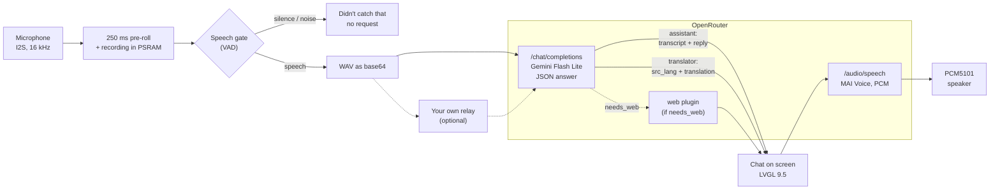

<p align="center">
  
</p>

<h1 align="center">Round Assistant</h1>

<p align="center">
  <b>A voice AI assistant and translator on a round ESP32-S3 screen</b><br>
  Press, speak, hear the answer. Plain ESP-IDF, no server of your own.
</p>

<p align="center">
  <a href="https://docs.espressif.com/projects/esp-idf/en/v6.1/"></a>
  <a href="docs/hardware.md"></a>
  <a href="https://lvgl.io"></a>
  <a href="https://github.com/Krupovroman/ESP-32-smart-agent/tags"></a>
  <a href="LICENSE"></a>
</p>

<p align="center">
  <a href="README.md">Русская версия</a> · <b>English</b>
</p>

<p align="center">
  <a href="#features">Features</a> ·
  <a href="#hardware">Hardware</a> ·
  <a href="#quick-start">Quick start</a> ·
  <a href="#cost">Cost</a> ·
  <a href="#development">Development</a> ·
  <a href="#limitations-and-plans">Limitations</a>
</p>

---

## What it is

**Round Assistant** is firmware for the **Waveshare ESP32-S3-Touch-LCD-1.85** board with its round 360×360 screen.
The device listens to your question, sends the recording to a language model through [OpenRouter](https://openrouter.ai),
shows the answer in a chat and speaks it aloud. The second mode is a **two-way translator**: put the device between
you and the person you talk to, and it works out by itself who is speaking which language.

- No backend of your own: the board talks to OpenRouter over HTTPS directly; all it needs is an API key.
- The UI is designed for a circle: an animated "orb" with a face, a chat, a round keyboard and a lock screen.
- A normal question takes about **1.5 s** to an answer on screen and **3–4 s** from the end of the phrase to the voice
  (measured on the board).

> The UI speaks Russian or English (chosen on first boot). The screenshots below show the Russian UI.

## Screenshots

<p align="center">
  
  
  
  <br>
  <sub>Home · Listening… · Answer in the chat</sub>
</p>

<p align="center">
  
  
  
  <br>
  <sub>Translator · Mode sheet · Settings</sub>
</p>

<p align="center">
  
  
  
  <br>
  <sub>Round keyboard · Lock screen · Idle clock</sub>
</p>

## Features

**Assistant**
- Hold to talk (push-to-talk), or go hands-free: tap, speak, then tap again or pause to send.
- Recording starts at the press, with 250 ms of pre-roll, so the first syllable is never lost.
- On-device speech gate: fan noise and empty recordings never go to the AI ("Didn't catch that").
- The model takes the audio directly (Gemini Flash Lite, strict JSON output), so no separate speech recognition is needed.
- The answer comes as chat text and as speech (MAI Voice). Text-only mode is one button away; the device also works with no speaker at all.
- Interrupt at any time: a press stops the speech, a hold starts a new question right away.
- Answer length setting: short, normal (default) or detailed.
- Short conversation memory (the last few turns) and the conversation history on its own screen.
- Questions can also be typed on the round keyboard.

**Translator**
- 13 languages: Russian, English, German, French, Spanish, Italian, Portuguese, Polish, Turkish, Ukrainian,
  **Chinese, Japanese, Korean**.
- The language of each utterance is detected automatically; the translation is spoken with a voice of the target language.
- Hold a language chip to set who is speaking.
- A large reader view of the translation for the other person that can be flipped 180°.
- CJK text is drawn with a Noto Sans CJK subset (21,803 glyphs) stored in its own flash partition and read through mmap.

**Web search**
- "Auto" mode: the model decides whether a search is needed (weather, news, exchange rates) and then the question is
  re-run with OpenRouter's web plugin ("Searching the web…"). Normal questions go without search and cost tens of
  times less.
- Switch: Settings → Provider → "Web search" (Auto / Always / Off).

**On-device settings**
- Wi-Fi (up to 5 saved networks, auto-reconnect), provider (URL and key separately for chat, TTS and STT — any
  OpenAI-compatible service will do), AI model, TTS voice and model, languages, volume, brightness, screen, "About",
  and diagnostics with microphone and speaker tests.
- First-time setup from a phone: the board starts an access point and shows a QR code; Wi-Fi and the key are entered
  on a web page.
- UI in Russian or English.

**Lock screen and battery**
- PWR locks and unlocks the device with an iris and padlock animation; the lock screen shows the clock, the date and a
  battery ring.
- Charging animation: a comet running along the ring, a breathing ring, a glowing bolt, rising particles.
- Honest power states: "charging", "charged", "USB: not enough power". The board has no charge signal, so the state is
  inferred from how the voltage behaves (model v4, with a ~12 h log: `bat log`).
- Warnings at 15 % and 5 %; when idle: dim, then a clock, then screen off.

**Reliability**
- Two firmware slots (A/B OTA) and **automatic rollback**: a new version must pass a self-test at boot, or the board
  returns to the previous one by itself. Safe mode after three crashes in a row.
- Updates through the USB console or from an HTTPS URL.

**For developers**
- USB dev console (`tools/dev.py`): screenshots to PNG, taps and swipes, WAV injection instead of the microphone,
  settings, events, logs, OTA.
- An on-device smoke test that needs no human (`tools/smoke.py`, 15 checks) and host tests of the modules on a PC.

## Hardware

| Part | Details |
|---|---|
| Board | Waveshare **ESP32-S3-Touch-LCD-1.85**, revision 2.1 (not the 1.85**B** or 1.85**C** — their wiring differs) |
| Chip | ESP32-S3R8: 2 × Xtensa LX7, 240 MHz, 2.4 GHz Wi-Fi |
| PSRAM | 8 MB (octal) |
| Flash | 16 MB |
| Display | 1.85" round IPS 360×360, ST77916 (QSPI) |
| Touch | CST816S (I2C) |
| Microphone | ICS-43434 digital I2S MEMS |
| Audio | PCM5101A DAC (I2S) + APA2068 amplifier |
| Power | USB or a Li-ion cell, ETA6098 charger, power latch on GPIO7 |
| Buttons | BOOT (GPIO0) and PWR (GPIO6) |

**What to connect**
- **Speaker**, 8 Ω 2 W, to the board's speaker connector. Without one, everything works in text-only mode.
- **Battery**, a 3.7 V Li-ion cell, to the 2-pin MX1.25 battery connector. Without one, the board runs from USB.

Pin map, the two panel batches and other gotchas: [docs/hardware.md](docs/hardware.md).

## How it works



1. While the screen is on, the microphone fills a ring buffer; a press starts the recording with that pre-roll.
2. The on-device speech detector drops silence and noise: such recordings are never sent and cost nothing.
3. The recording goes as one `chat/completions` request with the audio inside. The model answers with strict JSON:
   for the assistant, the transcript and the reply (plus a `needs_web` flag); for the translator, the utterance's
   language, the transcript and the translation.
4. If the model asked for a search, the same question is re-run as text with OpenRouter's web plugin.
5. The text appears in the chat; speech (`/audio/speech`, PCM) plays while it downloads, a long reply split into sentences.
6. If the selected model takes no audio, there is a fallback path: Whisper transcription and a plain text request.

Where openrouter.ai is not reachable directly, the provider URL can point to a small HTTPS relay of your own — see
[docs/proxy.md](docs/proxy.md). Protocol details: [docs/protocol.md](docs/protocol.md).

## Buttons and gestures

| Button | Short press | Hold | Double press |
|---|---|---|---|
| **BOOT** | hands-free: press, speak, press again (or pause) to send | speak while you hold it (≥ 0.4 s); release to send | Assistant ⇄ Translator |
| **PWR** | lock / unlock | **3 s**: power off on battery; on USB it turns the screen off | — |

- **Touching the orb** works like BOOT: hold to talk, a short tap for hands-free. Slide off the orb and release to cancel.
- **Tapping a message** opens the history; tapping a translation opens the large reader view.
- **Swipe right** or tap the title at the top to go back.
- While the device speaks, any press stops the speech and a hold starts a new question.
- When locked, touch and BOOT are ignored; PWR unlocks.

## Quick start

### 1. Install ESP-IDF v6.1

Use Espressif's installer ([EIM](https://docs.espressif.com/projects/idf-im-ui/en/latest/)) or the
[ESP-IDF guide](https://docs.espressif.com/projects/esp-idf/en/v6.1/esp32s3/get-started/index.html). The install path
must be ASCII with no spaces. On Windows you can reproduce the author's setup with `eim install --config eim_config.toml`
(ESP-IDF in `C:\esp\v6.1\esp-idf`, tools in `C:\Espressif`).

### 2. Build and flash

```bash
git clone https://github.com/Krupovroman/ESP-32-smart-agent.git
cd ESP-32-smart-agent

idf.py build                      # firmware and the font pack build/storage.bin
idf.py -p <PORT> flash            # bootloader, partition table, app
idf.py -p <PORT> storage-flash    # once: the font for Chinese, Japanese and Korean (~5 MB)
```

`<PORT>` is e.g. `COM7` on Windows or `/dev/ttyACM0` on Linux. On Windows there are wrappers, `.\tools\idf.ps1 build`,
`.\tools\flash.ps1` and `.\tools\flash.ps1 -Storage` (port via `-Port` or the `RA_PORT` variable). They load the ESP-IDF
environment themselves but expect an EIM install under `C:\Espressif` (as in `eim_config.toml`); with any other install,
run `idf.py` from your own ESP-IDF environment.

> Without `storage-flash` everything works, except that Chinese, Japanese and Korean are unavailable in the translator.
> OTA never touches that partition: flash it again only when the font changes.

If the board does not answer over USB: hold **BOOT**, press and release **RESET**, release BOOT — that is download mode.

### 3. First boot

1. **Language** of the UI: Russian or English.
2. **Wi-Fi**: "From phone (QR)" — the board starts an access point `RoundAI-XXXX` with a one-time password and shows
   a QR code. Join it with a phone and open the setup page (`http://192.168.4.1/`), where you also enter the key.
   Or "Pick a network" and type the password on the round keyboard.
3. **OpenRouter key** (skipped if the phone already sent it): create one at
   [openrouter.ai/keys](https://openrouter.ai/keys) and enter it from the phone (easier) or by hand.
4. **Speaker**: "Yes, it is" turns voice replies on, "No speaker" selects text-only mode.
5. **All set!** — a short button guide: "Hold the orb or BOOT and speak".

Keys are stored only in the board's NVS and are never printed in full: the console shows only their start and end. For developers, `tools/secrets_push.py` pushes Wi-Fi
and keys from a local `secrets.json` (the file is in `.gitignore` and never reaches the repository).

If OpenRouter is not reachable from your network, set up a relay as in [docs/proxy.md](docs/proxy.md) and enter its
URL under Settings → Provider.

## Cost

> An estimate. OpenRouter prices change; the exact cost of every request comes back in the response (`usage.cost`).

| What | How much |
|---|---|
| AI answer to a voice question, no speech (measured) | ≈ $0.0002–0.0003 |
| Speaking the answer (measured) | ≈ $0.0005–0.002 |
| Question with web search (measured) | ≈ $0.014 |
| Translator utterance, spoken (estimate) | ≈ $0.0015 |
| 30 spoken questions a day (estimate) | ≈ $4 a month, ≈ $0.5 text-only |

Speech makes up most of the cost; the answer length is a setting (short / normal / detailed). The calculation is in
[docs/protocol.md, §10](docs/protocol.md#10-estimated-cost-per-turn).

## Project layout

<details>
<summary>Directory tree</summary>

```
.
├─ main/                    the application
│   ├─ main.c, selftest.c   startup and the self-test before an OTA image is confirmed
│   ├─ app/                 conversation state machine, buttons, power, console commands
│   └─ ui/                  LVGL UI: screens scr_*.c, orb, chat, keyboard, fonts
├─ components/
│   ├─ board/               power latch, I2C, TCA9554 expander, buttons, battery model
│   ├─ display/             ST77916 panel (two batches), backlight, LVGL port, screenshots
│   ├─ touch/               CST816S and touch injection from the console
│   ├─ audio/               I2S microphone, PCM5101 output, speech detector (VAD)
│   ├─ net/                 Wi-Fi, saved networks, access point and setup page
│   ├─ dns_server/          captive DNS for the setup page
│   ├─ orhttp/              HTTPS transport to OpenRouter (keep-alive, timeouts, errors)
│   ├─ ai/                  chat, TTS, STT, prompts, model pickers
│   ├─ settings/            settings table in NVS; secrets are printed masked only
│   ├─ assets/              asset pack in the storage partition (CJK font, mmap + CRC-32)
│   ├─ ota/                 OTA, A/B slots, rollback
│   └─ devconsole/          USB developer console (protocol v2)
├─ bootloader_components/   bootloader hook that holds the power on right after ROM
├─ assets/fonts/            Inter, Font Awesome, a Noto Sans CJK subset and their licenses
├─ tools/                   dev.py, smoke.py, flash/restore/release scripts, font generators
├─ tests/                   audio fixtures for the smoke test, sdkconfig overlays for rollback tests
├─ docs/                    documentation (below)
├─ third_party/xiaozhi_ref/ board reference files from xiaozhi-esp32 (MIT)
└─ partitions.csv           nvs · otadata · ota_0/ota_1 4 MB each · storage 7.75 MB · coredump
```

</details>

**Documentation**

| File | Topic |
|---|---|
| [docs/STATUS.md](docs/STATUS.md) | current state and what was checked on the board (Russian) |
| [docs/requirements.md](docs/requirements.md) | requirements and decisions |
| [docs/architecture.md](docs/architecture.md) | components, FreeRTOS tasks, memory, console, boot |
| [docs/protocol.md](docs/protocol.md) | OpenRouter requests, prompts, cost |
| [docs/ui.md](docs/ui.md) | UI specification, animations, keyboard |
| [docs/hardware.md](docs/hardware.md) | the board, pins, gotchas |
| [docs/rollback.md](docs/rollback.md) | rollback and recovery (Russian) |
| [docs/proxy.md](docs/proxy.md) | OpenRouter relay |

## Development

**Dev console**: drive the board from a PC without looking at it:

```bash
python tools/dev.py info                     # version, slot, self-test result
python tools/dev.py shot shots/home.png      # screenshot to PNG
python tools/dev.py tap 180 260              # a tap
python tools/dev.py mic load speech.wav      # a WAV instead of the microphone
python tools/dev.py events 30 --until state=idle
python tools/dev.py log 10                   # the board's log
```

Needs Python 3 and `pyserial` (both in the ESP-IDF environment; on Windows: `.\tools\py.ps1 tools\dev.py …`).
The default port is `COM7`; set another with `--port` or `RA_PORT`.

**Tests**

- `python tools/smoke.py` — end-to-end test on the board: self-test, memory, UI, Wi-Fi, key, a real assistant question
  and a translation from pre-recorded phrases (`tests/audio`). `--no-ai` skips the paid requests.
- `python tools/test_dev.py` — `dev.py` against a firmware emulator, no board needed.
- Host tests of the modules on a PC (Windows, MSVC Build Tools): `components/{ai,audio,board,devconsole}/host_test`,
  `main/app/host_test`, `main/ui/host_test`. Each folder's `build.ps1` compiles `out\*.exe`: run it and expect
  `N checks, 0 failures` (`main/ui` runs its tests itself). `ai` and `main/ui` need one `idf.py build` first
  (`managed_components`, `build\storage.bin`).

**OTA and rollback**

```bash
python tools/dev.py ota push build/round_assistant.bin   # write the other slot and reboot into it
python tools/dev.py ota info                             # slots, last good version, rollback reason
python tools/dev.py ota rollback                         # go back to the previous slot
```

A new image boots in verify mode: if the self-test (NVS, display, LVGL, I2S, Wi-Fi, memory thresholds) fails, or the
image crashes before it is confirmed, the bootloader returns to the previous one. Every recovery scenario is in
[docs/rollback.md](docs/rollback.md). The factory dump is not in the repository: to be able to restore the factory
firmware later, save a full flash dump of your own board before the first flash
(`python -m esptool --port <PORT> read-flash 0 0x1000000 backups/factory_full_16MB.bin`) and write it back with the
`write-flash` command from [backups/README.md](backups/README.md); `restore.ps1 -Factory` checks the hash of the author's dump.

## Limitations and plans

An honest list of what is missing or works with caveats:

- **Button only.** There is no wake word; a conversation starts with a button or a touch.
- **Needs internet and an OpenRouter key.** There is no offline mode. From some IPs (Russian ones, for example)
  openrouter.ai answers 403, and then you need a relay of your own.
- **Answers arrive whole.** Streaming (SSE) is specified in the protocol but not enabled in the firmware yet.
- **Battery without a charge sensor.** The board has no VBUS or charge signal, so the state is inferred from the
  voltage; in edge cases (a nearly full cell, unplugging a charger that has already finished) the indicator reacts late.
- **Time zone** defaults to Moscow (UTC+3) and cannot be changed in the UI.
- **Chat history** lives in RAM only and is gone after a reboot (on purpose).
- **The RTC, IMU and microSD slot** on the board are not used yet.
- **Developer tooling is Windows-centric** (PowerShell scripts, MSVC host tests). Building with `idf.py` should work
  wherever ESP-IDF does, but the author has not tried it on Linux or macOS.
- The project is a release candidate (`v0.8-rc1`) and has been tested on one revision 2.1 board.

Next (ideas, not promises): streamed answers for lower latency, a time zone setting, using the RTC.

## License and thanks

Code: [Apache License 2.0](LICENSE).

Fonts and third-party files keep their own licenses:

- [Inter](https://rsms.me/inter/) — SIL OFL 1.1 ([assets/fonts/Inter-OFL.txt](assets/fonts/Inter-OFL.txt))
- [Noto Sans CJK](https://github.com/notofonts/noto-cjk) (subset) — SIL OFL 1.1 ([assets/fonts/NotoSansCJK-OFL.txt](assets/fonts/NotoSansCJK-OFL.txt))
- [Font Awesome Free](https://fontawesome.com) — font SIL OFL 1.1, icons CC BY 4.0 ([assets/fonts/FontAwesome-LICENSE.txt](assets/fonts/FontAwesome-LICENSE.txt))
- [xiaozhi-esp32](https://github.com/78/xiaozhi-esp32) — board reference files, MIT ([third_party/xiaozhi_ref/LICENSE](third_party/xiaozhi_ref/LICENSE))

Thanks to [Espressif](https://www.espressif.com) for ESP-IDF and its components, [LVGL](https://lvgl.io) for the
graphics library, [OpenRouter](https://openrouter.ai) for one API to many models, [Waveshare](https://www.waveshare.com)
for the board and its documentation, the authors of Inter, Noto CJK and Font Awesome, and the xiaozhi-esp32 project
for its board bring-up example.

Contributing: [CONTRIBUTING.md](CONTRIBUTING.md). Security and keys: [SECURITY.md](SECURITY.md).
Version history: [CHANGELOG.md](CHANGELOG.md).
