<p align="center">
  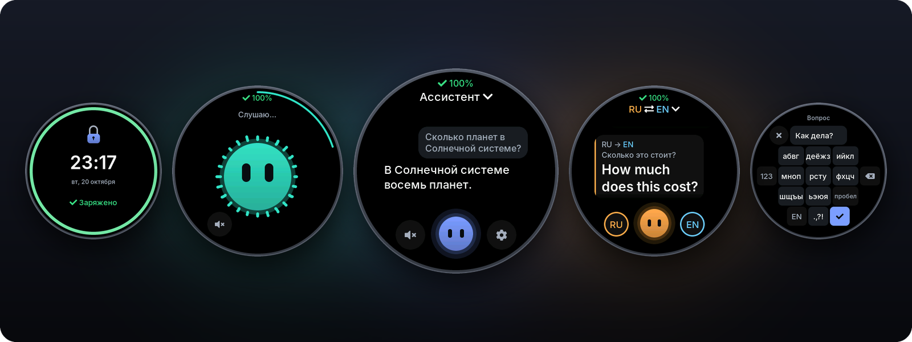
</p>

<h1 align="center">Round Assistant</h1>

<p align="center">
  <b>Голосовой ИИ-ассистент и переводчик на круглом экране ESP32-S3</b><br>
  Нажал — сказал — услышал ответ. Чистый ESP-IDF, без собственного сервера.
</p>

<p align="center">
  <a href="https://docs.espressif.com/projects/esp-idf/en/v6.1/"></a>
  <a href="docs/hardware.md"></a>
  <a href="https://lvgl.io"></a>
  <a href="https://github.com/Krupovroman/ESP-32-smart-agent/tags"></a>
  <a href="LICENSE"></a>
</p>

<p align="center">
  <b>Русский</b> · <a href="README.en.md">English version</a>
</p>

<p align="center">
  <a href="#возможности">Возможности</a> ·
  <a href="#железо">Железо</a> ·
  <a href="#быстрый-старт">Быстрый старт</a> ·
  <a href="#стоимость">Стоимость</a> ·
  <a href="#разработка">Разработка</a> ·
  <a href="#ограничения-и-планы">Ограничения</a>
</p>

---

## Что это

**Round Assistant** — прошивка для платы **Waveshare ESP32-S3-Touch-LCD-1.85** с круглым экраном 360×360.
Устройство слушает вопрос, отправляет запись языковой модели через [OpenRouter](https://openrouter.ai),
показывает ответ в чате и произносит его вслух. Второй режим — **двусторонний переводчик**: устройство лежит
между вами и собеседником и само определяет, кто на каком языке говорит.

- Никакого своего бэкенда: плата сама ходит в OpenRouter по HTTPS, нужен только API-ключ.
- Интерфейс сделан под круг: анимированный «шар» с лицом, чат, круглая клавиатура, экран блокировки.
- Обычный вопрос — около **1,5 с** до ответа на экране и **3–4 с** от конца фразы до голоса (замер на плате).

## Скриншоты

<p align="center">
  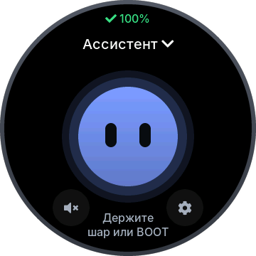
  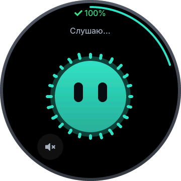
  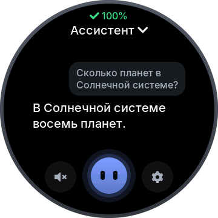
  <br>
  <sub>Главный экран · Слушаю… · Ответ в чате</sub>
</p>

<p align="center">
  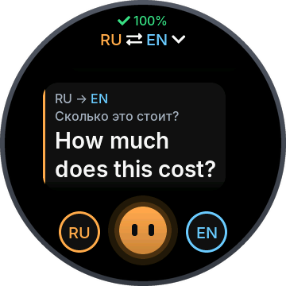
  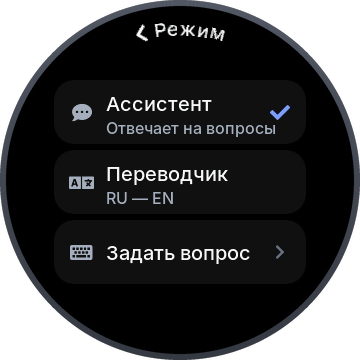
  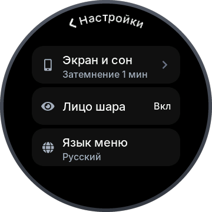
  <br>
  <sub>Переводчик · Меню режима · Настройки</sub>
</p>

<p align="center">
  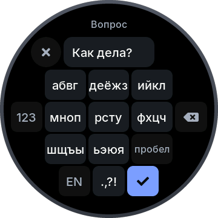
  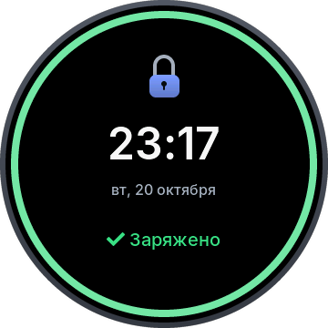
  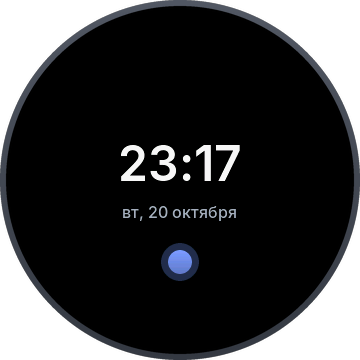
  <br>
  <sub>Круглая клавиатура · Экран блокировки · Часы в ожидании</sub>
</p>

## Возможности

**Ассистент**
- Говорите, удерживая кнопку (push-to-talk), или «без рук»: нажмите, скажите фразу, затем нажмите ещё раз
  или сделайте паузу.
- Запись начинается с момента нажатия, а 250 мс предзаписи сохраняют первый слог.
- Фильтр тишины на устройстве: шум вентилятора и пустые записи в ИИ не уходят («Не расслышал»).
- Модель получает аудио напрямую (Gemini Flash Lite, ответ строго в JSON) — отдельное распознавание речи не нужно.
- Ответ — текстом в чате и голосом (MAI Voice). Режим «только текст» включается одной кнопкой; можно работать вообще без динамика.
- Перебить ответ можно в любой момент: нажатие останавливает речь, удержание сразу начинает новый вопрос.
- Короткая память диалога (несколько последних реплик) и история разговора на отдельном экране.
- Вопрос можно набрать текстом на круглой клавиатуре.

**Переводчик**
- 13 языков: русский, английский, немецкий, французский, испанский, итальянский, португальский, польский,
  турецкий, украинский, **китайский, японский, корейский**.
- Язык фразы определяется автоматически, перевод произносится голосом нужного языка.
- Говорящего можно выбрать принудительно — удержанием «фишки» языка.
- Режим чтения крупным шрифтом для собеседника, с поворотом на 180°.
- Китайские, японские и корейские символы рисуются шрифтом Noto Sans CJK (подмножество, 21 803 глифа), который
  лежит в отдельном разделе флеша и читается через mmap.

**Поиск в интернете**
- Режим «Авто»: модель сама решает, нужен ли поиск (погода, новости, курсы), и тогда запрос повторяется с веб-плагином
  OpenRouter («Ищу в интернете…»). Обычные вопросы идут без поиска и стоят в десятки раз дешевле.
- Переключатель: Настройки → Провайдер → «Поиск в сети» (Авто / Всегда / Выкл).

**Настройки на устройстве**
- Wi-Fi (до 5 сохранённых сетей, автопереподключение), провайдер (адрес и ключ отдельно для чата, озвучки и
  распознавания — подойдёт любой OpenAI-совместимый сервис), модель ИИ, голос и модель озвучки, языки,
  громкость, яркость, экран, «О системе», диагностика с проверкой микрофона и динамика.
- Первая настройка с телефона: плата поднимает точку доступа, показывает QR-код, а на странице вводятся Wi-Fi и ключ.
- Интерфейс на русском или английском.

**Экран блокировки и батарея**
- PWR блокирует и разблокирует устройство с анимацией «диафрагмы» и замка; на экране — часы, дата и кольцо заряда.
- Анимация зарядки: «комета» по кольцу, «дышащее» кольцо, светящаяся молния, искры.
- Честные состояния питания: «заряжается», «заряжено», «USB: не хватает тока». У платы нет сигнала зарядки,
  поэтому состояние определяется по поведению напряжения (модель v3, журнал за ~12 часов: `bat log`).
- Предупреждения на 15 % и 5 %; при бездействии — затемнение, часы, затем выключение экрана.

**Надёжность**
- Два слота прошивки (A/B OTA) и **автоматический откат**: новая версия проходит самопроверку при загрузке,
  иначе плата сама возвращается к предыдущей. После трёх падений подряд — безопасный режим.
- Обновление через USB-консоль или по HTTPS-ссылке.

**Для разработчика**
- Dev-консоль по USB (`tools/dev.py`): скриншоты экрана в PNG, касания и свайпы, подстановка WAV вместо микрофона,
  настройки, события, логи, OTA.
- Smoke-тест на плате без участия человека (`tools/smoke.py`, 15 проверок) и host-тесты модулей на ПК.

## Железо

| Компонент | Описание |
|---|---|
| Плата | Waveshare **ESP32-S3-Touch-LCD-1.85**, ревизия 2.1 (не путать с 1.85**B** и 1.85**C** — у них другая разводка) |
| Чип | ESP32-S3R8: 2 ядра Xtensa LX7, 240 МГц, Wi-Fi 2,4 ГГц |
| PSRAM | 8 МБ (octal) |
| Flash | 16 МБ |
| Дисплей | 1,85" круглый IPS 360×360, ST77916 (QSPI) |
| Сенсорная панель | CST816S (I2C) |
| Микрофон | ICS-43434, цифровой I2S MEMS |
| Звук | ЦАП PCM5101A (I2S) + усилитель APA2068 |
| Питание | USB или Li-ion аккумулятор, зарядка ETA6098, защёлка питания на GPIO7 |
| Кнопки | BOOT (GPIO0) и PWR (GPIO6) |

**Что подключить**
- **Динамик** 8 Ом, 2 Вт — в разъём динамика на плате. Без динамика всё работает в режиме «только текст».
- **Аккумулятор** Li-ion 3,7 В — в разъём батареи MX1.25 (2 контакта). Без него плата работает от USB.

Распиновка, две партии панелей и прочие тонкости — в [docs/hardware.md](docs/hardware.md).

## Как это работает

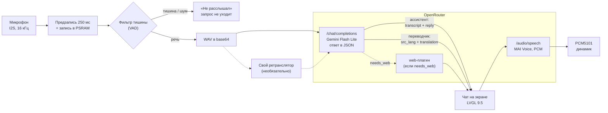

1. Пока экран включён, микрофон пишет в кольцевой буфер; по нажатию запись начинается с предзаписью.
2. Детектор речи на устройстве отсекает тишину и шум — такие записи не отправляются и не стоят денег.
3. Запись уходит одним запросом `chat/completions` с аудио внутри. Модель отвечает строгим JSON:
   ассистент — расшифровка и ответ (плюс флаг `needs_web`), переводчик — язык фразы, расшифровка и перевод.
4. Если модель попросила поиск, тот же вопрос повторяется текстом с веб-плагином OpenRouter.
5. Текст появляется в чате; озвучка (`/audio/speech`, PCM) играет по мере загрузки, длинный ответ делится на предложения.
6. Если выбранная модель не принимает аудио, есть резервный путь: распознавание через Whisper и обычный текстовый запрос.

Там, где openrouter.ai недоступен напрямую, адрес провайдера можно направить на небольшой собственный
HTTPS-ретранслятор — см. [docs/proxy.md](docs/proxy.md). Подробности протокола — в [docs/protocol.md](docs/protocol.md).

## Кнопки и жесты

| Кнопка | Короткое нажатие | Удержание | Двойное нажатие |
|---|---|---|---|
| **BOOT** | разговор «без рук»: нажмите, говорите, нажмите ещё раз (или сделайте паузу) — запрос уйдёт | говорите, пока держите (≥ 0,4 с); отпустите — запрос уйдёт | Ассистент ⇄ Переводчик |
| **PWR** | блокировка / разблокировка | **3 с** — выключение на батарее; от USB — гасит экран | — |

- **Касание шара** работает как BOOT: удержание — говорить, короткое касание — «без рук». Чтобы отменить, уведите
  палец с шара и отпустите.
- **Касание сообщения** открывает историю, касание перевода — крупный режим чтения.
- **Свайп вправо** или касание заголовка вверху — назад.
- Во время ответа любое нажатие останавливает речь, а удержание начинает новый вопрос.
- В блокировке касания и BOOT не работают; разблокировка — PWR.

## Быстрый старт

### 1. Установите ESP-IDF v6.1

Через установщик Espressif ([EIM](https://docs.espressif.com/projects/idf-im-ui/en/latest/)) или по
[инструкции ESP-IDF](https://docs.espressif.com/projects/esp-idf/en/v6.1/esp32s3/get-started/index.html).
Путь установки — латиницей и без пробелов. На Windows можно повторить конфигурацию автора:
`eim install --config eim_config.toml` (ESP-IDF в `C:\esp\v6.1\esp-idf`, инструменты в `C:\Espressif`).

### 2. Соберите и прошейте

```bash
git clone https://github.com/Krupovroman/ESP-32-smart-agent.git
cd ESP-32-smart-agent

idf.py build                      # прошивка и пакет шрифтов build/storage.bin
idf.py -p <PORT> flash            # загрузчик, таблица разделов, приложение
idf.py -p <PORT> storage-flash    # один раз: шрифт для китайского, японского и корейского (~5 МБ)
```

`<PORT>` — например, `COM7` на Windows или `/dev/ttyACM0` на Linux. На Windows есть обёртки `.\tools\idf.ps1 build`,
`.\tools\flash.ps1` и `.\tools\flash.ps1 -Storage` (порт — параметр `-Port` или переменная `RA_PORT`). Они сами
подгружают окружение ESP-IDF, но рассчитаны на установку через EIM в `C:\Espressif` (как в `eim_config.toml`);
при другой установке запускайте `idf.py` из своего окружения ESP-IDF.

> Без `storage-flash` всё работает, только китайский, японский и корейский в переводчике будут недоступны.
> OTA этот раздел не трогает: прошивать его нужно, только когда меняется шрифт.

Если плата не отвечает по USB: зажмите **BOOT**, нажмите и отпустите **RESET**, отпустите BOOT — это режим прошивки.

### 3. Первое включение

1. **Язык** интерфейса — русский или английский.
2. **Wi-Fi**: «С телефона (QR)» — плата поднимает точку доступа `RoundAI-XXXX` с одноразовым паролем и показывает
   QR-код. Подключитесь телефоном и откройте страницу настройки (`http://192.168.4.1/`) — там же вводится ключ.
   Или «Выбрать сеть» — пароль набирается на круглой клавиатуре.
3. **Ключ OpenRouter** (шаг пропускается, если ключ уже пришёл с телефона): создайте его на
   [openrouter.ai/keys](https://openrouter.ai/keys) и введите с телефона (удобнее) или вручную.
4. **Динамик**: «Есть динамик» — голосовые ответы включены, «Нет динамика» — режим «только текст».
5. **Готово!** — подсказка по кнопкам: «Держите шар или BOOT и говорите».

Ключи хранятся только в NVS платы и целиком нигде не печатаются: консоль показывает лишь начало и конец ключа. Разработчику пригодится `tools/secrets_push.py`:
он заливает Wi-Fi и ключи из локального `secrets.json` (файл в `.gitignore` и в репозиторий не попадает).

Если OpenRouter недоступен из вашей сети, поднимите ретранслятор по [docs/proxy.md](docs/proxy.md) и укажите
его адрес в Настройки → Провайдер.

## Стоимость

> Ориентировочно. Цены OpenRouter меняются; точная стоимость каждого запроса приходит в ответе (`usage.cost`).

| Что | Сколько |
|---|---|
| Ответ ИИ на голосовой вопрос, без озвучки (замер) | ≈ $0,0002–0,0003 |
| Озвучка ответа (замер) | ≈ $0,0005–0,002 |
| Вопрос с поиском в интернете (замер) | ≈ $0,014 |
| Фраза в переводчике с озвучкой (оценка) | ≈ $0,0015 |
| 30 голосовых вопросов в день (оценка) | ≈ $4 в месяц, без озвучки ≈ $0,5 |

Больше всего стоит озвучка, поэтому ответы ассистента короткие. Расчёт — в [docs/protocol.md, §10](docs/protocol.md#10-estimated-cost-per-turn).

## Структура проекта

<details>
<summary>Дерево каталогов</summary>

```
.
├─ main/                    приложение
│   ├─ main.c, selftest.c   запуск и самопроверка перед подтверждением OTA
│   ├─ app/                 автомат разговора, кнопки, питание, команды консоли
│   └─ ui/                  интерфейс LVGL: экраны scr_*.c, шар, чат, клавиатура, шрифты
├─ components/
│   ├─ board/               защёлка питания, I2C, расширитель TCA9554, кнопки, модель батареи
│   ├─ display/             панель ST77916 (две партии), подсветка, порт LVGL, скриншоты
│   ├─ touch/               CST816S и подстановка касаний из консоли
│   ├─ audio/               I2S-микрофон, вывод на PCM5101, детектор речи (VAD)
│   ├─ net/                 Wi-Fi, сохранённые сети, точка доступа и страница настройки
│   ├─ dns_server/          captive DNS для страницы настройки
│   ├─ orhttp/              HTTPS-транспорт к OpenRouter (keep-alive, таймауты, ошибки)
│   ├─ ai/                  чат, озвучка (TTS), распознавание (STT), промпты, выбор моделей
│   ├─ settings/            таблица настроек в NVS; секреты печатаются только в маске
│   ├─ assets/              пакет ресурсов в разделе storage (шрифт CJK, mmap + CRC-32)
│   ├─ ota/                 OTA, A/B-слоты, откат
│   └─ devconsole/          USB-консоль разработчика (протокол v2)
├─ bootloader_components/   хук загрузчика: держит питание сразу после ROM
├─ assets/fonts/            Inter, Font Awesome, подмножество Noto Sans CJK и их лицензии
├─ tools/                   dev.py, smoke.py, скрипты прошивки/восстановления/релиза, генераторы шрифтов
├─ tests/                   звуковые фикстуры для smoke-теста, sdkconfig-оверлеи для проверки отката
├─ docs/                    документация (см. ниже)
├─ third_party/xiaozhi_ref/ справочные файлы платы из xiaozhi-esp32 (MIT)
└─ partitions.csv           nvs · otadata · ota_0/ota_1 по 4 МБ · storage 7,75 МБ · coredump
```

</details>

**Документация**

| Файл | О чём |
|---|---|
| [docs/STATUS.md](docs/STATUS.md) | текущее состояние и что проверено на плате |
| [docs/requirements.md](docs/requirements.md) | требования и принятые решения |
| [docs/architecture.md](docs/architecture.md) | компоненты, задачи FreeRTOS, память, консоль, загрузка |
| [docs/protocol.md](docs/protocol.md) | запросы к OpenRouter, промпты, стоимость |
| [docs/ui.md](docs/ui.md) | спецификация интерфейса, анимации, клавиатура |
| [docs/hardware.md](docs/hardware.md) | плата, выводы, подводные камни |
| [docs/rollback.md](docs/rollback.md) | откат и восстановление прошивки |
| [docs/proxy.md](docs/proxy.md) | ретранслятор OpenRouter |

## Разработка

**Dev-консоль** — плату можно вести с ПК, не глядя на неё:

```bash
python tools/dev.py info                     # версия, слот, результат самопроверки
python tools/dev.py shot shots/home.png      # скриншот экрана в PNG
python tools/dev.py tap 180 260              # касание
python tools/dev.py mic load speech.wav      # WAV вместо микрофона
python tools/dev.py events 30 --until state=idle
python tools/dev.py log 10                   # логи платы
```

Нужны Python 3 и `pyserial` (есть в окружении ESP-IDF; на Windows — `.\tools\py.ps1 tools\dev.py …`).
Порт по умолчанию — `COM7`, другой задаётся через `--port` или `RA_PORT`.

**Тесты**

- `python tools/smoke.py` — сквозной тест на плате: самопроверка, память, интерфейс, Wi-Fi, ключ, настоящий вопрос
  ассистенту и перевод из заранее записанных фраз (`tests/audio`). С `--no-ai` — без платных запросов.
- `python tools/test_dev.py` — `dev.py` против эмулятора прошивки, плата не нужна.
- Host-тесты модулей на ПК (Windows, MSVC Build Tools): `components/{ai,audio,board,devconsole}/host_test`,
  `main/app/host_test`, `main/ui/host_test`. `build.ps1` в каждой папке собирает `out\*.exe`: запустите его и
  ждите `N checks, 0 failures` (`main/ui` запускает свои тесты сам). Для `ai` и `main/ui` сначала нужен один
  `idf.py build` (`managed_components`, `build\storage.bin`).

**OTA и откат**

```bash
python tools/dev.py ota push build/round_assistant.bin   # залить в другой слот и перезагрузиться
python tools/dev.py ota info                             # слоты, последняя хорошая версия, причина отката
python tools/dev.py ota rollback                         # вернуться к предыдущему слоту
```

Новая прошивка загружается в режиме проверки: если самотест (NVS, дисплей, LVGL, I2S, Wi-Fi, пороги памяти) не
проходит или прошивка падает до подтверждения, загрузчик возвращает предыдущую. Все сценарии восстановления —
в [docs/rollback.md](docs/rollback.md). Заводского дампа в репозитории нет: если захотите потом вернуть заводскую
прошивку, ещё до первой прошивки сохраните полный дамп флеша своей платы
(`python -m esptool --port <PORT> read-flash 0 0x1000000 backups/factory_full_16MB.bin`) и записывайте его обратно
командой `write-flash` из [backups/README.md](backups/README.md): `restore.ps1 -Factory` проверяет хеш дампа автора.

## Ограничения и планы

Честно о том, чего пока нет или что работает с оговорками:

- **Только по кнопке.** Голосовой активации (wake word) нет — разговор начинается кнопкой или касанием.
- **Нужны интернет и ключ OpenRouter.** Офлайн-режима нет. С некоторых IP (например, российских) openrouter.ai
  отвечает 403 — тогда нужен свой ретранслятор.
- **Ответ приходит целиком.** Потоковая выдача (SSE) описана в протоколе, но в прошивке пока не включена.
- **Батарея без датчика зарядки.** У платы нет сигнала VBUS/зарядки, поэтому состояние угадывается по напряжению;
  в пограничных случаях (почти полный аккумулятор, отключение зарядного устройства, которое уже закончило заряд)
  индикатор реагирует с задержкой.
- **Часовой пояс** по умолчанию — Москва (UTC+3), в интерфейсе не меняется.
- **История чата** хранится только в RAM и пропадает при перезагрузке (так задумано).
- **RTC, акселерометр и слот microSD** на плате пока не используются.
- **Инструменты разработчика заточены под Windows** (PowerShell-скрипты, host-тесты на MSVC). Сборка через
  `idf.py` должна работать везде, где есть ESP-IDF, но на Linux и macOS автор её не проверял.
- Проект в стадии release candidate (`v0.7-rc2`) и проверен на одной плате ревизии 2.1.

Что дальше (идеи, не обещания): потоковый ответ для меньшей задержки, настройка часового пояса, использование RTC.

## Лицензия и благодарности

Код — [Apache License 2.0](LICENSE).

Шрифты и сторонние файлы — под своими лицензиями:

- [Inter](https://rsms.me/inter/) — SIL OFL 1.1 ([assets/fonts/Inter-OFL.txt](assets/fonts/Inter-OFL.txt))
- [Noto Sans CJK](https://github.com/notofonts/noto-cjk) (подмножество) — SIL OFL 1.1 ([assets/fonts/NotoSansCJK-OFL.txt](assets/fonts/NotoSansCJK-OFL.txt))
- [Font Awesome Free](https://fontawesome.com) — шрифт SIL OFL 1.1, иконки CC BY 4.0 ([assets/fonts/FontAwesome-LICENSE.txt](assets/fonts/FontAwesome-LICENSE.txt))
- [xiaozhi-esp32](https://github.com/78/xiaozhi-esp32) — справочные файлы платы, MIT ([third_party/xiaozhi_ref/LICENSE](third_party/xiaozhi_ref/LICENSE))

Спасибо [Espressif](https://www.espressif.com) за ESP-IDF и компоненты, [LVGL](https://lvgl.io) за графическую
библиотеку, [Waveshare](https://www.waveshare.com) за
плату и документацию, авторам Inter, Noto CJK и Font Awesome, а также проекту xiaozhi-esp32 за образец
инициализации платы.

Безопасность и ключи — [SECURITY.md](SECURITY.md).
История версий — [CHANGELOG.md](CHANGELOG.md).
