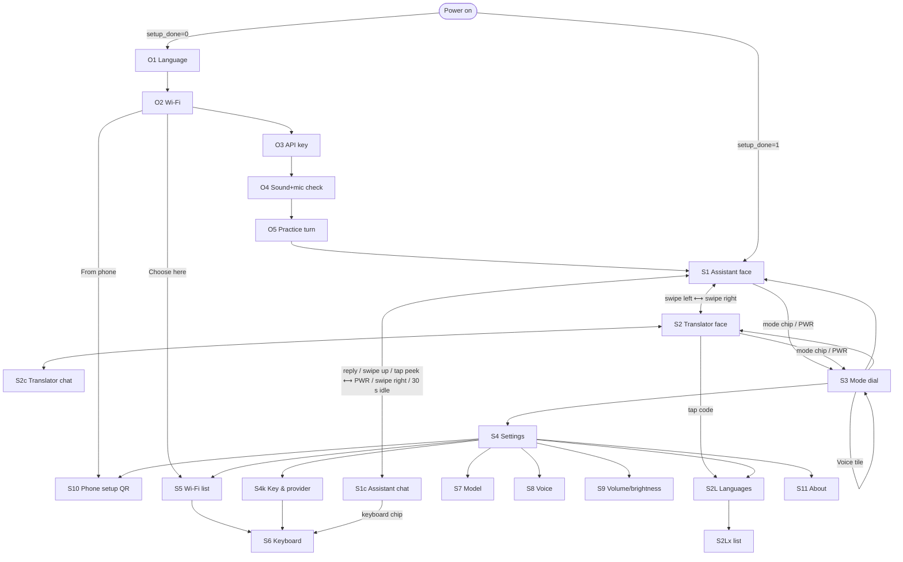

# Round AI Assistant: UI/UX Specification, "Calm Orb" concept

Target: Waveshare ESP32-S3-Touch-LCD-1.85 (ST77916 360×360 RGB565 over QSPI, CST816 single touch), LVGL 9.5.x through esp_lvgl_port 2.9, PARTIAL render mode with 2 × 360×40 internal-SRAM DMA buffers, 8 MB PSRAM.
Concept: **calm and watch-like**. The device is voice-first and has one hero orb. The physical buttons drive the core loop. There are very few screens and the user should not need to learn anything.

All coordinates are framebuffer pixels: origin top-left, centre (180,180). `c` means the vertical offset of an element's centre from y=180. `Rmax` means the farthest drawn pixel from (180,180). The hard limit is **Rmax ≤ 168** (12 px rim margin). Touch targets are **≥ 50 px**. "Estimate" marks numbers that must be measured on the device (see §8).

---

## 0. Design principles and key decisions

| # | Decision | Why |
|---|---|---|
| D1 | **Hold to talk anywhere.** Hold BOOT or hold the orb and speak; release to send. A quick tap latches hands-free listening instead. | One gesture covers 90% of use. It is the same on the button and on the screen. |
| D2 | **PWR = menu / back.** On a face it opens the Mode dial. Everywhere else it goes back one level. Holding it for 3 s powers off. | Matches a watch crown. It gives a physical exit from every state. |
| D3 | **Two faces** (Assistant, Translator). Each has two poses: *Face* (big orb) and *Chat* (mini orb + bubbles). | "Very few screens". The chat pose doubles as the chat history. |
| D4 | **Mode dial** is a 2×2 grid of 116 px circles: Assistant, Translator, Voice on/off, Settings. It opens from the bottom mode chip or PWR. | Visible and big. No rim menu, because a touch-drag along the rim has no bezel to guide it and conflicts with back gestures. |
| D5 | Gestures are **accelerators only**: vertical scroll, swipe → for back, swipe ↑ on a face for chat, swipe ←/→ on a face to switch mode. | Every action also has a visible tap target or a button. |
| D6 | **Keyboard: alphabetical half-pages** (А–П / Р–Я, A–M / N–Z). 5 tapered rows, 25 keys of 51–53 px, commit on release with an echo bubble. | 33 letters cannot be one page at 50 px. Range labels tell the user exactly where each letter is. |
| D7 | **Translator: one talk control with auto language detection.** Each card has a direction chip to force the opposite direction. | One control is zero-learning, and the model returns `src_lang` in the same JSON. Two "me/them" buttons would be ≤100 px each and force the user to decide who is speaking. |
| D8 | **Glow from an A8 image**, not shadows. Size changes come from custom-draw radii, never `transform_scale`. Nothing full-screen animates. Fades to and from black use the **backlight PWM (LEDC hardware fade)**. | Keeps every animated frame ≤ ~55 k px (§6). |
| D9 | No `clip_corner` on any screen. The circle is respected by geometry, and pixels outside it are physically absent. | Verify: `clip_corner` with radius 180 makes LVGL render the whole screen through ARGB8888 layers plus a mask. |

---

## 1. Visual language

### 1.1 Canvas and safe-area rules

- Usable chord at vertical offset d: **W(d) = 2·√(168² − d²)**

| d | 0 | 20 | 40 | 60 | 80 | 100 | 110 | 120 | 130 | 140 | 150 | 160 |
|---|---|---|---|---|---|---|---|---|---|---|---|---|
| W(d) px | 336 | 333.6 | 326.3 | 313.8 | 295.5 | 270.0 | 254.0 | 235.2 | 212.8 | 185.7 | 151.3 | 102.4 |

- **Circle** of radius r centred at distance D from the centre fits if D + r ≤ 168.
- **Pill** of height h (radius h/2) centred at offset c fits if its width is ≤ `2·√((168−h/2)² − c²) + h`.
- **Rounded rect** with corner radius rc fits if max(distance of each corner-arc centre) + rc ≤ 168.
- Put these three in `ui_geom.h`. A debug build runs `ui_geom_check(screen)` after each screen build. It walks visible objects, computes Rmax from `lv_obj_get_coords` plus the radius style, and logs offenders.
- Spacing grid is 4 px. Standard gaps are 4/8/12/16.
- Radii: pills = h/2, cards and bubbles = 16, keys = 12, QR card = 16.

### 1.2 Palette (dark; root background is pure black so the rim disappears into the bezel)

| Token | Hex | Use |
|---|---|---|
| `COL_BG` | `#000000` | root screens, key gap borders, fades |
| `COL_SURFACE_1` | `#12151C` | list pills, assistant bubble, field |
| `COL_SURFACE_2` | `#1C212B` | letter keys, pressed pills, arc track |
| `COL_SURFACE_3` | `#272D3A` | control keys, echo bubble |
| `COL_PRESSED` | `#3A4252` | pressed key |
| `COL_OUTLINE` | `#2F3644` | 1 px borders |
| `COL_TEXT_1` | `#EEF1F6` | primary text |
| `COL_TEXT_2` | `#A3ACBB` | secondary text, icons (≈9:1 on black) |
| `COL_TEXT_3` | `#6B7383` | placeholders, disabled, hints (≈4.4:1, large text only) |
| `COL_USER_BUBBLE` | `#1F2F4F` | user message bubble |
| `COL_OK` | `#4CD98A` | success ticks |
| `COL_WARN` | `#FFD25E` | low credit, brightness indicator |
| `COL_LANG_A` | `#7B8CFF` | translator language A (left) |
| `COL_LANG_B` | `#F38BB5` | translator language B (right) |
| `COL_CARD_A` / `COL_CARD_B` | `#1A2340` / `#351A2A` | translator card tints |
| `COL_ON_ACCENT` | `#0B0D12` | text on accent fills (OK key, primary pills) |

### 1.3 Accent per orb state

| State | Accent (halo, bars, arcs) | Core gradient top → bottom (VER) | Halo opa |
|---|---|---|---|
| IDLE | `#7B8CFF` | `#9AA6FF` → `#4F5BD5` | 90–160 (breathing) |
| LISTEN | `#33D6B5` | `#6FF0D6` → `#12A086` | 180 |
| UPLOAD / THINK | `#A98BFF` | `#C7B2FF` → `#7450E0` | 120 / 140 |
| SPEAK | `#FFB04A` | `#FFCD7A` → `#E58A14` | 150–200 |
| ERROR | `#FF5D6C` | `#FF8A96` → `#C83445` | 120 |

The primary-action pill and the OK key use `#7B8CFF` with `COL_ON_ACCENT` text. The volume arc uses `#FFB04A` and the brightness arc `#FFD25E`.

```c
/* ui_palette.h */
#define COL_BG        lv_color_hex(0x000000)
#define COL_SURFACE_1 lv_color_hex(0x12151C)
#define COL_SURFACE_2 lv_color_hex(0x1C212B)
#define COL_SURFACE_3 lv_color_hex(0x272D3A)
#define COL_PRESSED   lv_color_hex(0x3A4252)
#define COL_OUTLINE   lv_color_hex(0x2F3644)
#define COL_TEXT_1    lv_color_hex(0xEEF1F6)
#define COL_TEXT_2    lv_color_hex(0xA3ACBB)
#define COL_TEXT_3    lv_color_hex(0x6B7383)
typedef struct { uint32_t accent, top, bottom; uint8_t halo_opa; } orb_pal_t;
static const orb_pal_t ORB_PAL[] = {
  [ORB_IDLE]   = {0x7B8CFF, 0x9AA6FF, 0x4F5BD5, 125},
  [ORB_LISTEN] = {0x33D6B5, 0x6FF0D6, 0x12A086, 180},
  [ORB_UPLOAD] = {0xA98BFF, 0xC7B2FF, 0x7450E0, 120},
  [ORB_THINK]  = {0xA98BFF, 0xC7B2FF, 0x7450E0, 140},
  [ORB_SPEAK]  = {0xFFB04A, 0xFFCD7A, 0xE58A14, 175},
  [ORB_ERROR]  = {0xFF5D6C, 0xFF8A96, 0xC83445, 120},
};
```

### 1.4 Typography

**Font: Inter 4.1** (SIL OFL 1.1, full Cyrillic). Use the static TTFs from the release zip, not the variable font. Inter is narrower than Montserrat, which matters on chords. Rough planning widths: Cyrillic lowercase ≈ 0.56 em, uppercase ≈ 0.68 em. That is about 9 px per char at 16 px and 11.2 px per char at 20 px. Real widths come from `lv_text_get_size`, and every single-line label uses `LV_LABEL_LONG_DOT` as a safety net.

| Font object | Source | px | Roles | Line height (≈) |
|---|---|---|---|---|
| `font_16` | Inter-Medium | 16 | status, hints, captions, secondary lines, chips, dial labels | 19 |
| `font_20` | Inter-Regular | 20 | chat text, list labels, error titles | 24 (+2 line_space in bubbles) |
| `font_24` | Inter-SemiBold | 24 | screen titles, clock, keyboard key labels, newest translation | 29 |
| `font_32` | Inter-SemiBold | 32 | values (70%), language codes, key echo, dial and error icons | 39 |

All four are 4 bpp, uncompressed (`LV_USE_FONT_COMPRESSED 0` is faster), with FontAwesome merged in. They are compiled as C arrays into flash.

```sh
TEXT="-r 0x20-0x7E -r 0xA0-0x17F -r 0x218-0x21B -r 0x400-0x45F -r 0x490-0x491 \
      -r 0x2010-0x2027 -r 0x2030,0x2039,0x203A -r 0x20AC,0x20BD -r 0x2116 -r 0x2190-0x2193 -r 0x2212"
ICONS="-r 0xF00C,0xF00D,0xF011,0xF013,0xF021,0xF023,0xF028,0xF029,0xF04D,0xF053,0xF05A,0xF062,\
0xF06E,0xF070,0xF071,0xF077,0xF078,0xF084,0xF0AC,0xF0C2,0xF0E7,0xF11C,0xF127,0xF130,0xF131,0xF185,\
0xF186,0xF1AB,0xF1DA,0xF1DE,0xF1EB,0xF233,0xF240-0xF244,0xF252,0xF2ED,0xF362,0xF3CD,0xF4AD,0xF51E,\
0xF55A,0xF6A9"
FA=lvgl/scripts/built_in_font/FontAwesome5-Solid+Brands+Regular.woff
lv_font_conv --bpp 4 --size 16 --no-compress --format lvgl --lv-font-name font_16 \
  --font Inter-Medium.ttf   $TEXT --font $FA $ICONS -o font_16.c
lv_font_conv --bpp 4 --size 20 --no-compress --format lvgl --lv-font-name font_20 \
  --font Inter-Regular.ttf  $TEXT --font $FA $ICONS -o font_20.c
lv_font_conv --bpp 4 --size 24 --no-compress --format lvgl --lv-font-name font_24 \
  --font Inter-SemiBold.ttf $TEXT --font $FA $ICONS -o font_24.c
lv_font_conv --bpp 4 --size 32 --no-compress --format lvgl --lv-font-name font_32 \
  --font Inter-SemiBold.ttf $TEXT --font $FA $ICONS -o font_32.c
```

What the ranges cover:

| Range | Contents |
|---|---|
| ASCII | basic Latin |
| Latin-1 + Ext-A | « » ° ± × ÷ §, plus de/fr/es/it/pt/pl/cs/tr letters |
| 0x218–0x21B | Romanian ș ț |
| Full basic Cyrillic | Russian and Ukrainian (Є І Ї), plus 0x490–0x491 for Ґ ґ |
| General punctuation | – — ‘ ’ “ ” „ • … ‰ ‹ › (LLM output needs these, per verify) |
| Symbols | € ₽ №, arrows, minus |

Budget estimate: about 470 text glyphs plus 44 icons. 16 px ≈ 26 KB, 20 px ≈ 36 KB, 24 px ≈ 49 KB, 32 px ≈ 78 KB, so about 190–210 KB of flash in total.

- Unknown glyphs: the firmware strips markdown (`**`, `#`, backticks) and emoji from replies before `lv_label_set_text`.
- Optional v2: a CJK `.bin` font in the storage partition, loaded with `lv_binfont_create()` and chained via `font_20.fallback`.

### 1.5 Icons

Icons are FontAwesome 5 Free Solid glyphs merged into each text font, not images. They recolour with `text_color`, stay crisp at each size and cost about 150–500 B per glyph. They need no image decoder or cache. The only images are the two A8 glow masks (§7.5). Attribution goes in About: Font Awesome Free, icons CC BY 4.0, font OFL.

| Name | U+ | Where |
|---|---|---|
| comment-dots | F4AD | dial "Assistant" |
| language | F1AB | dial "Translator", settings languages |
| volume-up / volume-mute | F028 / F6A9 | voice toggle, status, volume |
| cog | F013 | dial "Settings" |
| wifi | F1EB | status, Wi-Fi rows |
| lock | F023 | secured network |
| battery 4…0 / bolt | F240–F244 / F0E7 | status |
| keyboard | F11C | chat chip "type" |
| arrow-up | F062 | Shift |
| backspace | F55A | ⌫ |
| check / times | F00C / F00D | OK, close |
| chevron-left / up / down | F053 / F077 / F078 | back, mode chip |
| exchange-alt | F362 | swap languages, direction chip |
| key | F084 | API key, bad-key error |
| coins | F51E | no-credit error |
| unlink | F127 | no internet |
| globe | F0AC | region blocked |
| hourglass-half | F252 | rate limited |
| cloud | F0C2 | server error |
| microphone / microphone-slash | F130 / F131 | dictation, mic silent |
| sun / moon | F185 / F186 | brightness, sleep |
| qrcode / mobile-alt | F029 / F3CD | phone setup |
| server | F233 | provider |
| sliders-h | F1DE | volume and brightness row |
| info-circle | F05A | about |
| history / trash | F1DA / F2ED | clear history |
| eye / eye-slash | F06E / F070 | password reveal |
| sync | F021 | rescan / retry |
| power-off | F011 | power menu |
| stop | F04D | stop speech |
| warning | F071 | generic error |

---

## 2. Screens and navigation

### 2.1 Inventory

| ID | Screen | Lifetime | Reached from |
|---|---|---|---|
| O1–O5 | Onboarding: language → Wi-Fi → key → sound check → practice turn | first boot (`setup_done`=0) | boot |
| S1 | **Assistant face** (pose A: big orb) | persistent | boot, dial, swipe → on S2 |
| S1c | **Assistant chat** (pose B: mini orb + bubbles; also the chat history) | same screen as S1 | reply arrives, swipe ↑, tap peek line |
| S2 / S2c | **Translator face / chat** | persistent | dial, swipe ← on S1 |
| S2L | Translator languages (pair screen) → S2Lx language list | on demand | tap RU/EN code on S2, settings |
| S3 | **Mode dial** | persistent | mode chip, PWR on a face |
| S4 | Settings list | on demand | dial |
| S4k | Key and provider | on demand | S4 |
| S5 | Wi-Fi scan list | on demand | S4, O2, errors |
| S6 | Text entry plus keyboard | on demand | S5, S4k, S1c chip, O2/O3 |
| S7 | AI model picker | on demand | S4, error "model unavailable" |
| S8 | TTS voice picker (+ S8m TTS model) | on demand | S4 |
| S9 | Volume and brightness | on demand | S4 |
| S10 | Phone setup (SoftAP plus `lv_qrcode`); S10q generic "open on phone" QR | on demand | O2/O3, S4, S5, errors |
| S11 | Diagnostics / About | on demand | S4 |
| E | Error states: overlays on the face (orb, title, action pill) | — | any failure |
| T / P | Toast, power-off ring (on `lv_layer_top`) | transient | — |

### 2.2 Navigation map



### 2.3 Global controls

| Context | **BOOT** (GPIO0) | **Orb touch** | **PWR** short (GPIO6) | **PWR** hold |
|---|---|---|---|---|
| Face / chat, IDLE | press = start listening (hybrid, §5.1) | same as BOOT | face: open dial · chat: back to face | 2 s: show off-ring; 3 s: power off |
| LISTEN | release (hold mode) or tap (latched) = send | release = send; slide > 80 px away = cancel | cancel | — |
| UPLOAD / THINK | press = cancel and listen again | same | cancel | — |
| SPEAK | tap = stop speech · hold = stop and listen | same | stop speech | — |
| ERROR on face | press = dismiss and listen | same | dismiss | — |
| Mode dial | close dial and listen | — | close dial | — |
| Lists / settings | jump to the current face and listen | — | back | — |
| Keyboard | hold = dictate into the field (TEXT fields only; otherwise a toast) | — | cancel; draft kept 60 s | — |
| Screen asleep | wake **and** start listening | first touch only wakes | wake | — |

Notes:
- BOOT is a strapping pin: use the internal pull-up and a 20 ms debounce.
- The PWR press that powers the board on is still held when firmware starts. Ignore PWR until its first release.
- Holding PWR for 3 s drives GPIO7 low on battery. On USB the board cannot cut power, so it turns the backlight off and stops LVGL instead.

### 2.4 Why gestures do not conflict with scrolling or hold-to-talk

1. **The orb is not scrollable and does not bubble gestures.** Clear `LV_OBJ_FLAG_SCROLLABLE`, `LV_OBJ_FLAG_SCROLL_CHAIN` and `LV_OBJ_FLAG_GESTURE_BUBBLE`. Keep `LV_OBJ_FLAG_PRESS_LOCK` (the default for children). A drag that starts on the orb never scrolls the chat and never switches mode. It only arms slide-to-cancel.
2. **The orb is never inside the scrolling chat.** In chat pose the mini orb, keyboard chip and voice chip sit below the chat container (container ends at y=262).
3. **Chat and lists scroll vertically only** (`lv_obj_set_scroll_dir(.., LV_DIR_VER)`). LVGL skips gesture detection while a scroll is in progress (`if(indev->pointer.scroll_obj) return;`). So vertical drags scroll, and only clear horizontal flicks become gestures.
4. **Gesture thresholds are raised**: `lv_indev_set_gesture_min_distance(indev, 60)` and `lv_indev_set_gesture_min_velocity(indev, 4)`. Defaults are 50 and 3.
5. **Widgets with horizontal drags clear `GESTURE_BUBBLE`**: keyboard, volume arc, QR card. Sliding across keys never triggers back.
6. **Hit testing is circular.** Orb, mini orb, dial tiles and round chips use `LV_OBJ_FLAG_ADV_HITTEST` plus an `LV_EVENT_HIT_TEST` handler (distance ≤ radius). Overlapping bounding boxes (mini orb vs chips, orb vs translator codes) therefore never steal touches.
7. **Long-press has one meaning:** hold-to-talk on the orb, and key repeat on ⌫. Nothing else uses long-press. Destructive rows use an explicit hold-to-confirm fill.

---

## 3. Geometry per screen

Status cluster, shared by S1, S1c, S2 and S2c:

| Element | Widget | x,y,w,h | Centre | Rmax | Style |
|---|---|---|---|---|---|
| Wi-Fi glyph | label | 120,38,16,16 | 128,46 | 154 | font_16, TEXT_2; connecting = opa pulse 1 s; off = ERROR colour |
| Clock "14:32" | label | 146,22,68,29 | 180,36 | 161 | font_24, TEXT_1 (RTC PCF85063 + SNTP; hidden until valid) |
| Battery | label | 222,38,20,16 | 232,46 | 155 | font_16, TEXT_2; bolt glyph when charging |
| Mute glyph (voice off / no speaker) | label | 92,54,16,16 | 100,62 | 154 | font_16, TEXT_3 |

### S1 Assistant face (pose A)

| Element | Widget | x,y,w,h | Centre | Rmax | Notes |
|---|---|---|---|---|---|
| Root | screen | 0,0,360,360 | — | — | bg `#000`, radius 0, **no clip_corner**, scroll off |
| Orb | custom-draw `lv_obj` | 80,64,200,200 | 180,164 | 114 (bar tips) | core R=60; hit radius 76 (touch disc Ø152); bars to r=98 |
| Hint / peek | label LONG_DOT | 70,268,220,19 | 180,277 | 151 | font_16 TEXT_2; state hints (§5.9); idle after 5 sessions = first line of last reply + "⌃" |
| Mode chip | pill obj + label + icon | 108,292,144,40 | 180,312 | 162 | r=20, SURFACE_1, border 1 OUTLINE; "Ассистент ⌃"; `ext_click_area` 8 → 160×56 touch |

### S1c Assistant chat (pose B, same screen)

| Element | Widget | x,y,w,h | Centre | Rmax | Notes |
|---|---|---|---|---|---|
| Chat container | `lv_obj` flex COLUMN, scroll VER | 56,60,248,202 | 180,161 | 165.9 (bubble corners) | gap 8, pad 0, scrollbar OFF, momentum on |
| Message row | `lv_obj` transparent, w 248, h CONTENT | — | — | — | holds one bubble aligned TOP_LEFT (AI) or TOP_RIGHT (user) |
| Bubble | `lv_obj` + label WRAP | max w 232 | — | — | r=16, pad 10/12, font_20, line_space 2; AI = SURFACE_1, user = USER_BUBBLE |
| Top fade | `lv_obj`, not clickable | 56,60,248,24 | — | — | bg `#000` VER gradient, main_opa 255 → grad_opa 0 |
| Bottom fade | `lv_obj`, not clickable | 56,238,248,24 | — | — | opa 0 → 255 |
| Mini orb | custom-draw `lv_obj` | 120,236,120,120 | 180,296 | 164 | core R=28, bars r 36..48, hit radius 36 (Ø72) |
| Keyboard chip | circle obj | 74,264,52,52 | 100,290 | 162 | SURFACE_1, F11C font_20 TEXT_2 → S6 (TEXT) |
| Voice chip | circle obj | 234,264,52,52 | 260,290 | 162 | F028 TEXT_2 / F6A9 ERROR; toggles `S_VOICE` |
| Scroll indicator | `lv_arc`, not clickable | 16,16,328,328 | — | 164 | bg angles 330..30, width 3, indicator TEXT_3; shown while scrolling, fades after 600 ms |

Bubble fit: a bubble's top-left corner arc at the container top is centred at (72,76), which is 149.9 + 16 = 165.9 ✓. Text width is 208 px, about 19 Cyrillic characters per line. The chat box shows about 7 lines.

**UI requirement for the system prompt:** replies of at most 2 sentences or about 160 characters unless the user asks for detail.

### S2 Translator face

| Element | x,y,w,h | Centre | Rmax | Notes |
|---|---|---|---|---|
| Orb | 80,64,200,200 | 180,164 | 114 | as S1 |
| Code A "RU" | 20,132,64,64 (circle touch) | 52,164 | 161 | font_32 LANG_A; pressed bg SURFACE_2; tap → S2L |
| Code B "EN" | 276,132,64,64 | 308,164 | 161 | font_32 LANG_B |
| Direction dot | 10×10 circle | moves on r=104 around (180,164) | ≤ 125 | §6 A16 |
| Hint | 70,268,220,19 | 180,277 | 151 | "Говорите на RU или EN" |
| Mode chip | 108,292,144,40 | 180,312 | 162 | "Переводчик ⌃" |

S2c is S1c with translator cards (§5.6) instead of bubbles.

### S3 Mode dial

| Element | x,y,w,h | Centre | Rmax | Content |
|---|---|---|---|---|
| Tile TL "Ассистент" | 58,58,116,116 | 116,116 | 148.5 | icon F4AD font_32 at (cx, cy−14); label font_16 at (cx, cy+20), max 100 px |
| Tile TR "Переводчик" | 186,58,116,116 | 244,116 | 148.5 | F1AB |
| Tile BL "Голос: вкл/выкл" | 58,186,116,116 | 116,244 | 148.5 | F028 / F6A9; toggles in place; disabled with "Нет динамика" when no speaker |
| Tile BR "Настройки" | 186,186,116,116 | 244,244 | 148.5 | F013 |
| Close × | 154,154,52,52 | 180,180 | 26 | 6.5 px clear of the tiles |

Tiles are circles: SURFACE_1, border 1 OUTLINE. The active mode tile has a 3 px accent border.

### S4 Settings (and every list: S5, S7, S8, S2Lx, S11)

| Element | Value |
|---|---|
| Container | `lv_obj` 64,24,232,312, flex COLUMN, gap 6, pad_top = pad_bottom = 126, `scroll_snap_y = CENTER`, scrollbar OFF |
| Title row (first child) | transparent, h 48, "‹ Настройки" font_24; tap = back |
| Row | pill 232×60, r=30, SURFACE_1; icon font_20 TEXT_2 at x+20; label font_20 at x+52 (max 160 px, LONG_DOT); value font_16 TEXT_2 on line 2; toggles use `lv_switch` 44×24 at x+168 |
| Full-visibility band | \|c\| ≤ 108, from the pill rule: √(86² + c²) + 30 ≤ 168 |
| Distance fade (LV_EVENT_SCROLL) | opa 255 for \|c\| ≤ 96, linear to 0 at \|c\| = 156; rows below opa 20 get `LV_OBJ_FLAG_HIDDEN` |

Rows of S4:
1. Голосовые ответы (toggle)
2. Громкость и яркость
3. Wi-Fi · *SSID*
4. Модель ИИ · *name*
5. Голос · *Маша · MAI-Voice*
6. Языки перевода · *RU ⇄ EN*
7. Настройка с телефона
8. Ключ и провайдер · *openrouter.ai · …a3f9*
9. Язык интерфейса · *Русский*
10. Экран и сон · *30 с*
11. Динамик подключён (toggle; also has "Проверить")
12. Очистить историю (hold-to-confirm 1.5 s fill)
13. Об устройстве

### S5 Wi-Fi list

1. Title "‹ Wi-Fi".
2. Status row: "Подключено: HomeNet −58 dBm", or a "Поиск сетей…" row with `lv_spinner` 32×32.
3. Up to 15 networks sorted by RSSI. Each row shows the wifi glyph (TEXT_1 ≥ −60 dBm, TEXT_2 down to −75, TEXT_3 below), the SSID, and F023 if secured.
4. "Другая сеть…" opens S6 for the SSID.
5. "Обновить".
6. "С телефона" opens S10.

Scan with `esp_wifi_scan_start(.., false)` on enter. Rows are rebuilt on `SCAN_DONE`.

### S6 Text entry: see §4

### S7 Model picker

Uses the list layout with two-line rows: name font_20, price font_16 such as "$0.25 / $1.50 · аудио $0.50" (per 1M tokens). The selected row gets F00C plus a 2 px accent border, and the default model is marked "★".

Data: `GET /api/v1/models?input_modalities=audio&output_modalities=text&supported_parameters=response_format,structured_outputs&sort=pricing-low-to-high&limit=12`. Drop:
- `:batch` ids
- ids starting with `~`
- `-preview` duplicates
- negative prices
- non-null `expiration_date`

Show 12 entries plus the current model. Loading shows a spinner row; failure shows a "Не удалось загрузить · Повторить" row. The last row is "Другая модель… (с телефона)".

### S8 Voice picker

1. Title.
2. "Модель голоса · MAI-Voice 2.1 Flash", which opens S8m: a curated list of mai-voice-2.1-flash, gemini-3.8-flash-lite-tts, grok-voice-tts-1.0, and fish s2.1-pro-free shown with "до 30.11".
3. "Без голоса (только текст)".
4. Voices from `supported_voices` filtered by UI locale prefix (`ru-RU-`). Display names come from a map: Masha → Маша, Lev → Лев, Grant → Грант, Harper → Харпер.
5. "Для переводчика: автоматически".

Tapping a voice selects it and plays the preview "Привет! Я буду говорить так." The row shows the speaking mini-bars meanwhile. With no speaker, preview is disabled and the row shows a "Нет динамика" chip.

### S9 Volume and brightness

| Element | x,y,w,h | Centre | Rmax | Notes |
|---|---|---|---|---|
| Arc | `lv_arc` 26,26,308,308 | 180,180 | 162 (knob) | bg angles 135→45 (270° through the top), width 18 (band r 136–154), track SURFACE_2, indicator `#FFB04A` / `#FFD25E`, knob pad 8 (Ø34) TEXT_1, range 0–100 (brightness 5–100); `GESTURE_BUBBLE` cleared |
| Icon | label font_32 | 180,128 | 68 | F028 or F185 |
| Value "70%" | label font_32 | 180,176 | 40 | |
| Caption | label font_16 | 180,214 | 40 | "Громкость" / "Яркость" |
| − / + | circles 84,224,56,56 / 220,224,56,56 | 112,252 / 248,252 | 127 | ±5 per tap, repeat on hold; inside the arc's inner edge (136) |
| Tab: volume / brightness | circles 122,288,52,52 / 186,288,52,52 | 148,314 / 212,314 | 163.8 | sit in the arc's bottom gap (66°–114°); active = accent ring |

Volume is a software PCM gain with a perceptual curve. Releasing the knob plays a 120 ms tick at the new level. Volume 0 skips TTS requests.

Brightness: LEDC duty = 4095·(v/100)^2.2, minimum 3%.

### S10 Phone setup (SoftAP plus captive portal)

| Element | x,y,w,h | Centre | Rmax | Notes |
|---|---|---|---|---|
| Title | label font_16 | 180,40 | 159 | "Наведите камеру" / "Scan with camera" |
| QR card | white `#FFFFFF` rect r=16 | 90,60,180,180 | 143.6 | |
| QR | `lv_qrcode` 164 px | 98,68,164,164 | — | dark `#000`, light `#FFF`, quiet zone ON |
| Line 1 | label font_20 | 180,262 | ~150 | step 1: SSID "Orb-7568" · step 2: "192.168.4.1" |
| Line 2 | label font_16 TEXT_2 | 180,288 | ~150 | step 1: "Пароль 4820 1937" · step 2: "Откройте страницу" |
| Cancel | pill 120,298,120,40 | 180,318 | 163.7 | also PWR / swipe → |

Three steps:
1. AP up. The QR is `WIFI:T:WPA;S:Orb-7568;P:48201937;;`, with a random 8-digit WPA2 password per session and `\ ; , : "` escaped. That is 36 B, QR version 3 (29 modules). With the quiet zone that is 37 modules, so the scale is 4 px per module (148 px drawn).
2. `WIFI_EVENT_AP_STACONNECTED` arrives. The QR switches to `http://192.168.4.1/` (V2, 33 modules incl. quiet zone, 132 px). DNS hijack plus DHCP option 114 usually open it automatically.
3. Form received: a ✓ circle (Ø96, COL_OK, at 180,140), received items as font_16 lines at y 210–270, then a "Готово" pill. The device then connects to Wi-Fi and verifies the key.

The portal page is our own `esp_http_server` page, because esp-wifi-connect cannot take extra fields. Fields: Wi-Fi (scan dropdown plus password), OpenRouter key, UI language, and under "Advanced" a base URL, key and model per endpoint (chat / STT / TTS). The AP times out after 10 min.

S10q reuses the layout with an arbitrary URL, for example `https://openrouter.ai/settings/credits` for the no-credit error, captioned "Откройте на телефоне".

### S11 Diagnostics / About

A list of read-only two-line rows: version and OTA slot, Wi-Fi SSID/RSSI/IP, free SRAM / PSRAM, FPS (render-ready counter), panel init variant (ST77916 ID), touch chip, key limit/usage from `GET /api/v1/key` (shows "без лимита" when `limit_remaining` is null), last round-trip time.

Actions: "Тест микрофона" (orb listening bars plus dBFS readout), "Тест динамика" (sweep), "Перезагрузить", "Сброс настроек" (hold 3 s). Then licences: Inter OFL, Font Awesome CC BY 4.0, LVGL MIT, xiaozhi-esp32 board code MIT © 2025 Shenzhen Xinzhi Future Technology Co., Ltd. and Project Contributors.

Values refresh at 1 Hz, visible rows only.

### S2L Translator languages

| Element | x,y,w,h | Centre | Rmax |
|---|---|---|---|
| Title "‹ Языки" font_24 | label | 180,56 | ~150 |
| Pill A | 64,100,232,60, r30, 10 px LANG_A dot + name font_24 | 180,130 | 129.5 |
| Swap button F362 | circle 154,170,52,52 | 180,196 | 42 |
| Pill B | 64,232,232,60 | 180,262 | 148.8 |

Tapping A or B opens S2Lx, a list of names written in their own language: Русский, English, Українська, Deutsch, Français, Español, Italiano, Português, Polski, Türkçe, Čeština, Nederlands. Picking the language already on the other side swaps them.

### Onboarding (O1–O5)

| Screen | Elements (centre; Rmax) |
|---|---|
| O1 Language | mini orb box 120,40,120,120 at (180,100) breathing (Rmax 140); title "Привет · Hello" font_24 (180,172); pills 200×56 "Русский" (180,226) and "English" (180,290) (159.5) |
| O2 Wi-Fi | title "Подключим Wi-Fi" font_24 (180,84); primary pill 232×56 accent "С телефона" (180,160); caption font_16 "Wi-Fi и ключ за один раз" (180,204); secondary pill "Выбрать сеть" (180,254) (143) |
| O3 Key | skipped if the portal delivered a key. Same template: "Ключ OpenRouter", "С телефона" / "Ввести вручную" (S6 KEY). Validates with `GET /api/v1/key` and shows "Ключ работает ✓" |
| O4 Sound | big orb box 80,40,200,200 at (180,140) plays a local chime (no network needed); title font_20 "Слышите звук?" (180,254); pills 104×52 "Слышу" (128,296) and "Не слышу" (232,296) (165.8). Then the mic step: orb listening, "Скажите что-нибудь", auto-advances after 300 ms above −40 dBFS |
| O5 Practice | real S1 with a coach mark: `lv_arclabel` "BOOT ›" at radius 150, angle `BOOT_HINT_DEG` (measured on the case), font_16 LISTEN colour, opa pulse 1 s; hint "Удерживайте BOOT или шар и спросите что-нибудь". The first successful turn sets `setup_done`=1 and toasts "Готово!" |

### Error overlay (on S1/S2 face)

| Element | x,y,w,h | Centre | Rmax |
|---|---|---|---|
| Orb in ERROR state, icon font_32 `#2A0E12` in the core | — | 180,164 | 84 |
| Title font_20 TEXT_1 | label max 250 | 180,262 | ~150 |
| Action pill 168×44 accent | 96,288,168,44 | 180,310 | 166 |

The hint and mode chip are hidden while an error is shown. The error contents are listed in §5.7.

### Toast and power ring (`lv_layer_top`)

- Toast: pill 70,64,220,36, r18, SURFACE_3, font_16 TEXT_1, Rmax 152.4.
- Power ring: `lv_arc` 16,16,328,328, width 6, ERROR colour, plus centre label "Удерживайте — выключение" font_16.

---

## 4. On-screen keyboard

### 4.1 Choice: alphabetical half-pages

Geometry allows only 25 keys of at least 50 px (§4.2), against 33 Russian letters plus 7 controls.

| Option | Taps per letter | Zero-learning? | Verdict |
|---|---|---|---|
| Full ЙЦУКЕН (12/row) | 1 | yes | impossible: needs 600 px rows |
| ЙЦУКЕН split left/right | ≈1.5 | no (which half?) | rejected |
| Frequency page (оеаинтсрвлкмдпуяыь) plus rest | ≈1.12 | no (unfamiliar order) | rejected |
| T9 multi-tap / group-then-letter | 2+ | partly | slow, two visual searches |
| Rim rotary picker | — | no | COMPASS data is for physical bezels (verify) |
| **Alphabetical halves А–П / Р–Я** | ≈1.4 | **yes**: the page key is labelled with the other range | **chosen** |

Long-press alternates are not used (hidden). Ё has its own key.

The keyboard is a **fallback**:
- Chat text comes from voice. Hold BOOT inside a TEXT field to dictate.
- Long secrets come from the phone portal.
- Wi-Fi passwords are mostly Latin and digits, so English uses the same scheme (A–M / N–Z) plus three symbol pages that cover all 32 ASCII punctuation characters.

### 4.2 Geometry and fit proof

Screen layout:
- **Field** (`lv_textarea`, one line): 88,30,184,44, r22, SURFACE_1, border 1 OUTLINE (focused: 2 px `#7B8CFF`), pad_hor 14, font_20.
  - Cap centres (110,52) and (250,52) → √(70² + 128²) + 22 = **167.9 ✓**.
  - Text box x 102–258 at y ≥ 40 fits W(140) = 185.7 ✓, about 14 characters visible. The field scrolls horizontally.
  - The placeholder carries the context, for example "Пароль для HomeNet". There is no caption, because the chord above y=30 is too small.
- **Keyboard**: one `lv_keyboard` at **18,78, w 324, h 250**, pad 0, pad_row 0, pad_column 0. That gives 5 rows of 50 px.

Visual gaps come from a 2 px `#000` border on `LV_PART_ITEMS`, so the visible key is (w−4)×46 with r12. Hit areas tile with **no dead gaps**. Spacer keys are `LV_BUTTONMATRIX_CTRL_HIDDEN`. Their label must be `" "`, because `""` terminates the map.

| Row | y (incl.) | Far edge d | Allowed x (= 180 ± √(168²−d²)) | Units: spacer + keys + spacer (Σ) | Key x ranges (screen, incl.) | Key widths | Outer corner → R |
|---|---|---|---|---|---|---|---|
| R1 | 78–127 | 102 | 46.5–313.5 | 8 + 13×5 + 8 (81 → 4 px/unit exactly) | 50–101, 102–153, 154–205, 206–257, 258–309 | 52 ×5 | (50,78) → 165.2 ✓ |
| R2 | 128–177 | 52 | 20.25–339.75 | 1 + 15×6 + 1 (92) | 21–73, 74–126, 127–179, 180–231, 232–284, 285–337 | 53,53,53,52,53,53 | (21,128) → 167.3 ✓ |
| R3 | 178–227 | 48 | 19.0–341.0 | as R2 | as R2 | as R2 | (21,227) → 165.8 ✓ |
| R4 | 228–277 | 98 | 43.5–316.5 | as R1 | as R1 | 52 ×5 | (50,277) → 162.2 ✓ |
| R5 | 278–327 | 148 | 100.5–259.5 | 13 + 8×3 + 13 (50) | 102–153, 154–204, 205–256 | 52, 51, 52 | (102,327) → 166.4 ✓ |

Pixel positions follow LVGL's `x1 = (max_w·u_cum)/Σu`, `x2 = (max_w·(u_cum+u))/Σu − 1`, with max_w = 324 and pcol = 0. Every key corner lies inside r=168 even before corner rounding. Every hit area is ≥ 51×50 px.

Button index layout, 35 entries, the same for every page:

| Row | Indices |
|---|---|
| R1 | `0 sp · 1 · 2 · 3 · 4 · 5 · 6 sp` |
| R2 | `7 sp · 8–13 · 14 sp` |
| R3 | `15 sp · 16–21 · 22 sp` |
| R4 | `23 sp · 24 · 25 · 26 · 27 · 28 · 29 sp` |
| R5 | `30 sp · 31 · 32 · 33 · 34 sp` |

Roles:
- Letter pages: 1 = LANG, 5 = PAGE, 24 = SHIFT, 28 = ⌫, 31 = 123, 32 = SPACE, 33 = OK, everything else = CHAR.
- Symbol pages: 1 = CHAR, 5 = SYM-PAGE, 24 = CHAR (EYE on SYM1 in password fields), 28 = ⌫, 31 = ABC, 32 = SPACE, 33 = OK.

### 4.3 Every page

Key widths per row are fixed by §4.2. Labels are font_24.
- ⇧ = F062, ⌫ = F55A, ✓ = F00C.
- ␣ is a visible key with label `" "`; a 24×4 px TEXT_2 bar is drawn on it in `LV_EVENT_DRAW_POST`.
- Control keys carry `CHECKED`, which gives SURFACE_3 with TEXT_2 text.

**RU page 1, lower (а–п)**

| Row | 1 | 2 | 3 | 4 | 5 | 6 |
|---|---|---|---|---|---|---|
| R1 | EN | а | б | в | р–я | |
| R2 | г | д | е | ё | ж | з |
| R3 | и | й | к | л | м | н |
| R4 | ⇧ | о | п | . | ⌫ | |
| R5 | 123 | ␣ | ✓ | | | |

**RU page 1, upper**

| Row | 1 | 2 | 3 | 4 | 5 | 6 |
|---|---|---|---|---|---|---|
| R1 | EN | А | Б | В | Р–Я | |
| R2 | Г | Д | Е | Ё | Ж | З |
| R3 | И | Й | К | Л | М | Н |
| R4 | ⇧ | О | П | . | ⌫ | |
| R5 | 123 | ␣ | ✓ | | | |

**RU page 2, lower (р–я)**

| Row | 1 | 2 | 3 | 4 | 5 | 6 |
|---|---|---|---|---|---|---|
| R1 | EN | р | с | т | а–п | |
| R2 | у | ф | х | ц | ч | ш |
| R3 | щ | ъ | ы | ь | э | ю |
| R4 | ⇧ | я | , | . | ⌫ | |
| R5 | 123 | ␣ | ✓ | | | |

**RU page 2, upper**

| Row | 1 | 2 | 3 | 4 | 5 | 6 |
|---|---|---|---|---|---|---|
| R1 | EN | Р | С | Т | А–П | |
| R2 | У | Ф | Х | Ц | Ч | Ш |
| R3 | Щ | Ъ | Ы | Ь | Э | Ю |
| R4 | ⇧ | Я | , | . | ⌫ | |
| R5 | 123 | ␣ | ✓ | | | |

Coverage check: 17 + 16 = 33 Russian letters, and "." sits at index 27 on every letter page.

**EN page 1, lower (a–m)**

| Row | 1 | 2 | 3 | 4 | 5 | 6 |
|---|---|---|---|---|---|---|
| R1 | RU | a | b | c | n–z | |
| R2 | d | e | f | g | h | i |
| R3 | j | k | l | m | - | _ |
| R4 | ⇧ | @ | / | . | ⌫ | |
| R5 | 123 | ␣ | ✓ | | | |

**EN page 1, upper**

| Row | 1 | 2 | 3 | 4 | 5 | 6 |
|---|---|---|---|---|---|---|
| R1 | RU | A | B | C | N–Z | |
| R2 | D | E | F | G | H | I |
| R3 | J | K | L | M | - | _ |
| R4 | ⇧ | @ | / | . | ⌫ | |
| R5 | 123 | ␣ | ✓ | | | |

**EN page 2, lower (n–z)**

| Row | 1 | 2 | 3 | 4 | 5 | 6 |
|---|---|---|---|---|---|---|
| R1 | RU | n | o | p | a–m | |
| R2 | q | r | s | t | u | v |
| R3 | w | x | y | z | ! | ? |
| R4 | ⇧ | : | , | . | ⌫ | |
| R5 | 123 | ␣ | ✓ | | | |

**EN page 2, upper**

| Row | 1 | 2 | 3 | 4 | 5 | 6 |
|---|---|---|---|---|---|---|
| R1 | RU | N | O | P | A–M | |
| R2 | Q | R | S | T | U | V |
| R3 | W | X | Y | Z | ! | ? |
| R4 | ⇧ | : | , | . | ⌫ | |
| R5 | 123 | ␣ | ✓ | | | |

The English pages keep the URL and e-mail characters (`- _ @ / . : , ! ?`) on the letter pages.

**SYM1 (123)**

| Row | 1 | 2 | 3 | 4 | 5 | 6 |
|---|---|---|---|---|---|---|
| R1 | 1 | 2 | 3 | 4 | #+= | |
| R2 | 5 | 6 | 7 | 8 | 9 | 0 |
| R3 | . | , | - | _ | @ | # |
| R4 | 👁/+ | ! | ? | / | ⌫ | |
| R5 | абв | ␣ | ✓ | | | |

**SYM2 (#+=)**

| Row | 1 | 2 | 3 | 4 | 5 | 6 |
|---|---|---|---|---|---|---|
| R1 | $ | % | & | * | «» | |
| R2 | ( | ) | [ | ] | { | } |
| R3 | < | > | = | + | ' | " |
| R4 | : | ; | ~ | ^ | ⌫ | |
| R5 | абв | ␣ | ✓ | | | |

**SYM3 («»)**

| Row | 1 | 2 | 3 | 4 | 5 | 6 |
|---|---|---|---|---|---|---|
| R1 | \ | \| | ` | € | 123 | |
| R2 | « | » | „ | “ | ” | № |
| R3 | — | – | … | • | ° | ₽ |
| R4 | ± | × | ÷ | § | ⌫ | |
| R5 | абв | ␣ | ✓ | | | |

- SYM1 R4 slot 1 is the eye toggle (F06E/F070) in PASSWORD fields and "+" elsewhere. "+" is also on SYM2.
- "абв" or "abc" on R5 returns to the last letter page.
- The 32 ASCII punctuation characters are all present across the letter and symbol pages.

### 4.4 Field types

| Type | Opens on | Auto-cap | Mask | BOOT dictation | Max len | Prefill | Submit |
|---|---|---|---|---|---|---|---|
| TEXT (chat / translate) | UI-language page 1 | first letter and after ". " | no | **yes** (STT into the cursor) | 500 | — | sends as a text turn |
| PASSWORD (Wi-Fi) | EN p1 lower | no | `lv_textarea_set_password_mode`, last char shown 1200 ms, eye on SYM1 | no (toast) | 63 | — | connect; failure = coral border + 360 ms shake + "Неверный пароль" |
| KEY | EN p1 lower | no | shows first 9 + last 4 when unfocused | no | 200 | `sk-or-v1-` | `GET /api/v1/key` to validate |
| URL | EN p1 lower | no | no | no | 200 | `https://` | save |
| SSID | EN p1 lower | no | no | no | 32 B UTF-8 | — | → PASSWORD |

Shift:
- Tap = one-shot. The key fill turns accent and returns to lower after one character.
- Two taps within 400 ms = caps lock: accent fill plus a 2 px TEXT_1 underline drawn in DRAW_POST.
- Lock is cleared by a tap or a page/language change.

PWR or swipe → cancels. The draft is kept 60 s, so re-opening restores it.

### 4.5 Mapping onto lv_keyboard / lv_buttonmatrix

- **One `lv_keyboard` instance, always mode `LV_KEYBOARD_MODE_USER_1`.** There are 11 layouts and only 9 mode slots. `lv_keyboard_set_map()` re-applies the map immediately even for the current mode (`lv_keyboard_update_map` is called unconditionally, checked in the 9.5 source). So each page change is one `lv_keyboard_set_map(kb, LV_KEYBOARD_MODE_USER_1, map, ctrl)`. `set_mode` is never needed, and it returns early when the mode is unchanged.
- Gotcha: `kb_map[]` and `kb_ctrl[]` are file-static in `lv_keyboard.c`, shared by every keyboard. Keep exactly one alive.
- `lv_keyboard_set_popovers(kb, false)`. Popovers extend past the widget and are clipped at the rim; a custom echo (below) replaces them.
- Remove the built-in handler and add our own: `lv_obj_remove_event_cb(kb, lv_keyboard_def_event_cb); lv_obj_add_event_cb(kb, kb_value_cb, LV_EVENT_VALUE_CHANGED, NULL);`. Dispatch on the **button index** through a per-layout role table, never on label strings ("р–я" vs text).
- `lv_keyboard_set_textarea(kb, ta)` is kept for focus and cursor display. Insertion is ours: `lv_textarea_add_text` / `add_char` / `delete_char`.
- `lv_obj_set_size(kb, 324, 250); lv_obj_set_align(kb, LV_ALIGN_TOP_LEFT); lv_obj_set_pos(kb, 18, 78);` overrides the keyboard's default 100%×50% bottom alignment. Also `lv_obj_remove_flag(kb, LV_OBJ_FLAG_GESTURE_BUBBLE)`.

```c
#define SPC(w) ((w) | LV_BUTTONMATRIX_CTRL_HIDDEN)
#define CH(w)  ((w) | LV_BUTTONMATRIX_CTRL_CLICK_TRIG | LV_BUTTONMATRIX_CTRL_NO_REPEAT)   /* commit on release */
#define CT(w)  (CH(w) | LV_BUTTONMATRIX_CTRL_CHECKED)                                    /* control style    */
#define BK(w)  ((w) | LV_BUTTONMATRIX_CTRL_CHECKED)                                      /* fires on press, repeats */
#define OKK(w) (CT(w) | LV_BUTTONMATRIX_CTRL_CUSTOM_1)                                   /* accent fill      */

static const char * const MAP_RU1_L[] = {
  " ", "EN", "а", "б", "в", "р–я", " ", "\n",
  " ", "г", "д", "е", "ё", "ж", "з", " ", "\n",
  " ", "и", "й", "к", "л", "м", "н", " ", "\n",
  " ", SYM_SHIFT, "о", "п", ".", LV_SYMBOL_BACKSPACE, " ", "\n",
  " ", "123", " ", LV_SYMBOL_OK, " ", ""
};
static const lv_buttonmatrix_ctrl_t CTRL_LETTERS[35] = {
  SPC(8), CT(13), CH(13), CH(13), CH(13), CT(13), SPC(8),
  SPC(1), CH(15), CH(15), CH(15), CH(15), CH(15), CH(15), SPC(1),
  SPC(1), CH(15), CH(15), CH(15), CH(15), CH(15), CH(15), SPC(1),
  SPC(8), CT(13), CH(13), CH(13), CH(13), BK(13), SPC(8),
  SPC(13), CT(8), CH(8), OKK(8), SPC(13),
};
/* CTRL_SYM: same, but [1] = CH(13), [24] = CH(13) (or CT(13) when it is the eye key) */
/* SYM_SHIFT = "\xEF\x81\xA2" (U+F062) */

typedef enum { KR_SP, KR_CHAR, KR_LANG, KR_PAGE, KR_SHIFT, KR_BKSP, KR_MODE, KR_SPACE, KR_OK, KR_EYE } kr_t;
typedef struct { const char * const *map; const lv_buttonmatrix_ctrl_t *ctrl; const uint8_t *roles; } kb_layout_t;

static void kb_value_cb(lv_event_t *e) {
  lv_obj_t *kb = lv_event_get_current_target(e);
  uint32_t id = lv_buttonmatrix_get_selected_button(kb);
  if (id == LV_BUTTONMATRIX_BUTTON_NONE) return;
  switch (g_kb.layout->roles[id]) {
    case KR_CHAR:  lv_textarea_add_text(g_kb.ta, lv_buttonmatrix_get_button_text(kb, id));
                   if (g_kb.shift == SHIFT_ONCE) kb_set_shift(SHIFT_OFF); break;
    case KR_SPACE: lv_textarea_add_char(g_kb.ta, ' '); kb_autocap(); break;
    case KR_BKSP:  lv_textarea_delete_char(g_kb.ta); break;
    case KR_SHIFT: kb_shift_tap(lv_tick_get()); break;          /* 400 ms double-tap = lock */
    case KR_PAGE:  g_kb.page = kb_next_page(); kb_apply(); break;
    case KR_LANG:  g_kb.lang ^= 1; g_kb.page = 0; kb_apply(); break;
    case KR_MODE:  g_kb.sym = !g_kb.sym; kb_apply(); break;
    case KR_EYE:   kb_toggle_reveal(); break;
    case KR_OK:    kb_submit(); break;
  }
}
static void kb_apply(void) {
  g_kb.layout = kb_pick(g_kb.lang, g_kb.page, g_kb.shift != SHIFT_OFF, g_kb.sym, g_kb.type);
  lv_keyboard_set_map(g_kb.kb, LV_KEYBOARD_MODE_USER_1, g_kb.layout->map, g_kb.layout->ctrl);
}
```

Styles on the keyboard:

| Selector | Style |
|---|---|
| `LV_PART_MAIN` | bg_opa 0, border 0, pad 0, pad_gap 0 |
| `LV_PART_ITEMS` | bg SURFACE_2, radius 12, border 2 `#000`, text font_24 TEXT_1, no shadow |
| `ITEMS \| CHECKED` | bg SURFACE_3, text TEXT_2 |
| `ITEMS \| PRESSED` | bg COL_PRESSED |
| `ITEMS \| DISABLED` | text TEXT_3 |

The OK key accent and the Shift-active state use `LV_OBJ_FLAG_SEND_DRAW_TASK_EVENTS` with an `LV_EVENT_DRAW_TASK_ADDED` handler. It reads `lv_draw_task_get_draw_dsc(t)->id1` (the button index). For FILL tasks it sets `lv_draw_task_get_fill_dsc(t)->color`. For LABEL tasks on OK it sets `COL_ON_ACCENT`.

**Key echo** replaces popovers. It is a circle Ø52 on `lv_layer_top`: SURFACE_3, border 2 `#7B8CFF`, glyph in font_32.
- Shown on `LV_EVENT_PRESSED` and moved on `LV_EVENT_PRESSING` (the selection follows a sliding finger). Hidden on `RELEASED` / `PRESS_LOST`.
- Position comes from a precomputed per-index table, by default centre (key_cx, key_top − 28).
- Exceptions computed to keep Rmax ≤ 166:
  - R2 index 8 moves to x=64 and index 13 to x=296.
  - R1 index 1 on symbol pages shows **below** the key, at (76,156).
- All other R1 letter keys fit above. For example (128,50) gives 140 + 26 = 166 ✓.
- Echo is shown for CHAR keys only.

Because letters commit on release (`CLICK_TRIG`), a wrong press can be corrected by sliding onto the right key before lifting. ⌫ fires on press and auto-repeats every 100 ms after 400 ms (`LONG_PRESSED_REPEAT`).

---

## 5. Interaction design

### 5.1 Push-to-talk (identical for BOOT and the orb)

```
press ──► LISTEN (recording starts at once, 300 ms pre-roll from the mic ring buffer)
  │ released < 350 ms ──► LATCHED: keep recording; ends on next tap, 1.2 s silence after ≥ 400 ms speech, or 30 s
  │ held ≥ 350 ms     ──► HOLD: release = send
  │ (orb only) finger > 80 px from orb centre ──► CANCEL-ARMED (orb ✕, hint "Отпустите — отмена") ── release = cancel
  │ < 300 ms of speech energy at send ──► discard, toast "Удерживайте, пока говорите"
  ▼
UPLOAD (progress ring from bytes written) ──► THINK (until first SSE token) ──► reply streams into a bubble
  ──► SPEAK (first TTS PCM) ──► IDLE           text-only: THINK ──► IDLE + "done" halo pulse
```

| Constant | Value |
|---|---|
| Debounce | 20 ms |
| Tap / hold threshold | 350 ms |
| Pre-roll | 300 ms |
| VAD end (latched) | 1.2 s below −45 dBFS after ≥ 400 ms speech |
| Max recording | 30 s (rim arc turns amber at 25 s; auto-send at 30) |
| Chat → face return | 30 s without touch or audio |
| Dim / sleep | 30 s → 30% backlight; +60 s → off and `lvgl_port_stop()` |
| Error auto-clear | 6 s for transient errors; config errors persist |
| Toast | 2000 ms |

Earcons, only when a speaker is present and "Звуки интерфейса" is on:
- start: 880 → 1320 Hz, 60 ms, −18 dBFS. Recording begins after the earcon, and the pre-roll covers the gap.
- send: a falling tone.
- error: a low double tone.
All are generated procedurally, with no assets.

### 5.2 Cancel, retry, barge-in

- **Cancel** by sliding off the orb, PWR during LISTEN/UPLOAD/THINK, or BOOT during UPLOAD/THINK (that cancels and re-listens). The HTTP request is aborted, the orb plays the collapse animation, and a toast says "Отменено".
- **Retry**: the last recording (≤ 960 KB at 16 kHz/16-bit) stays in PSRAM until the next turn. "Повторить" re-sends it without re-recording.
- **Barge-in**: BOOT or the orb during SPEAK ramps audio to 0 over 30 ms and stops. A tap goes to IDLE; holding goes straight to LISTEN. Tapping an assistant bubble or translator card replays its audio if a speaker is present.

### 5.3 Text-only toggle

Subject `S_VOICE`. It can be toggled from three places: the dial tile, the chat-pose voice chip and the settings row. A toast confirms: "Ответы только текстом" / "Голосовые ответы включены".

When off:
- No `/audio/speech` calls are made, which saves money.
- The orb skips SPEAK.
- The status bar shows F6A9.

If `S_SPEAKER`=0, the toggle is disabled with "Динамик не подключён". The setting is made in onboarding O4 and settings; the PCM5101 cannot detect a speaker. Volume 0 behaves like voice off for TTS requests.

### 5.4 Translator turn-taking

- **One talk control** (BOOT or orb, same hybrid PTT). Whoever speaks presses, or the user presses for the other person.
- The request asks for `{src_lang, transcript, translation}` with A and B given. The target is whichever was not spoken.
- If `src_lang` ∉ {A, B}: the hint shows "Не понял язык — повторите" and nothing is spoken.
- After detection the direction dot travels from the source code to the target code (§6 A16). The target code brightens, and TTS speaks with the target-language voice from the locale map.
- If there is no voice for the target language (e.g. MAI lacks uk), the card gets a "нет голоса" chip and stays text-only.
- **Fix-up:** every card has a 16 px direction chip, for example "RU→EN ⇄" (visual 64×28, `ext_click_area` 12 → 88×52). Tapping it re-sends the same audio with the direction forced reversed.
- Optional v1.1 "show to partner": `esp_lcd_panel_mirror(panel, true, true)` plus `esp_lcd_touch_set_mirror_x/y` rotate the whole UI 180° in hardware at zero render cost.

### 5.5 What the orb shows

| State | Core | Halo (A8) | Ring | Hint (face) | Loop rate |
|---|---|---|---|---|---|
| IDLE | R 60↔62, IDLE gradient | opa 90↔160, 4 s ease-in-out | — | "Удерживайте и говорите" or peek | 15 Hz; stops after 60 s |
| PRESSED | R → 56 in 90 ms | — | — | — | anim |
| LISTEN | R 60 static, teal | opa 180 | 32 bars, w 4, r 72→72+len, len 4–26 from mic RMS × travelling wave; rim timer arc r164 w3 | "Отпустите — отправлю" / "Нажмите — отправлю" | 30 Hz |
| CANCEL-ARMED | ERROR gradient, ✕ icon | 120 | bars freeze at 30% opa | "Отпустите — отмена" (coral) | — |
| UPLOAD | R 58, violet | 120 | progress arc r=R+16, w 6, 0→360° by bytes | "Отправляю…" | event ≤ 15 Hz |
| THINK | R 58±3, 600 ms | 140 | arc A r=R+16 w6 70° at 300°/s; arc B r=R+28 w3 40° at −200°/s, opa 70% | "Думаю…" / translator "Перевожу…" | 30 Hz |
| SPEAK | R 60, amber | 150↔200, 1.6 s | 32 bars from TTS-output RMS (attack 60 ms, release 220 ms) | "Нажмите, чтобы прервать" | 30 Hz |
| ERROR | coral + glyph font_32 | 120 | — | error title + action pill | static after shake |

The mini orb in chat pose uses the same states: R=28, bars width 3 at r 36→48 (len 2–12), and a 120×120 halo mask.

Bar formula, per 33 ms tick:

```
target_i = Lmin + (Lmax − Lmin) · lvl · (0.75 + 0.25·sin(2π·(i/8) + ω·t))
lvl = clamp((dBFS + 60)/60, 0, 1)
len_i += (target_i − len_i) · (target_i > len_i ? 0.5 : 0.2)
ω = 2π/1.2 s (listen) or 2π/2 s (speak)
```

### 5.6 Chat bubbles and translator cards

1. On send, a **user bubble** appears at once, right-aligned. It shows F130 plus the duration "0:04" in TEXT_2. When the streamed JSON yields `transcript` (structured outputs stream partial JSON), the label text is replaced.
2. An **assistant bubble** appears left-aligned, with three typing dots (8 px, opa wave 900 ms). Reply deltas are appended at most every 125 ms (8 Hz) to bound relayouts.
3. **Follow mode:**
   - While text streams and the reply fits, the view is scrolled to the bottom with `LV_ANIM_OFF`.
   - If the bubble is taller than the 202 px box, scroll so its top sits at the top of the box. During SPEAK, scroll proportionally to TTS progress: `y = top + (h − 202)·spoken_chars/total_chars`, at 8 Hz.
   - Any touch on the chat stops follow mode.
4. Scroll-to-new-message uses `lv_obj_scroll_to_view(row, LV_ANIM_ON)`. Tapping an assistant bubble replays TTS.
5. Limits:
   - 40 rows are kept as LVGL objects; the oldest are deleted.
   - Message text is kept in a 64 KB PSRAM ring (about 100 messages).
   - It is persisted to `/storage/history.txt` every 10 turns and on power-off.
   - "Очистить историю" exists in settings and as the first element at the top of the chat log.
6. **Translator card**:
   - r16, width 160–240.
   - Left-aligned with tint `COL_CARD_A` when spoken in A, right-aligned with `COL_CARD_B` when spoken in B.
   - A 3 px border on the target side (`border_side LEFT` / `RIGHT`) in the target language colour.
   - Children: direction chip (font_16 TEXT_2), transcript (font_16 TEXT_2), translation (font_24 TEXT_1 for the newest card, font_20 for older ones).
7. Inline failures appear as a centred system line, font_16 coral, for example "Нет интернета · Повторить". Tapping it retries.

### 5.7 Error states

| Trigger | Glyph | Title RU / EN | Action pill → | Clears |
|---|---|---|---|---|
| STA not connected > 10 s | F1EB | Нет Wi-Fi / No Wi-Fi | Выбрать сеть → S5 | on connect |
| DNS/TLS fail with Wi-Fi up | F127 | Нет интернета / No internet | Повторить | 6 s |
| HTTP 401 | F084 | Ключ API не подходит / API key rejected | С телефона → S10 (secondary: ввести → S6 KEY via S4k) | on a new valid key |
| HTTP 402 | F51E | Закончились кредиты / Out of credits | Пополнить → S10q `https://openrouter.ai/settings/credits` | on success |
| HTTP 403 "region" | F0AC | Недоступно в регионе / Not available in region | Сменить провайдера → S10 (advanced) | persistent |
| HTTP 429 | F252 | Подождите минуту / Please wait a minute | — (auto-retry countdown on the rim arc, 30 s) | auto |
| 5xx / 524 / 529 / timeout | F0C2 | Сервер не ответил / Server didn't respond | Повторить (re-sends the kept audio) | 6 s |
| 404 model / 400 params | F071 | Модель недоступна / Model unavailable | Выбрать модель → S7 | on change |
| Mic RMS < −55 dBFS for the whole clip | F131 | Не слышу вас / I can't hear you | — | 3 s |
| TTS failed | — (inline chip on the bubble: "🔇 голос недоступен") | — | — | — |
| No speaker | F6A9 in the status bar + one-time toast "Динамик не подключён — ответы текстом" | — | Settings row | — |
| `limit_remaining` < $1 | COL_WARN dot on the settings key row + one-time toast "Мало кредитов" | — | — | — |

Error shake: orb x offsets 0, −6, +6, −4, +4, −2, 0 over 360 ms.

### 5.8 Sleep, wake, power

- Dim and wake use the **LEDC hardware fade** (`ledc_set_fade_with_time`). Dim takes 400 ms, wake 150 ms, and boot fades in over 300 ms after the first frame. These fades cost LVGL nothing.
- Asleep: `lvgl_port_stop()` and orb timers paused. Wake: `lvgl_port_resume()`.
- Never sleep while in LISTEN, THINK or SPEAK, or while on the phone-setup screen.
- PWR hold:
  - at 2 s the off-ring appears and grows 0 → 360° over 1 s;
  - releasing early cancels;
  - at 3 s the device saves history, shows "До свидания" for 400 ms, fades the backlight out, and drives GPIO7 low.

### 5.9 Copy deck (core strings)

| Key | RU | EN |
|---|---|---|
| hint_hold | Удерживайте и говорите | Hold and speak |
| hint_release | Отпустите — отправлю | Release to send |
| hint_tap_send | Нажмите — отправлю | Tap to send |
| hint_cancel | Отпустите — отмена | Release to cancel |
| hint_sending | Отправляю… | Sending… |
| hint_thinking | Думаю… | Thinking… |
| hint_translating | Перевожу… | Translating… |
| hint_stop | Нажмите, чтобы прервать | Tap to stop |
| hint_pair | Говорите на %s или %s | Speak %s or %s |
| toast_cancelled | Отменено | Cancelled |
| toast_short | Удерживайте, пока говорите | Hold while you speak |
| toast_text_only | Ответы только текстом | Text-only replies |
| mode_assistant / translator | Ассистент / Переводчик | Assistant / Translator |
| voice_on / off | Голос: вкл / Голос: выкл | Voice: on / Voice: off |
| settings | Настройки | Settings |
| kb_ph_password | Пароль для %s | Password for %s |
| unknown_lang | Не понял язык — повторите | Language not recognised |

All strings live in `const char * const STR[STR_COUNT][2]`. Layout widths are budgeted for the Russian strings, which run about 20–30% longer. Changing the UI language rebuilds all screens.

---

## 6. Animations and frame budget

**Cost model (estimate; check with LV_USE_SYSMON):**
- Bus: QSPI 80 MHz × 4 = 40 MB/s, which is 20 Mpx/s. 40 k px takes 2.0 ms; a full frame (129.6 k px) takes 6.5 ms. At 40 MHz everything is doubled.
- Software render on the S3 at 240 MHz without SIMD (esp_lvgl_port SIMD is off for LVGL ≥ 9.2): about 15–25 ns/px for opaque fill, about 50–80 ns/px for blended, anti-aliased or text pixels.
- Rendering in 360×40 strips is double-buffered, so DMA overlaps rendering.

**Budget rules:**
- Looping animations: ≤ 45 k px per frame at ≤ 30 Hz.
- Transitions: ≤ 80 k px per frame for ≤ 450 ms.
- No full-screen invalidation two frames in a row.
- `LV_DEF_REFR_PERIOD 33` (30 fps cap; try 20 ms only after measuring).
- Looping orb effects run from one `lv_timer` per orb (66 ms idle, 33 ms active). The orb timer phase is derived from `lv_tick_get()`, and the timer is paused when its screen is not active.

| # | Animation | Mechanism | Properties | Duration / easing | Invalidated per frame | Estimate |
|---|---|---|---|---|---|---|
| A1 | Idle breathing | orb `lv_timer` 66 ms | halo opa 90↔160, core R 60↔62 | 4 s period, sine (ease-in-out) | orb box 200×200 = 40 k px | ~4 ms/frame at 15 Hz (~6% CPU); stops after 60 s |
| A2 | Press feedback | `lv_anim` custom exec (R) | R 60→56 / back | 90 ms ease_out / 160 ms overshoot | core box 124×124 = 15 k | trivial |
| A3 | Any state colour change | `lv_anim` 0→255 `mix`; draw uses `lv_color_mix(new, old, mix)` | accent, gradient, halo opa | 180 ms (→LISTEN), 240 ms (→SPEAK), 160 ms (→ERROR), ease_out | 40 k | 6 frames |
| A4 | Listening bars | orb timer 33 ms + atomic mic dBFS | 32 bar lengths | continuous | **4 ring bands** around a static core: 2×(200×38) + 2×(38×124) = 24.6 k via `lv_obj_invalidate_area` | ~3 ms → 30 fps |
| A5 | Recording rim timer | `lv_arc` value at 4 Hz | indicator angle | 30 s linear | changed sector only (`lv_arc` invalidates the delta) | ~0 |
| A6 | Upload progress | event-driven ≤ 15 Hz | arc end angle | — | ring bands 24.6 k | low |
| A7 | Thinking | 2 `lv_anim` REPEAT_INFINITE (angles) + core breath | arc angles, R ±3 | 1200 ms/rev linear, 1800 ms/rev, 600 ms ease_in_out | 40 k | ~4–5 ms → 30 fps |
| A8 | Speaking bars | orb timer + atomic TTS dBFS | bar lengths, halo opa | continuous | 40 k (big) / 14.4 k (mini) | 30 fps |
| A9 | Error shake | `lv_anim` 0..6 keyframe index → `shake_dx` | x offset | 360 ms linear keyframes | 212×200 = 42 k | 11 frames |
| A10 | Face → chat pose | `lv_anim_timeline`: 0–300 ms orb (custom exec: y 164→296, R 60→28, obj 200→120, hit 76→36); 0–150 ms halo opa →0 then mini halo 150–300 ms; 120–240 ms hint and chip opa →0; 260–440 ms chat container `translate_y` 16→0 + `opa` 0→255; 300–440 ms chips Ø40→52 + opa | position, radii, opa (`opa`, not `opa_layered`) | 440 ms, ease_in_out (orb), ease_out (others) | ≤ 42 k (orb union) + 52 k (chat) during the 40 ms overlap; otherwise ≤ 52 k | peak ~94 k for ~2 frames; acceptable |
| A11 | Chat → face | same timeline, `lv_anim_timeline_set_reverse(tl, true)` + start | — | 440 ms | same | — |
| A12 | New bubble | `lv_anim` ×2 on the row | translate_y 12→0, opa 0→255 | 200 ms ease_out | row ≤ 248×80 = 20 k (+ scroll) | — |
| A13 | Chat scroll / scroll_to_view | LVGL scroll anim | scroll_y | ~200–400 ms (LVGL default) | chat box 248×202 = 50 k | ~5 ms + 2.5 ms bus → 30 fps |
| A14 | Typing dots | `lv_anim` repeat, 3 dots phase-shifted | opa 80↔255 | 900 ms loop | 40×16 | ~0 |
| A15 | Dial open | screen load NONE (instant black), then 4 `lv_anim` on tiles | w/h 92→116 (children centred by align), opa 0→255 | 200 ms ease_out, stagger 0/30/60/90 ms | ≤ 4×116² = 54 k | 8 frames |
| A16 | Translator direction dot | `lv_anim` custom exec θ 180°→0° on r=104 around (180,164) | dot pos, colour A→B | 420 ms ease_in_out | 2×14×14 | ~0 |
| A17 | List / secondary screen enter | screen load NONE + container anim | translate_y 12→0, opa 0→255 | 160 ms ease_out | 232×312 = 72 k | 5 frames |
| A18 | List scroll + distance fade | LVGL scroll + `LV_EVENT_SCROLL` sets row `opa` | scroll_y, opa | — | 72 k | ~7–9 ms → ~30 fps (watch) |
| A19 | Key press / echo | state change, no theme transition | bg colour; echo show/move | 1 frame | key 53×50 + echo 52×52 ≈ 5.4 k | ~0 |
| A20 | Toast | `lv_anim` ×2 | opa, translate_y −8→0 | 160 ms in, 2000 ms dwell, 200 ms out | 220×36 = 8 k | ~0 |
| A21 | Volume arc drag | `lv_arc` | indicator sector, value label | — | sector + 80×40 | low |
| A22 | Power-off ring | `lv_anim` on `lv_arc` value | 0→360° | 1000 ms linear | sector delta | ~0 |
| A23 | Backlight fades (boot, dim, wake, off) | **LEDC hardware fade**, not LVGL | duty | 300 / 400 / 150 / 300 ms | 0 | 0 |
| A24 | Mode switch (face ↔ face) | `lv_screen_load` NONE + A3 colour flash + codes opa 0→255 | — | 200 ms | ≤ 40 k + 2×64² | — |
| A25 | Text-only "done" pulse | `lv_anim` | halo opa →255 → back | 400 ms ease_out | 40 k | 12 frames |

Explicitly not used:
- `clip_corner` anywhere except small containers.
- `transform_scale` / `transform_rotate`.
- `opa_layered`, `blend_mode`, bitmap masks.
- Box shadows (`LV_DRAW_SW_SHADOW_CACHE_SIZE 0`).
- Lottie / ThorVG.
- Complex (radial/conical) gradients; the core uses a simple 2-stop vertical gradient.
- `lv_screen_load_anim` MOVE/FADE, tileview swipes, full-screen opacity animations.

Tearing: neither ST77916 init table sends TEON and esp_lvgl_adapter documents QSPI as "tearing NONE". The design therefore keeps large moving content to ≤ 13 px per frame (orb) and scroll. TE sync on GPIO18 is a later research spike.

---

## 7. LVGL 9.5 implementation notes

### 7.1 Configuration (sdkconfig `CONFIG_LV_*`)

Enable:
- `LV_COLOR_DEPTH 16`
- `LV_DEF_REFR_PERIOD 33`
- `LV_USE_OBSERVER 1`, `LV_USE_QRCODE 1` (needs `LV_USE_CANVAS 1`), `LV_USE_ARCLABEL 1`, `LV_USE_KEYBOARD 1` (xiaozhi sets it to n; reverse that), `LV_USE_TEXTAREA 1`, `LV_USE_BUTTONMATRIX 1`, `LV_USE_ARC 1`, `LV_USE_SWITCH 1`, `LV_USE_SPINNER 1`, `LV_USE_IMAGE 1`, `LV_USE_FLEX 1`
- `LV_USE_OBJ_NAME 1` (test ids), `LV_USE_SNAPSHOT 1` (dev console)
- Dev builds only: `LV_USE_SYSMON 1` + `LV_USE_PERF_MONITOR 1`

Disable:
- `LV_USE_LIST 0`, `LV_USE_MENU 0`, `LV_USE_WIN 0` (all deprecated in 9.6), `LV_USE_ROLLER 0` (INFINITE mode duplicates options), `LV_USE_TILEVIEW 0`, `LV_USE_TABVIEW 0`, `LV_USE_LOTTIE 0`, `LV_USE_THORVG_INTERNAL 0`, `LV_USE_VECTOR_GRAPHIC 0`
- `LV_USE_DRAW_SW_COMPLEX_GRADIENTS 0`, `LV_DRAW_SW_SHADOW_CACHE_SIZE 0`
- `LV_USE_FONT_COMPRESSED 0`
- `LV_USE_THEME_DEFAULT 0` (it adds 80 ms press transitions); use `LV_USE_THEME_SIMPLE 1` plus our styles

Also:
- `LV_DRAW_SW_CIRCLE_CACHE_SIZE 16`, because orb radii cycle through about 8 values.
- `LV_DRAW_SW_DRAW_UNIT_CNT 1` (core 0 belongs to Wi-Fi and audio).
- `LV_USE_STDLIB_MALLOC LV_STDLIB_CUSTOM`, implementing `lv_malloc_core/realloc_core/free_core` with `heap_caps_*(MALLOC_CAP_SPIRAM|MALLOC_CAP_8BIT)`. With `SPIRAM_USE_MALLOC`, allocations under 16 KB would otherwise land in internal RAM.

### 7.2 Port

- Display: `lvgl_port_display_cfg_t` with `buffer_size = 360*40`, `double_buffer = true`, `flags.buff_dma = 1`, `flags.buff_spiram = 0`, `flags.swap_bytes = 1`, `hres = vres = 360`.
- Task: `lvgl_port_cfg_t` with `task_affinity = 1`, `task_priority = 4`, `task_stack = 8192`, internal stack caps.
- Touch: `lvgl_port_add_touch` with CST816 on I2C1. Set `lv_indev_set_gesture_min_distance(indev, 60)` and `lv_indev_set_gesture_min_velocity(indev, 4)`.
- If the ST77916 shows odd-alignment artefacts, add an `LV_EVENT_INVALIDATE_AREA` rounder on the display (x1 &= ~1; x2 |= 1) or use esp_lvgl_port's `rounder_cb`.
- During development a second virtual `LV_INDEV_TYPE_POINTER` reads injected touches from the USB dev console.

### 7.3 Widget choices

| Need | Widget |
|---|---|
| Orb / mini orb | plain `lv_obj` with `LV_EVENT_DRAW_MAIN` custom draw + `ADV_HITTEST` |
| Lists | `lv_obj` flex column + scroll snap + fade callback (no `lv_list`) |
| Chat | `lv_obj` flex column → row `lv_obj` → bubble `lv_obj` + `lv_label` (WRAP, `LV_SIZE_CONTENT` with `max_width`) |
| Keyboard | `lv_keyboard` (one instance) + `lv_textarea` one-line |
| Sliders | `lv_arc` (volume/brightness, scroll indicator, rim timer, off-ring) |
| Loading | `lv_spinner` 32×32 in list rows only |
| QR | `lv_qrcode` (I1 canvas) |
| Rim text | `lv_arclabel` (coach mark only) |
| Toggles | `lv_switch` 44×24 |

### 7.4 Shared styles

All are `static lv_style_t`, initialised once in `ui_styles_init()` and attached with `lv_obj_add_style`. Local styles are used only for per-row `opa`, which the fade writes.

| Style | Contents |
|---|---|
| `st_screen` | bg `#000`, opa cover, pad 0, border 0, radius 0, text font_20, TEXT_1 |
| `st_pill` | radius `LV_RADIUS_CIRCLE`, bg SURFACE_1, border 1 OUTLINE, pad_hor 16 |
| `st_pill_pressed` | bg SURFACE_2 |
| `st_pill_accent` | bg `#7B8CFF`, text COL_ON_ACCENT |
| `st_circle_btn` | radius circle, bg SURFACE_1, `ADV_HITTEST` |
| `st_bubble_ai` / `st_bubble_user` | radius 16, pad 10/12, bg SURFACE_1 / USER_BUBBLE |
| `st_card_a` / `st_card_b` | translator card tints |
| `st_caption`, `st_value` | font_16, TEXT_2 |
| `st_title` | font_24 |
| `st_key`, `st_key_ctrl`, `st_key_pressed` | §4.5 |
| `st_fade_top` / `st_fade_bottom` | vertical gradients, not clickable |

### 7.5 Orb custom draw

The glow masks are **A8 images**. `halo_200` is 200×200 = 40,000 B with alpha(r) = 255·(1 − smoothstep(56, 100, r)). `halo_120` is 120×120 = 14,400 B with alpha(r) = 255·(1 − smoothstep(26, 60, r)). They are generated offline as `lv_image_dsc_t` (`LV_COLOR_FORMAT_A8`) in flash. The software renderer paints an A8 image with `recolor` as its colour.

Draw order: halo, bars/arcs, core, optional sheen disc (r = 0.45R, offset (−0.28R, −0.32R), white opa 26), error glyph.

```c
static void orb_draw(lv_event_t *e) {
  lv_obj_t *obj = lv_event_get_current_target(e);
  orb_t *o = lv_obj_get_user_data(obj);
  lv_layer_t *layer = lv_event_get_layer(e);
  lv_area_t a; lv_obj_get_coords(obj, &a);
  int32_t cx = (a.x1 + a.x2) / 2 + o->shake_dx, cy = (a.y1 + a.y2) / 2, R = o->r_core;
  lv_color_t acc = lv_color_mix(lv_color_hex(ORB_PAL[o->st].accent), lv_color_hex(ORB_PAL[o->prev].accent), o->mix);

  lv_draw_image_dsc_t h; lv_draw_image_dsc_init(&h);
  h.src = o->mini ? &halo_120 : &halo_200; h.recolor = acc; h.recolor_opa = LV_OPA_COVER; h.opa = o->halo_opa;
  int32_t hs = o->mini ? 60 : 100; lv_area_t ha = {cx - hs, cy - hs, cx + hs - 1, cy + hs - 1};
  lv_draw_image(layer, &h, &ha);

  if (o->bars_on) { lv_draw_line_dsc_t l; lv_draw_line_dsc_init(&l);
    l.color = acc; l.width = o->mini ? 3 : 4; l.round_start = l.round_end = 1;
    for (int i = 0; i < 32; i++) { int32_t r0 = o->bar_r0, r1 = r0 + o->bars[i];
      l.p1.x = cx + (COS32[i] * r0 >> 15); l.p1.y = cy + (SIN32[i] * r0 >> 15);
      l.p2.x = cx + (COS32[i] * r1 >> 15); l.p2.y = cy + (SIN32[i] * r1 >> 15);
      lv_draw_line(layer, &l); } }

  if (o->arcs_on) { lv_draw_arc_dsc_t ar; lv_draw_arc_dsc_init(&ar); ar.center.x = cx; ar.center.y = cy;
    ar.color = acc; ar.rounded = 1;
    ar.radius = R + 19; ar.width = 6; ar.start_angle = o->arc_a; ar.end_angle = o->arc_a + o->arc_len; lv_draw_arc(layer, &ar);
    ar.radius = R + 29; ar.width = 3; ar.opa = 180; ar.start_angle = o->arc_b; ar.end_angle = o->arc_b + 40; lv_draw_arc(layer, &ar); }

  lv_draw_rect_dsc_t c; lv_draw_rect_dsc_init(&c); c.radius = LV_RADIUS_CIRCLE;
  c.bg_grad.dir = LV_GRAD_DIR_VER; c.bg_grad.stops_count = 2;
  c.bg_grad.stops[0] = (lv_grad_stop_t){ .color = mix_top(o),    .opa = LV_OPA_COVER, .frac = 0   };
  c.bg_grad.stops[1] = (lv_grad_stop_t){ .color = mix_bottom(o), .opa = LV_OPA_COVER, .frac = 255 };
  lv_area_t ca = {cx - R, cy - R, cx + R - 1, cy + R - 1}; lv_draw_rect(layer, &c, &ca);
}
static void orb_hit(lv_event_t *e) {  /* LV_EVENT_HIT_TEST, needs LV_OBJ_FLAG_ADV_HITTEST */
  lv_hit_test_info_t *hi = lv_event_get_hit_test_info(e); orb_t *o = lv_event_get_user_data(e);
  lv_area_t a; lv_obj_get_coords(lv_event_get_current_target(e), &a);
  int32_t dx = hi->point->x - (a.x1 + a.x2) / 2, dy = hi->point->y - (a.y1 + a.y2) / 2;
  hi->res = (dx * dx + dy * dy) <= o->hit_r * o->hit_r;
}
```

The orb obj has `bg_opa 0`. It handles PRESSED / PRESSING (distance check for cancel) / RELEASED / PRESS_LOST itself and forwards them to the same PTT state machine as BOOT.

### 7.6 Curved-list fade

```c
static void rlist_scroll_cb(lv_event_t *e) {
  lv_obj_t *cont = lv_event_get_target(e);
  for (uint32_t i = 0; i < lv_obj_get_child_count(cont); i++) {
    lv_obj_t *row = lv_obj_get_child(cont, i); lv_area_t a; lv_obj_get_coords(row, &a);
    int32_t c = LV_ABS((a.y1 + a.y2) / 2 - 180);
    lv_opa_t opa = c <= 96 ? LV_OPA_COVER : c >= 156 ? LV_OPA_TRANSP : (lv_opa_t)(255 * (156 - c) / 60);
    lv_obj_set_style_opa(row, opa, 0);
    if (opa < 20) lv_obj_add_flag(row, LV_OBJ_FLAG_HIDDEN); else lv_obj_remove_flag(row, LV_OBJ_FLAG_HIDDEN);
  }
}
/* lv_obj_add_event_cb(cont, rlist_scroll_cb, LV_EVENT_SCROLL, NULL); call once after build */
```

Hiding rows while scrolling does not change scroll extents if the hidden row keeps its size. To be safe, use `LV_OBJ_FLAG_IGNORE_LAYOUT`-free rows and set opa 0 instead of HIDDEN if measurement shows layout jumps.

### 7.7 Observer / subjects (wrapped for the 9.6 upgrade)

LVGL 9.6 replaces `lv_subject_init_*`/`deinit` with `lv_subject_create(type)`/`lv_subject_delete`. It also replaces `lv_obj_bind_flag_if_*` / `bind_state_if_*`. Therefore:
1. Subjects are created through one wrapper and always handled as pointers.
2. **Only `lv_subject_add_observer_obj()` with our own callbacks is used.** It exists in both versions. No `bind_flag_if_*`.

```c
/* ui_subject.h */
typedef lv_subject_t *ui_subj_t;
#if LVGL_VERSION_MAJOR == 9 && LVGL_VERSION_MINOR < 6
static inline ui_subj_t ui_subj_int(int32_t v){ lv_subject_t *s = lv_malloc_zeroed(sizeof *s); lv_subject_init_int(s, v); return s; }
static inline void ui_subj_free(ui_subj_t s){ lv_subject_deinit(s); lv_free(s); }
#else
static inline ui_subj_t ui_subj_int(int32_t v){ lv_subject_t *s = lv_subject_create(LV_SUBJECT_TYPE_INT); lv_subject_set_int(s, v); return s; }
static inline void ui_subj_free(ui_subj_t s){ lv_subject_delete(s); }
#endif
#define ui_set(s, v)              lv_subject_set_int((s), (v))
#define ui_get(s)                 lv_subject_get_int(s)
#define ui_observe(s, obj, cb, u) lv_subject_add_observer_obj((s), (cb), (obj), (u))
```

| Subject | Values | Observers |
|---|---|---|
| `S_ORB` | IDLE, LISTEN, CANCEL_ARMED, UPLOAD, THINK, SPEAK, ERROR | both orbs (start A3 + loop), hint label, chips |
| `S_POSE` | FACE, CHAT | timeline A10/A11 |
| `S_MODE` | ASSISTANT, TRANSLATOR | dial highlight, active screen |
| `S_VOICE`, `S_SPEAKER` | 0/1 | dial tile, voice chip, mute glyph, settings rows |
| `S_WIFI` | OFF, CONNECTING, ONLINE, NO_INTERNET | status glyph, error overlay |
| `S_BATT` | 0–100 (+1000 when charging) | status glyph |
| `S_ERR` | error enum | error overlay |
| `S_VOL`, `S_BRIGHT` | 0–100 | S9 arc / labels, audio gain, LEDC |
| `S_LANG_A`, `S_LANG_B`, `S_UI_LANG` | indices | translator codes, hint, rebuild |
| `S_CLOCK` | minute of day or −1 | clock label |

### 7.8 Thread-safety rule

1. **Only the LVGL task touches LVGL**, including `lv_subject_set_int`.
2. Wi-Fi, HTTP, audio, button and portal tasks `xQueueSend(g_ui_q, &msg, 0)` a 16-byte `ui_msg_t {type, a, b, char *text}`. Text is a PSRAM copy; the UI frees it after `lv_label_set_text` copies it. Then they call `lvgl_port_task_wake(LVGL_PORT_EVENT_USER, NULL)`. A 10 ms `lv_timer` drains up to 16 messages per tick.
3. Continuous values (mic dBFS, TTS dBFS, upload bytes) are `_Atomic` variables read by the orb timer. They are never queued.
4. Escape hatch for init code and the dev console: `if (lvgl_port_lock(100)) { …; lvgl_port_unlock(); }`. Never hold the lock across network or flash I/O, and never take it inside LVGL callbacks.
5. NVS commits are debounced 2 s and deferred until `S_ORB == IDLE`. Flash writes stall the cache, and with it PSRAM and LVGL (≈30–50 ms per sector erase), which would hitch animations. OTA shows a static progress screen updated at ≤ 5 Hz.

### 7.9 Memory per screen (estimates)

| Item | RAM | Where |
|---|---|---|
| Draw buffers 2 × 360×40×2 | 57,600 B | internal DMA |
| LVGL task stack | 8 KB | internal |
| Fonts (4 sizes) | ~200 KB | flash (rodata) |
| Halo masks | 40,000 + 14,400 B | flash (optionally copied to PSRAM) |
| Base styles + theme | ~4 KB | PSRAM (LVGL heap) |
| S1 face + S1c chat (40 rows × ~650 B) | ~30 KB | PSRAM, persistent |
| S2 / S2c | ~30 KB | PSRAM, persistent |
| S3 dial | ~2.5 KB | PSRAM, persistent |
| S4 settings (13 rows × 4 objs) | ~9 KB | on demand |
| S5 Wi-Fi (15 rows) | ~9 KB + scan 1.2 KB | on demand |
| S6 keyboard + textarea + echo | ~3 KB | on demand |
| S7 model picker | ~8 KB rows + ~60 KB transient JSON/cJSON | on demand |
| S10 QR (I1 164×164 → 21 B × 164 = 3,444 B) | ~4 KB + qrcodegen temp ~8 KB during update | on demand |
| S11 diagnostics | ~8 KB | on demand |
| Chat text ring | 64 KB | PSRAM |
| Last recording (retry / redo) | ≤ 960 KB | PSRAM |
| Dev snapshot | 259,200 B | PSRAM, dev only |

Persistent UI is about 70 KB. Peak with a secondary screen plus JSON is about 150 KB. Budget the LVGL heap at 512 KB and warn at 75%.

On-demand screens are built on enter and deleted on back: `lv_screen_load(prev)` then `lv_obj_delete(cur)`. Faces and the dial are never deleted.

### 7.10 Testability

- Every interactive object gets `lv_obj_set_name()`, for example `orb`, `mini_orb`, `mode_chip`, `chat`, `dial_assistant`, `kb`, `kb_field`, `vol_arc`, `qr`.
- The dev console resolves names with `lv_obj_find_by_name(lv_screen_active(), …)` and injects press/hold/release at the object centre.
- `lv_snapshot_take(lv_screen_active(), LV_COLOR_FORMAT_RGB565)` is sent over USB and converted to PNG on the PC.
- The same `ui/` code builds in the LVGL Windows simulator at 360×360. The simulator overlays the r=168 circle (dev overlay only, not `clip_corner`).

---

## 8. Acceptance gates

1. **Visible circle:** draw rings at r = 160 / 168 / 176 on the device and confirm r=168 is fully visible. If not, change `R_SAFE` and re-run `ui_geom_check`.
2. **FPS** (SYSMON):
   - A4/A7/A8 ≥ 30 fps at ≤ 60% LVGL-core CPU.
   - A10, A13, A18 ≥ 25 fps.
   - If a gate fails: ring-band invalidation first, then a 20 Hz loop, then dropping the sheen and arc B.
3. **Keyboard:** scripted touch injection at every key centre and at points 2 px inside every key edge selects the right index. The echo never exceeds Rmax 166.
4. **PTT:** tap < 350 ms latches. Hold sends on release. Slide 80 px cancels. BOOT and the orb behave identically. Barge-in stops audio within 50 ms.
5. **No-speaker path:** all flows work with `S_SPEAKER`=0 and never request TTS.
6. **QR:** an Android and an iPhone camera both join the AP from 10–15 cm.

---

## 9. Sources checked for API names (LVGL release/v9.5 and esp-bsp)

- `src/widgets/keyboard/lv_keyboard.c`: `set_map` re-applies immediately; `set_mode` returns early if unchanged; the default callback strings.
- `lv_keyboard.h` (modes USER_1..4, TEXT_ARABIC), `lv_buttonmatrix.h` (ctrl flags 0x0010–0x8000, width 1–15).
- `lv_qrcode.h/.c` (I1 canvas, `set_quiet_zone`, off by default).
- `lv_observer.h` (9.5) and the 9.6 migration guide (`lv_subject_create/delete`, bind_* replaced).
- `lv_arclabel.h`, `lv_anim.h`, `lv_anim_timeline.h`.
- `lv_indev.c` (gesture skipped while scrolling; gesture limit 50, min velocity 3, long press 400 / repeat 100).
- `lv_obj_event.h` (`lv_event_get_hit_test_info`, `lv_event_get_layer`, `lv_event_get_draw_task`).
- `lv_conf_template.h` (`LV_USE_OBJ_NAME`, `LV_DEF_REFR_PERIOD 33`, circle cache 4).
- esp_lvgl_port.h (`lvgl_port_lock/unlock/stop/resume/task_wake`, `lvgl_port_cfg_t`).
- LVGL docs on A8 images taking the recolor colour.
