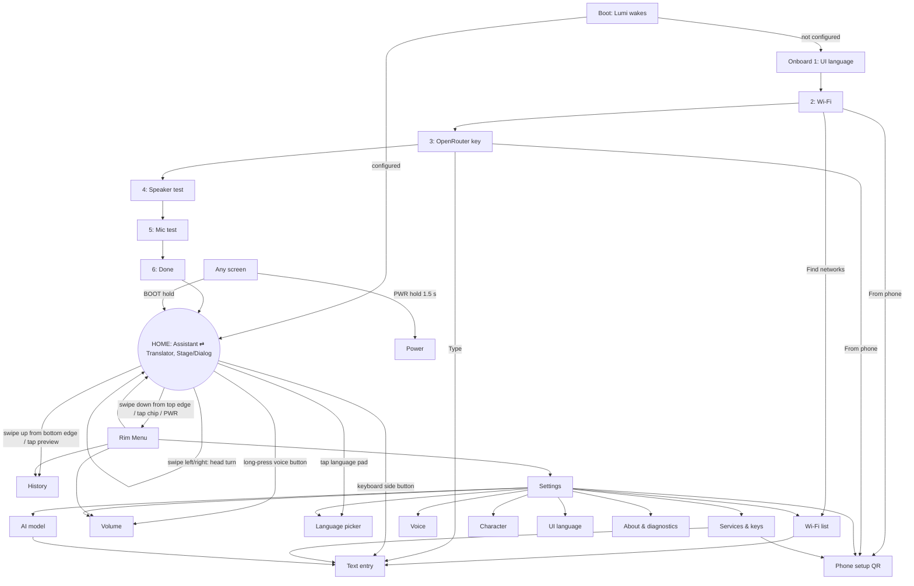

# Lumi: UI/UX specification for the round ESP32-S3 assistant

**Concept:** an expressive character  
**Target:** Waveshare ESP32-S3-Touch-LCD-1.85 rev 2.1. ST77916 360×360 RGB565 panel over QSPI (about 40 MB/s), CST816 single-touch, BOOT button on GPIO0, PWR button on GPIO6.  
**Stack:** ESP-IDF 6.1, esp_lvgl_port 2.9, LVGL 9.5.x. PARTIAL render mode with 2 × (360×40) internal-SRAM DMA draw buffers; everything else in 8 MB PSRAM.  
**Languages:** UI in Russian (default) and English. Every user-visible string below is given in both.

---

## 0. Concept and decisions at a glance

The device is a character called **Луми / Lumi**: a glowing round face on a deep-navy screen. Each stage of the voice pipeline (listening, uploading, thinking, speaking, failing) is shown as an emotion of that face. The user reads system status from Lumi's eyes, colour and motion instead of from status text. Text is still there as chat bubbles and short captions, but the character carries the state.

**Design principles**

1. **The orb is the interface.** It is the main push-to-talk target, the status display and the personality.
2. **Motion means something.** Every animation maps to a state change. The only idle loops are breathing and blinking, and both go quiet after 60 s.
3. **Cheap pixels.** Animations touch small areas. A full-screen redraw happens only for one frame when the screen changes.
4. **Round first.** Every element is checked against the r = 168 content circle (§1.1).
5. **Voice first, keyboard second, phone third.** Long secrets such as the API key are entered from a phone portal.
6. **Never stuck.** PWR always goes back. Holding BOOT always talks.

| Topic | Decision |
|---|---|
| Navigation | The home screen has two faces, Assistant and Translator. A horizontal swipe switches between them with a "head turn" of the orb. The Rim Menu hub opens on a swipe down from the top edge, a tap on the mode chip, or a PWR click. History opens on a swipe up from the bottom edge or a tap on the chat preview. On sub-screens, back is PWR click, swipe right, or a tap on the header chip. There is no tileview and no full-screen slide or fade transition. |
| Push-to-talk (PTT) | The orb and BOOT both support hold-to-talk and tap-to-toggle. The hold threshold is 160 ms on touch and 250 ms on BOOT. Sliding the finger off the orb cancels. While Lumi is speaking, a tap stops speech and a hold interrupts and starts listening. |
| Text-only | Persistent toggle in the right side button, the Rim Menu and Settings. It is forced on when the user says "no speaker" during onboarding. |
| Translator | One PTT with automatic language detection: the model returns `src_lang`. Holding a language pad forces the direction. Optional "auto turn" mode. |
| Keyboard | A 12-key "petal" flick keyboard: letters in T9-style groups, the most frequent letter on a plain tap, the other letters on a flick, petals that bloom on press. All 33 Russian letters plus digits are on one page. Built on `lv_keyboard` with custom maps and our own handler, plus 6 round rim keys for controls. |
| Typeface | Nunito (OFL) static instances in 5 sizes (14/18/20/26/40 px), 4 bpp, with FontAwesome 5 Free Solid glyphs merged in. |
| Palette | Deep-navy dark UI. Each state has an accent: mint (listening), sky (uploading), violet (thinking), amber (speaking), coral (error). |
| Rendering budget | Invalidated area per frame: ≤ 30k px in steady state, ≤ 46k px during transitions, ≤ 58k px while scrolling. Not used: clip_corner, transforms, shadows, Lottie, screen fades. |
| State | Integer `lv_subject_t` values behind a `ui_subj_*` wrapper so the LVGL 9.6 `lv_subject_create` API is a one-file change. Bindings use `lv_subject_add_observer_obj`, not `lv_obj_bind_flag_if_*` (deprecated in 9.6). |
| Threads | Only the LVGL task calls LVGL. Other tasks use the `ui_post()` queue and atomics. `lvgl_port_lock()` is used only at init. |

---

## 1. Visual language

### 1.1 Canvas, safe area and fit test

- The canvas is 360×360 with the origin at top-left. The centre is **C = (180,180)**. The physical circle has r = 180. The **content circle has r = 168**, which leaves a 12 px rim margin.
- Usable chord width at vertical offset d from the centre: **W(d) = 2·√(168² − d²)**.

| d (px) | 0 | 20 | 40 | 60 | 80 | 100 | 110 | 120 | 130 | 140 | 150 | 160 |
|---|---|---|---|---|---|---|---|---|---|---|---|---|
| W (px) | 336.0 | 333.6 | 326.3 | 313.8 | 295.5 | 270.0 | 254.0 | 235.2 | 212.8 | 185.7 | 151.3 | 102.4 |

- **Fit test** used for every element in §3 and §4. This is the "max r" column in the tables.
  - A plain rectangle fits if all four corners are within 168 px of C.
  - A rounded rectangle with corner radius ρ fits if, for each corner-circle centre c, |c − C| + ρ ≤ 168. This is exact for pills and lets them reach further toward the rim than their bounding box suggests.
  - A circle with centre p and radius r fits if |p − C| + r ≤ 168.
- **Angles** follow LVGL: 0° is 3 o'clock and angles increase clockwise, so 270° is 12 o'clock and 90° is 6 o'clock.
- **Touch targets:** the hit area is ≥ 50×50 px. The visual can be smaller and is enlarged with `lv_obj_set_ext_click_area`, the button-matrix half-gap expansion, or an advanced hit test.
- **Clipping:** no `clip_corner` anywhere. The bezel hides the corners physically and layout keeps content inside the circle. Scroll viewports are plain rectangles: rows inside them are pills that pass the fit test, and rows near the viewport edges are faded out (§3.6).

### 1.2 Palette

The theme is dark, with a navy tint. IPS black glows a little, and the navy hides that better than #000.

| Token | Hex | RGB565 | Use | Contrast vs bg |
|---|---|---|---|---|
| `bg` | #0A0B14 | 0x0842 | screen background | 1.00 |
| `surface1` | #161A2B | 0x10C5 | assistant bubbles, list rows, cards | 1.14 |
| `surface2` | #1F2438 | 0x1927 | keys, round buttons, chips | 1.28 |
| `surface3` | #2A3150 | 0x298A | pressed or selected state, control keys | 1.54 |
| `outline` | #343C5E | 0x31EB | 1–2 px outlines, dividers, inactive arc tracks | 1.82 |
| `text_hi` | #F2F4FF | 0xF7BF | primary text | 17.9 |
| `text_mid` | #A7AECB | 0xA579 | secondary text, petal hints | 8.9 |
| `text_lo` | #6C7394 | 0x6B92 | tertiary text (≥ 14 px only), digit hints | 4.2 |
| `user_bubble` | #283372 | 0x298E | user bubble background (text_hi on it: 10.6:1) | 1.69 |
| `orb_body` | #11142A | 0x10A5 | the face disc | 1.08 |
| `on_accent` | #0A0B14 | 0x0842 | text and icons on bright accent fills (≥ 6.5:1 on every accent) | — |

**State accents.** Each accent sets the orb rim, the halo, the eye tint and the active chrome.

| State | Accent | Eye colour (accent mixed 55 % toward white) | Halo opacity | Contrast vs bg |
|---|---|---|---|---|
| Idle | #7C8CFF (0x7C7F) | #C4CBFF | 150↔230, breathing | 6.6 |
| Listening | #3EE6C4 (0x3F38) | #A8F4E4 | 230 | 12.4 |
| Uploading | #4FB3FF (0x4D9F) | #B0DDFF | 200 | 8.6 |
| Thinking | #B07CFF (0xB3FF) | #DBC4FF | 140↔220, 1 Hz | 6.7 |
| Speaking | #FFB25B (0xFD8B) | #FFDCB5 | 220 | 11.0 |
| Error | #FF5C6C (0xFAED) | #FFB6BD | 200 | 6.5 |
| Warning (credit, battery) | #FFD166 (0xFE8C) | #FFEABA | 200 | 13.6 |
| Success | #8BEA6A (0x8F4D) | #CBF5BC | 230 | 13.1 |
| Sleep | #4A4F7A (0x4A6F) | #9095BE | 60 | 2.5 (decorative only) |
| Translator language A | #6FA8FF (0x6D5F) | — | — | 8.1 |
| Translator language B | #FF8FB1 (0xFC76) | — | — | 9.2 |

Colour rules:

- RGB565 bands badly on dark gradients, so gradients are not used anywhere. The only soft light is the baked A8 halo, which has dither built in (§6.3).
- Accent changes are cross-faded in RGB space over 160–300 ms with `lv_color_mix`. Only the orb area is invalidated during the fade.

### 1.3 Typography

**Typeface: Nunito.** SIL OFL 1.1, from Google Fonts. Its subsets include Cyrillic, Cyrillic Extended and Latin Extended (checked in google/fonts `ofl/nunito/METADATA.pb`). The rounded terminals match the character, the x-height is large, and the Cyrillic is well drawn.

google/fonts only ships the variable `Nunito[wght].ttf`, and lv_font_conv cannot select a weight axis. Use **static instances** instead: the `static/` folder of the Google Fonts family download, or instances made with `fontTools varLib.instancer` on the PC.

| Token (C symbol) | Source | Weight | px | Line height ≈ | Roles | Ranges | Flash (est.) |
|---|---|---|---|---|---|---|---|
| `font_num_40` | Nunito-ExtraBold | 800 | 40 | 55 | slider value, sleep clock | R_NUM | 4 KB |
| `font_title_26` | Nunito-Bold | 700 | 26 | 36 | card titles, keyboard centre letters, language codes, rim-key and menu icons | R_TITLE + R_ICONS | 41 KB |
| `font_ui_20` | Nunito-SemiBold | 600 | 20 | 27 | list titles, buttons, text field, translation text, rim-key icons | R_TEXT + R_ICONS | 37 KB |
| `font_body_18` | Nunito-Medium | 500 | 18 | 25 | chat bubbles, card body, captions, mode chip | R_TEXT + R_ICONS | 31 KB |
| `font_cap_14` | Nunito-SemiBold | 600 | 14 | 19 | values, petal hints, arc labels, toasts, timestamps, source transcript | R_TEXT + R_ICONS | 20 KB |

Notes on the table:

- Line heights assume Nunito's ascent + descent of about 1.36 em. Read the real `line_height` from the generated fonts.
- Flash sizes are 4 bpp, uncompressed, scaled from the measured LVGL Montserrat figures (6.6 KB for 158 glyphs at 16 px, 13.8 KB at 24 px) plus 8 B per glyph descriptor. The total is about **135 KB**, which is negligible against the 16 MB flash.
- Compressed fonts render more slowly, so they are not used.

**Glyph ranges** (lv_font_conv `-r` syntax):

```
R_TEXT  = 0x20-0x7E,0xA0-0xFF,0x100-0x17F,0x218-0x21B,0x400-0x45F,0x490-0x491,
          0x2010-0x2027,0x2030,0x2039-0x203A,0x20AC,0x20BD,0x2116,0x2122,0x2212   (≈453 glyphs)
          # ASCII, Latin-1, Latin Ext-A + ș ț, full basic Cyrillic incl. ё і ї є ў ђ ј љ њ ћ џ + ґ,
          # dashes, quotes, ellipsis, • (U+2022 = password bullet), ‰ ‹ ›, €, ₽, №, ™, minus
R_TITLE = 0x20-0x7E,0xA0-0xFF,0x400-0x45F,0x490-0x491,0x2010-0x2027,0x2116        (≈314 glyphs)
R_NUM   = 0x20,0x25,0x2B-0x3A,0xB0,0x2212                                          (space % + , - . / 0-9 : ° −)
R_ICONS = 0xF007,0xF00C,0xF00D,0xF011,0xF013,0xF01E,0xF021,0xF023,0xF028,0xF029,0xF04B,0xF04D,
          0xF053,0xF054,0xF05A,0xF061,0xF062,0xF067,0xF068,0xF06E,0xF070,0xF071,0xF084,0xF0AC,
          0xF0E7,0xF118,0xF11C,0xF130,0xF131,0xF141,0xF185,0xF186,0xF1AB,0xF1D8,0xF1DA,0xF1EB,
          0xF240,0xF241,0xF242,0xF243,0xF244,0xF252,0xF2ED,0xF362,0xF3CD,0xF4AD,0xF51E,0xF544,
          0xF55A,0xF5DC,0xF6A9                                                       (51 icons)
```

**Generation** (run on the PC; one invocation per size):

```sh
lv_font_conv --bpp 4 --no-compress --format lvgl --size 18 \
  --font Nunito-Medium.ttf -r "$R_TEXT" \
  --font fa-solid-900.ttf  -r "$R_ICONS" \
  --lv-font-name font_body_18 -o font_body_18.c
# same pattern: 14 (SemiBold, R_TEXT), 20 (SemiBold, R_TEXT), 26 (Bold, R_TITLE), 40 (ExtraBold, R_NUM, no icons)
```

- For the FA file, use the FontAwesome 5 Free Solid file that LVGL's built-in symbols come from (`scripts/built_in_font/` in the LVGL repo), or `fa-solid-900.ttf` from Font Awesome 5 Free. The font files are OFL. Keep the licence notices for both fonts in `docs/licenses/`.
- Missing glyphs inside a range are skipped. While developing, set `LV_USE_FONT_PLACEHOLDER 1` so gaps show up as boxes; set it to 0 in release builds.

**Text sanitiser** (`ui_text_sanitize()`, applied to every LLM string before it reaches a label):

- `‘ ’ ‚ ‛` → `'`.
- `“ ” „` → `« »` when the UI language is RU, otherwise `"`.
- Markdown `**`, `__`, backticks and leading `#` are stripped. `- ` and `* ` at the start of a line become `• `.
- Emoji and any other code point outside R_TEXT are removed. If no `emotion` field arrived, the first emoji is mapped to an emotion instead (😊 → happy, 😂 → laugh, 😮 → surprised, 😢 → sad, 🤔 → thinking, ❤ → love, 😉 → wink, 😎 → cool).
- Three or more consecutive newlines collapse to one blank line.
- The result is capped at 2,000 bytes per bubble.

### 1.4 Icons

FontAwesome 5 Free Solid glyphs are merged into every text font, so any label can mix icons and text. There are no bitmap icons. The UTF-8 macros live in `ui_icons.h`:

```c
#define ICON_MIC          "\xEF\x84\xB0" /* U+F130 */   #define ICON_MIC_OFF      "\xEF\x84\xB1" /* U+F131 */
#define ICON_LANGUAGE     "\xEF\x86\xAB" /* U+F1AB */   #define ICON_GLOBE        "\xEF\x82\xAC" /* U+F0AC */
#define ICON_EXCHANGE     "\xEF\x8D\xA2" /* U+F362 */   #define ICON_COMMENT_DOTS "\xEF\x92\xAD" /* U+F4AD */
#define ICON_HISTORY      "\xEF\x87\x9A" /* U+F1DA */   #define ICON_COG          "\xEF\x80\x93" /* U+F013 */
#define ICON_KEY          "\xEF\x82\x84" /* U+F084 */   #define ICON_QRCODE       "\xEF\x80\xA9" /* U+F029 */
#define ICON_SUN          "\xEF\x86\x85" /* U+F185 */   #define ICON_MOON         "\xEF\x86\x86" /* U+F186 */
#define ICON_VOLUME_UP    "\xEF\x80\xA8" /* U+F028 */   #define ICON_VOLUME_MUTE  "\xEF\x9A\xA9" /* U+F6A9 */
#define ICON_ROBOT        "\xEF\x95\x84" /* U+F544 */   #define ICON_INFO         "\xEF\x81\x9A" /* U+F05A */
#define ICON_WARNING      "\xEF\x81\xB1" /* U+F071 */   #define ICON_WIFI         "\xEF\x87\xAB" /* U+F1EB */
#define ICON_LOCK         "\xEF\x80\xA3" /* U+F023 */   #define ICON_MOBILE       "\xEF\x8F\x8D" /* U+F3CD */
#define ICON_ARROW_UP     "\xEF\x81\xA2" /* U+F062 */   #define ICON_ARROW_RIGHT  "\xEF\x81\xA1" /* U+F061 */
#define ICON_CHEVRON_LEFT "\xEF\x81\x93" /* U+F053 */   #define ICON_CHEVRON_RIGHT "\xEF\x81\x94" /* U+F054 */
#define ICON_CHECK        "\xEF\x80\x8C" /* U+F00C */   #define ICON_TIMES        "\xEF\x80\x8D" /* U+F00D */
#define ICON_BACKSPACE    "\xEF\x95\x9A" /* U+F55A */   #define ICON_KEYBOARD     "\xEF\x84\x9C" /* U+F11C */
#define ICON_EYE          "\xEF\x81\xAE" /* U+F06E */   #define ICON_EYE_SLASH    "\xEF\x81\xB0" /* U+F070 */
#define ICON_COINS        "\xEF\x94\x9E" /* U+F51E */   #define ICON_BRAIN        "\xEF\x97\x9C" /* U+F5DC */
#define ICON_REDO         "\xEF\x80\x9E" /* U+F01E */   #define ICON_TRASH        "\xEF\x8B\xAD" /* U+F2ED */
#define ICON_STOP         "\xEF\x81\x8D" /* U+F04D */   #define ICON_PLAY         "\xEF\x81\x8B" /* U+F04B */
#define ICON_POWER        "\xEF\x80\x91" /* U+F011 */   #define ICON_CHARGE       "\xEF\x83\xA7" /* U+F0E7 */
#define ICON_BATT_FULL    "\xEF\x89\x80" /* …F241 F242 F243, BATT_0 = F244 */
#define ICON_USER         "\xEF\x80\x87" /* U+F007 */   #define ICON_PAPER_PLANE  "\xEF\x87\x98" /* U+F1D8 */
#define ICON_ELLIPSIS     "\xEF\x85\x81" /* U+F141 */   #define ICON_HOURGLASS    "\xEF\x89\x92" /* U+F252 */
#define ICON_REFRESH      "\xEF\x80\xA1" /* U+F021 */   #define ICON_PLUS "\xEF\x81\xA7" #define ICON_MINUS "\xEF\x81\xA8"
#define ICON_SMILE        "\xEF\x84\x98" /* U+F118 */
```

These are **drawn procedurally instead of using icons**: the whole orb face, the listening bars, the voice dots, the space-bar glyph on the keyboard, and the badges on the orb (Wi-Fi-slash = FA wifi glyph plus a 3 px coral slash line; coin = FA coins glyph in a Ø24 warning-coloured disc).

### 1.5 Shape, spacing and depth

- **Corner radius:** pills use h/2; cards 20 px; bubbles 16 px; keys 14 px; circles `LV_RADIUS_CIRCLE`.
- **Spacing scale:** 4 / 6 / 8 / 12 / 16 / 24 px. Key gap 6 px, list row gap 8 px, bubble gap 8 px, card padding 12–16 px.
- **Depth** comes from surface steps (surface1 → surface3) and 1–2 px outlines. **Box shadows are never used** (`shadow_width = 0` in every style). Light comes only from the baked A8 halo.
- **Pressed feedback ("squish"):** background goes up one surface step, plus `transform_width` and `transform_height` of −3 px. These two properties do not create a layer, unlike `transform_scale`. A style transition of 80 ms with ease_out handles it.
- **Disabled:** `opa` 40 %.

### 1.6 Motion tokens

| Token | Value | | Easing token | LVGL |
|---|---|---|---|---|
| `T_MICRO` | 80 ms (press, ear-perk) | | `E_OUT` | `lv_anim_path_ease_out` |
| `T_FAST` | 140 ms (fades, chip) | | `E_IN` | `lv_anim_path_ease_in` |
| `T_BASE` | 220 ms (bubbles, rows) | | `E_INOUT` | `lv_anim_path_ease_in_out` |
| `T_SLOW` | 320 ms (dock) | | `E_BACK` | `lv_anim_path_custom_bezier3` + `lv_anim_set_bezier3_param(a, 348, 1597, 655, 1024)` (≈ easeOutBack, about 10 % overshoot) |
| `T_CHAR` | 420 ms (head turn, menu) | | `E_BOUNCE` / `E_OVER` | `lv_anim_path_bounce` / `lv_anim_path_overshoot` |

**Reduced motion** (Settings › Character › Animations: "Спокойные / Calm"):

- Turned off: the head turn becomes an instant colour swap behind a blink; docking becomes instant; bounces, idle look-around and sparkles are removed.
- Kept: blinking, state colours and the rings.

### 1.7 The character: Lumi

**Personality.** Friendly, curious, a little playful, never sarcastic.

- UI copy avoids gendered Russian past-tense verbs: "Не слышно" rather than "Не расслышал(а)", and "Не удалось распознать".
- The assistant's own grammatical gender in replies is set by the system prompt and is an open decision for the user.

**Face anatomy.** All values are fractions of the orb radius r, so the same face works at r = 70 (stage), 50 (cards), 38–40 (menu, slider), 30 (docked), 16 (lists) and 13 (keyboard).

| Part | Geometry | Drawn with |
|---|---|---|
| Halo | baked A8 radial falloff, radius ≈ 1.25r | `lv_draw_image` with an A8 source; the colour comes from `recolor` (alpha-only images are drawn as a mask blend in `recolor` colour, checked in `lv_draw_sw_img.c` 9.5) |
| Body | disc of radius r, `orb_body` fill, 3 px rim in the accent at opacity 217 | `lv_draw_rect` with `radius = LV_RADIUS_CIRCLE` |
| Specular | ellipse 0.5r × 0.28r centred at (−0.32r, −0.5r), white, opacity 28 | small baked A8 image |
| Eyes | capsules, w = 0.26r, h = 0.42r, centre-to-centre spacing 0.62r, centred at y = −0.08r (plus look offset) | `lv_draw_rect`, radius = w/2 |
| Lids | top and bottom closure 0–100 %; drawn height = h·(1 − top − bottom), minimum 0.06r | geometry only, no extra draw |
| Brow tilt | inner or outer top corner cut by a triangle in the body colour, −20° to +20° | `lv_draw_triangle` |
| Alternative eye shapes | arc "^" (radius 0.16r, width 0.10r, 200°–340°); circle; X; heart; spiral; sunglasses bar | `lv_draw_arc`, `lv_draw_line`, rect |
| Mouth (only when needed) | centre y = +0.36r, width 0.36r; smile/frown arc; speaking rect with h = 0.04r–0.30r from the TTS level; "o"; zigzag | `lv_draw_arc`, `lv_draw_rect`, `lv_draw_line` |
| Blush | dots at (±0.48r, +0.22r), radius 0.09r, #FF8FB1 | rect |

For the stage orb (r = 70): eyes 18×29 px centred at (180 ± 22, 158), mouth centre y = 189, mouth width 25 px.

**Emotion presets.** `face_t` holds about 20 numeric fields. A preset is a constant `face_t`. Changing preset interpolates every numeric field over 200 ms with E_OUT. If the eye *shape* changes (capsule → arc), the change goes through a **blink-swap**: lids close in 60 ms, the shape swaps while closed, and the lids open in 80 ms. This hides every shape morph.

| Preset | Eyes (w × h, % of r) | Look x,y (% r) | Lids top/bottom | Tilt | Mouth | Extras | Used for |
|---|---|---|---|---|---|---|---|
| NEUTRAL | capsule 26×42 | 0, 0 | 0/0 | 0 | — | breathing, blinking | idle |
| ATTENTIVE | capsule 30×48 | 0, −4 | 0/0 | 0 | — | ear-perk | listening |
| FOCUS | capsule 28×42 | 0, 0 | 35/0 | 0 | — | upload ring | uploading |
| PONDER | L 24×36, R 28×42 | +14, −14 | 20/0 | 0 | flat 0.2r | orbit dots, saccades | thinking |
| HAPPY | capsule 28×42 | 0, 0 | 0/38 ("smiling eyes") | 0 | smile arc | voice dots | speaking (default) |
| JOY | arc "^" | 0, 0 | — | — | open "D" 0.46r × 0.23r | bounce, sparkles | success, "laugh" |
| SURPRISED | circle 32×32 | 0, −4 | 0/0 | 0 | "o" Ø0.17r | — | "surprised" |
| SAD | capsule 26×34 | 0, +8 | 25/0 | outer −20° | frown | — | region error, "sad" |
| CONFUSED | L 26×42, R 26×24 | +8, 0 | 0/0 | R +10° | zigzag | "?" glyph floats up | bad key, empty transcript |
| WORRIED | capsule 22×34 | −6, +4 | 20/0 | inner −14° | small frown | coin badge | no credit, slide-to-cancel |
| SLEEPY | capsule 28×42 | 0, +4 | 80/0 | 0 | — | "z" particles | doze, offline |
| DIZZY | spirals (2 arcs rotating 360°/s) | — | — | — | wavy | — | server error, timeout |
| LOVE | hearts 30 | 0, 0 | — | — | smile | blush 80 % | "love" |
| WINK | L arc "^", R capsule | 0, 0 | — | — | smile | — | "wink", tips |
| COOL | sunglasses bar 0.9r × 0.26r | — | — | — | smirk | glint sweep | "cool", brightness 100 % |
| HUSH | capsule | 0, +6 | 0/20 | 0 | zipper line | — | text-only toggle, interrupt |

**Ambient behaviours**

| Behaviour | Timing |
|---|---|
| Blink | every `lv_rand(2500, 6000)` ms; 15 % chance of a double blink; lids close 60 ms E_IN, hold 40 ms, open 80 ms E_OUT |
| Look-around | every 4–9 s to a random target within ±12 % r; 220 ms E_INOUT |
| Touch-follow | while a finger is down anywhere on the home screen except the orb, the eyes look toward it (clamped to ±16 % r); they return 400 ms after release |
| Yawn | after 45 s idle: eyes squint, mouth "o" opens to 0.3r over 600 ms |
| Calm | after 60 s idle: breathing stops; blinking only |
| Doze | after 90 s idle: SLEEPY preset, "z" particles every 1.5 s |
| Backlight | dims to 20 % after 2 min (setting); goes off at the screen timeout (default 10 min) |
| Wake | touch, BOOT or PWR. The first touch after backlight-off only wakes the device (`lv_indev_wait_release`) |

**Emotion from the reply.** The assistant's JSON schema gets one extra field:

```
"emotion": {"type":"string","enum":["neutral","happy","laugh","surprised","thinking","sad","confused","love","wink","cool"]}
```

The orb shows that emotion while speaking and for 1.5 s afterwards, then returns to NEUTRAL. The mapping is neutral → HAPPY with lower-lid 20 %, happy → HAPPY, laugh → JOY, surprised → SURPRISED, thinking → PONDER, sad → SAD, confused → CONFUSED, love → LOVE, wink → WINK, cool → COOL. Setting: "Эмоции из ответов / Emotions from replies" (default on).

**Earcons** (optional; only when voice is on and volume > 0). Procedurally synthesised 16-bit sine tones with a 5 ms attack and 60 ms release, so no audio files are needed:

- listen start: 880 → 1320 Hz, 80 ms
- listen stop: 1320 → 880 Hz, 80 ms
- error: 220 Hz "bonk", 120 ms
- success: C6–E6–G6 arpeggio, 240 ms

---

## 2. Screen inventory and navigation

### 2.1 Inventory

| ID | Name (RU / EN) | Purpose | Lifetime |
|---|---|---|---|
| `SCR_BOOT` | — | Lumi wakes: eyes open from closed (300 ms), then "Привет!" / "Hi!" | created at boot, deleted |
| `SCR_ONBOARD` | Знакомство / Welcome | 6-step first-run flow (§5.8): UI language, Wi-Fi, key, speaker, mic, done | created per step |
| `SCR_HOME` | Ассистент / Переводчик | One screen with two **modes** (ASSIST, TRANSL) and two **layouts** (STAGE = orb centred, DIALOG = orb docked at the top with the conversation below) | **persistent** |
| `SCR_MENU` | Меню / Menu | Rim Menu hub: 6 radial items | on demand |
| `SCR_HISTORY` | История / History | Full conversation log (assistant and translator entries) | on demand |
| `SCR_LANG` | Язык A / Язык B | Translator language picker | on demand |
| `SCR_SETTINGS` | Настройки / Settings | Settings list | on demand |
| `SCR_WIFI` | Wi-Fi | Scan list, hidden network, connect | on demand |
| `SCR_TEXT` | Ввод текста / Text entry | Text field + petal keyboard (§4), with field types | on demand |
| `SCR_MODEL` | Модель ИИ / AI model | Curated and fetched model list, custom ID | on demand |
| `SCR_VOICE` | Голос / Voice | TTS model and voice picker with preview | on demand |
| `SCR_SLIDER` | Громкость / Яркость | Arc slider (volume or brightness) | on demand |
| `SCR_SERVICES` | Сервисы и ключи / Services & keys | Base URL, key and model per endpoint (chat, STT, TTS); key check | on demand |
| `SCR_PORTAL` | С телефона / Phone setup | SoftAP + captive portal + QR codes | on demand |
| `SCR_CHARACTER` | Персонаж / Character | Animations full/calm, emotions from replies, UI sounds, name | on demand |
| `SCR_UILANG` | Язык интерфейса / UI language | RU / EN | on demand |
| `SCR_DIAG` | Об устройстве / About | Diagnostics and tests | on demand |
| `SCR_POWER` | Питание / Power | Sleep, restart, power off | on demand |
| `OVL_CARD` | — | Mood card overlay for errors, confirmations and progress (Wi-Fi connecting) | on `lv_layer_top()` |
| `OVL_FLOWER` | — | Keyboard petal flower | on `lv_layer_top()` |
| `OVL_HINT` | — | First-run gesture ghost | on `lv_layer_top()` |
| Chip toasts | — | Transient messages shown by morphing the mode or header chip | no separate object |

### 2.2 Navigation map



The navigation stack holds screen **IDs and arguments, not objects**. Pushing a screen calls `lv_screen_load_anim(new, LV_SCREEN_LOAD_ANIM_NONE, 0, 0, auto_del)`, with `auto_del = false` only when leaving `SCR_HOME`. At most one non-home screen exists at a time. Back re-creates the previous screen from its ID and restores its scroll position from the stack entry.

### 2.3 Input model

**Physical buttons**

| Button | Action | Result |
|---|---|---|
| **BOOT** (GPIO0, active low, 20 ms debounce) | press and hold ≥ 250 ms | hold-to-talk; release sends. From any screen except `SCR_TEXT`, it first loads `SCR_HOME` instantly ("talk from anywhere"). |
| | click < 250 ms | tap-to-toggle listening. During toggle listening a click sends; during speaking a click stops TTS; during upload or thinking a press cancels the request and starts a new hold-to-talk. |
| | in `SCR_TEXT` (TEXT field) | hold = dictation into the field. For PASSWORD and KEY fields it is ignored with the toast "Диктовка недоступна / Dictation off for secrets". |
| **PWR** (GPIO6, active low) | click < 600 ms | on HOME: open Rim Menu; on MENU: close it; elsewhere: back. During listening, upload or thinking: cancel. |
| | hold 1.5 s | a ring fills along the rim (§6) → `SCR_POWER`. Firmware owns the GPIO7 power latch. |

GPIO0 is a strapping pin: holding BOOT while resetting enters download mode. That belongs in the recovery runbook; the UI does nothing with it.

**Gestures.** LVGL's own gesture detection runs on the CST816 points; the chip's gesture register is not used.

```c
lv_indev_set_gesture_min_distance(touch, 40);   // px before a swipe counts
lv_indev_set_gesture_min_velocity(touch, 3);
lv_indev_set_scroll_limit(touch, 10);
lv_indev_set_long_press_time(touch, 400);
lv_indev_set_long_press_repeat_time(touch, 80);  // backspace repeat
```

| Where | Gesture | Action |
|---|---|---|
| HOME, anywhere except keyboard-like widgets | ← or → | switch mode (Assistant ⇄ Translator), shown as a head turn |
| HOME, the press started on `edge_top` (y < 64), the mode chip, or the docked orb | ↓ | Rim Menu |
| HOME, the press started on `edge_bottom` (y > 296 in STAGE, y > 300 in DIALOG) or the preview caption | ↑ | History |
| Sub-screens (lists, cards, slider centre, QR) | → | back |
| Keyboard, arcs, flower | — | `LV_OBJ_FLAG_GESTURE_BUBBLE` cleared, so flicks and drags never navigate |

`edge_top` (0, 0, 360×64) and `edge_bottom` (0, 296, 360×64) are transparent, clickable `lv_obj` children of `SCR_HOME`. They are created *before* the chip, caption and buttons, so those sit on top. The screen's `LV_EVENT_GESTURE` handler checks `lv_event_get_target_obj(e)`, the object where the press started. Vertical gestures are accepted only from the allowed origins listed above. Horizontal gestures are accepted from anything that bubbles. After acting, the handler calls `lv_indev_wait_release()`.

**Why nothing conflicts**

| Context | Hold | Tap | Vertical drag | Horizontal drag |
|---|---|---|---|---|
| Orb (stage or docked) | PTT after 160 ms with < 14 px movement | toggle listen | moving > 14 px before 160 ms disarms PTT; the gesture then counts (↓ = menu only from docked orb or edge) | disarm → mode switch. Once PTT is active, gestures are ignored and movement only drives slide-to-cancel. |
| HOME dialog chat | none (no long-press actions) | assistant bubble → replay voice | scrolls the chat (`LV_DIR_VER`). Not an edge origin, so never opens the menu or history. | the chat is not horizontally scrollable, so LVGL raises a gesture → mode switch |
| HOME background or caption | none | caption → History | edge rules only | mode switch |
| Lists | — | open row | scroll | → back |
| Keyboard | flower stays visible | type the centre letter | flick (U/D petal) | flick (L/R petal) |
| Slider arc (`LV_OBJ_FLAG_ADV_HITTEST` set, so only the ring is hit-tested) | drag value | jump with change rate 240°/s | drag | drag. A swipe in the centre disc means back. |

Hold-to-talk never depends on a touch gesture: BOOT is always available. The touch PTT is limited to the orb, and the orb's 160 ms arming window decides between "talk" and "swipe" before any UI changes. Audio is captured from t = 0 into a pre-roll buffer, so the first syllable is never lost. The buffer is discarded if the press turns out to be a swipe.

**Rim Menu.** A radial hub with 6 items. Each item has a curved caption on the rim; the orb in the centre looks at whichever item is pressed.

| Item (screen angle) | Position | RU / EN | Icon | Action |
|---|---|---|---|---|
| 270° (top) | (180, 70) | Ассистент / Assistant | `ICON_ROBOT` | HOME, mode ASSIST |
| 330° | (275, 125) | Переводчик / Translator | `ICON_LANGUAGE` | HOME, mode TRANSL |
| 30° | (275, 235) | История / History | `ICON_HISTORY` | SCR_HISTORY |
| 90° (bottom) | (180, 290) | Настройки / Settings | `ICON_COG` | SCR_SETTINGS |
| 150° | (85, 235) | Голос: вкл / выкл | `ICON_VOLUME_UP` / `ICON_VOLUME_MUTE` | toggles in place; the orb does HUSH or HAPPY; the menu stays open |
| 210° | (85, 125) | Громкость / Volume | `ICON_SUN` + `ICON_VOLUME_UP` stacked | SCR_SLIDER (a long-press opens brightness) |

---

## 3. Geometry per screen

Coordinates are in pixels: (x, y) is the top-left of the object, w×h its size. "Max r" is the fit-test result from §1.1 and must be ≤ 168.

### 3.1 HOME, Assistant, STAGE layout (idle, listening, uploading, thinking)

| Element | Object | Geometry | Font / colour | Max r |
|---|---|---|---|---|
| Status, left | `lv_arclabel` "14:32" | radius 158, centre angle 235°, size 40°, clockwise | cap_14, text_mid | ≈165 |
| Status, right | `lv_arclabel` `ICON_WIFI` + `ICON_BATT_*` (+ `ICON_VOLUME_MUTE` when text-only) | radius 158, centre 305°, size 40° | cap_14, text_mid | ≈165 |
| Mode chip | pill, 18 px radius | (124, 22) 112×36; grows to 140 max for toasts (x 110–250); ext click 7 → hit 50 high | body_18; `ICON_ROBOT` + " Ассистент" | 163.1 (167.3 at 140 wide) |
| Orb | custom-draw `lv_obj` (§7) | object (72, 56) 216×216; disc centre (180, 164), r = 70; halo to r 88; bars r 80–106 | — | bars: 124 |
| Orb hit area | `LV_OBJ_FLAG_ADV_HITTEST` | circle r 80 around (180, 164) | — | — |
| Keyboard button | round | centre (40, 164), Ø48 → (16, 140) 48×48; ext click 4 → 56 | `ICON_KEYBOARD`, ui_20, text_mid, on surface2 | 165.2 |
| Voice button | round | centre (320, 164), Ø48 → (296, 140); long-press opens volume | `ICON_VOLUME_UP` / `MUTE` (coral dot when "no speaker") | 165.2 |
| Caption (preview or status) | label, 2 lines, centred, `LV_LABEL_LONG_MODE_DOTS` | (88, 276) 184×42 | body_18, text_mid | 165.9 |
| Cancel pill (toggle-listening only; replaces the caption) | pill, 24 px radius | (110, 274) 140×48 | ui_20: `ICON_TIMES` + " Отмена" | 150.6 |
| Upload ring | `lv_arc`, display only (knob removed, not clickable) | (90, 74) 180×180, width 4 → r 86–90 | accent upload | 94 |
| Edge zones | transparent `lv_obj` | top (0, 0) 360×64; bottom (0, 296) 360×64 | — | n/a (hit only) |

Spacing checks: the bars' top (y 58) clears the chip bottom (58). The bars' sides (x 74 and 286) leave 10 px to the side buttons (x 64 and 296).

### 3.2 HOME, Assistant, DIALOG layout (reply, speaking, follow-ups)

| Element | Geometry | Notes | Max r |
|---|---|---|---|
| Docked orb | object (132, 14) 96×96; centre (180, 62), r = 30; halo r 38; docked bars r 34–46 (24 bars) | still the PTT target, hit r 36 (72 px) | 164.0 |
| Status arc labels | same as stage (235° and 305°) | they clear the docked orb (arc point at 235° is (89, 51)) | ≈165 |
| Side buttons | same as stage: (16, 140) and (296, 140) | | 165.2 |
| Chat viewport | (70, 112) 220×188, `LV_DIR_VER`, `LV_SCROLLBAR_MODE_OFF`, flex column, row gap 8, padding 0 | at most 12 bubbles; older ones are pruned to History | 162.8 |
| Assistant bubble | left-aligned, width `LV_SIZE_CONTENT`, max_width 204; padding 10/8 (h/v); radius 16; surface1; left border 3 px in the current accent | body_18, text_hi; an `lv_spangroup` (one span per sentence) for the spoken-sentence highlight | inside viewport |
| User bubble | right-aligned in a 220-wide transparent row wrapper; max_width 188; user_bubble background; radius 16 | body_18, text_hi | inside viewport |
| Typing bubble | left, 60×32, three Ø8 dots | | — |
| Bottom hint or toast | label (100, 304) 160×20, centred | cap_14, text_lo ("BOOT / удерживай меня") | 164.7 |
| Bottom edge zone | (0, 300) 360×60 | | — |

### 3.3 HOME, Translator

**STAGE**

| Element | Geometry | Notes | Max r |
|---|---|---|---|
| Chip | as §3.1: `ICON_LANGUAGE` + " Переводчик" | | 163.1 |
| Orb | object (92, 56) 176×176, centre (180, 144), r = 56; bars r 62–84 (top y = 60, clears the chip) | the body is split into two 50 % halves tinted with A and B colours at 25 % (left = A, right = B); the eyes look toward the active side | 120 |
| Pad A | circle, centre (74, 236), Ø80 → (34, 196) 80×80; 3 px border in lang_a; surface1 fill | code "RU" (title_26, text_hi) at y −8; native name "Русский" (cap_14, text_mid) at y +18. Tap = picker; hold = forced A → B. | 159.9 |
| Pad B | centre (286, 236), Ø80 → (246, 196) | lang_b border | 159.9 |
| Swap | circle, centre (180, 300), Ø44 → (158, 278); ext click 4 | `ICON_EXCHANGE`, ui_20 | 142.0 |
| Hint | label (120, 236) 120×34, 2 lines | cap_14, text_lo: "Говорите на любом из двух" | inside |

Clearance check: the gap between pad A and the orb's bar ring is 100.4 px (distance between centres) − 40 (pad radius) = 60 px beyond the bars' outer radius of 84, so there is no overlap.

**DIALOG**

| Element | Geometry | Max r |
|---|---|---|
| Docked orb | as §3.2 | 164 |
| Language pill A | (60, 64) 70×36, radius 18, lang_a fill at opa 51 with lang_a 2 px border; "RU" in ui_20 | 159.4 |
| Language pill B | (230, 64) 70×36 | 159.4 |
| Translation card | (70, 108) 220×192, surface1, radius 20, padding 12, scrollable | 162.8 |

Card content, top to bottom:

1. Header: "RU" + `ICON_ARROW_RIGHT` + "EN" in cap_14, each code in its language colour.
2. Source transcript: cap_14, text_mid, at most 3 lines.
3. 1 px divider in outline colour.
4. Translation: ui_20, text_hi. If the target script is not covered by the font, the romanised `display` field is shown with a small "лат." badge (§5.4).

### 3.4 Rim Menu (`SCR_MENU`)

| Element | Geometry | Max r |
|---|---|---|
| Orb | centre (180, 180), r = 40, object (130, 130) 100×100 | 50 |
| 6 items | circles Ø72 at radius R = 110 and angles 270/330/30/90/150/210°; top-left positions (144, 34), (239, 89), (239, 199), (144, 254), (49, 199), (49, 89); surface2 fill; icon in title_26 | 146.0 each |
| 6 captions | `lv_arclabel` at radius 156, centred on each item's angle, size 44°. Upper half clockwise; lower half (30/90/150°) `LV_ARCLABEL_DIR_COUNTER_CLOCKWISE` so the text stays upright. cap_14, text_mid. | ≈163 |
| Active mode item | accent fill, on_accent icon | — |

Gaps: 38 px between neighbouring items and 34 px between an item and the orb.

### 3.5 History (`SCR_HISTORY`)

| Element | Geometry | Max r |
|---|---|---|
| Header chip (back) | pill (110, 24) 140×40, radius 20: `ICON_CHEVRON_LEFT` + " История" (ui_20) | 164.9 |
| Viewport | (56, 74) 248×216, scrollable vertically, flex column, gap 8 | 165.8 |
| Bubbles | row wrapper 248 wide; bubble max_width 210 (user right-aligned, assistant left-aligned). Translator entries are cards with the "RU → EN" header. Date separators: cap_14, text_lo, centred. | inside |
| Rim scrollbar | `lv_arc`, display only, (12, 12) 336×336, width 4 → r 164–168; background angles 330°–30° in outline colour; indicator = visible fraction, position follows `LV_EVENT_SCROLL` | 168 |
| Clear button | circle Ø48, centre (180, 318) → (156, 294); `ICON_TRASH`; opens a confirmation card | 162.0 |

### 3.6 List template (Settings, Wi-Fi, model, voice, language, services, character, UI language, diagnostics)

| Element | Geometry | Max r |
|---|---|---|
| Header chip (back + title) | pill (110, 24) 140×40, radius 20, `ICON_CHEVRON_LEFT` + title, ui_20, `LV_LABEL_LONG_MODE_DOTS` | 164.9 |
| Viewport | (48, 70) 264×220. Clip rectangle only; its corners lie beyond r 168 but nothing is drawn there (see below). Scroll snap `LV_SCROLL_SNAP_CENTER`, scrollbar off. | — |
| One-line row | pill 264×52, radius 26, surface1, pitch 60 | 161.2 at the top or bottom edge row (row centre y = 96 or 264); 132 at the centre |
| Two-line row | 264×64, radius 22, pitch 72: title ui_20 + value cap_14 text_mid | 162.9 at the edge |
| Row content | icon ui_20 at x + 18; title from x + 52; right-aligned value (cap_14) or chevron; inline switch 44×26 at x + 202 (the switch is not clickable itself — a tap anywhere on the row toggles it) | — |
| Edge fade | in `LV_EVENT_SCROLL`, each row's `opa` = 255 while \|row centre − 180\| ≤ 84, falling linearly to 64 at 110. Partly clipped rows are therefore nearly invisible. | — |
| Rim scrollbar | as §3.5 | 168 |
| Optional bottom action | circle Ø48, centre (180, 318) | 162.0 |

**Settings rows** (in order; two-line rows show the current value):

1. `ICON_WIFI` Wi-Fi · "HomeNet" / "не подключено" → `SCR_WIFI`
2. `ICON_MOBILE` Настройка с телефона / Phone setup → `SCR_PORTAL`
3. `ICON_VOLUME_UP` Ответы голосом / Spoken replies — switch
4. Громкость / Volume · "60 %" → `SCR_SLIDER(vol)`
5. `ICON_SUN` Яркость / Brightness · "80 %" → `SCR_SLIDER(bri)`
6. `ICON_BRAIN` Модель ИИ / AI model · "Gemini 3.1 Flash-Lite" → `SCR_MODEL`
7. `ICON_COMMENT_DOTS` Голос / Voice · "Masha · MAI-Voice" → `SCR_VOICE`
8. `ICON_LANGUAGE` Переводчик / Translator · "RU ⇄ EN" → `SCR_LANG`
9. `ICON_KEY` Сервисы и ключи / Services & keys → `SCR_SERVICES`
10. `ICON_SMILE` Персонаж / Character → `SCR_CHARACTER`
11. `ICON_KEYBOARD` Клавиатура / Keyboard · "Жесты" / "Два касания" (a tap cycles the value)
12. `ICON_GLOBE` Язык интерфейса / UI language · "Русский" → `SCR_UILANG`
13. `ICON_MOON` Экран / Display · sleep timeout "2 мин" (a tap cycles 1/2/5/10 min / never)
14. `ICON_INFO` Об устройстве / About → `SCR_DIAG`
15. `ICON_REDO` Сброс / Factory reset → confirmation card with hold-to-confirm

**Wi-Fi rows** (one-line):

- `ICON_WIFI`, tinted by signal: text_hi at ≥ −60 dBm, text_mid at ≥ −75 dBm, text_lo below.
- SSID in ui_20 with dots overflow, plus `ICON_LOCK` (cap_14) when secured.
- The connected network is a two-line row with an accent outline and the value "Подключено / Connected".
- The last row is "Другая сеть… / Other network…" (SSID entry).
- The bottom action is the **refresh button, drawn as a mini orb** (r = 16). While scanning it shows a look-around animation instead of an icon.

**Model rows** (two-line): the name, plus the price line "$0.25 / $1.50 · аудио $0.50 за 1M" taken from `pricing × 1e6`.

- Top of the list: a curated list from `assets/models.json`. The default is `google/gemini-3.1-flash-lite`.
- Then "Обновить из OpenRouter / Refresh from OpenRouter". It fetches `GET /api/v1/models?input_modalities=audio&output_modalities=text&sort=pricing-low-to-high` and keeps entries that meet all of the following, up to 30, parsed in PSRAM:
  - `supported_parameters` contains both `response_format` and `structured_outputs`;
  - the id does not end in `:batch`;
  - no negative prices;
  - `expiration_date` is null;
  - not a `-preview` duplicate;
  - not a `~` alias.
- Last: "Ввести ID / Enter ID" → `SCR_TEXT` (MODEL_ID).
- The selected model has a 2 px accent outline and `ICON_CHECK`.

**Voice rows** have small cap_14 section headers per model: "MAI-Voice 2.1 Flash" with Masha, Lev, Grant and Harper (ids `ru-RU-Masha:MAI-Voice-2.1-Flash` etc.); "Gemini 3.8 Flash-Lite TTS" with Kore, Puck, Charon and others; and "Выкл (только текст) / Off (text only)". Tapping a row selects it and plays the sample "Привет! Я Луми." If there is no speaker, the toast "Нет динамика — только текст" appears instead.

**Language rows** (translator):

- A code badge 40×28 (radius 8, filled with the side's colour at opa 51) containing "DE" (ui_20 Bold), then the native name in ui_20.
- A right-hand badge: `ICON_VOLUME_UP` if the current TTS model has a voice for that language, otherwise `ICON_VOLUME_MUTE`.
- Choosing the language already used by the other side swaps the two.

### 3.7 Card templates (onboarding, errors, confirmations, progress)

**Card A** (onboarding: one primary action and a text link)

| Element | Geometry | Font | Max r |
|---|---|---|---|
| Step dots | 6 × Ø8 along radius 158 at 255°, 261°, 267°, 273°, 279°, 285°; done = accent, current = text_hi, upcoming = outline | — | 162 |
| Orb | centre (180, 96), r = 40 → object (130, 46) 100×100 | — | 124 |
| Title | (30, 146) 300×30, centred | title_26, text_hi | 153.4 |
| Body | (40, 182) 280×56, 2 lines, centred | body_18, text_mid | 151.5 |
| Primary pill | (70, 246) 220×52, radius 26, accent fill | ui_20, on_accent | 150.6 |
| Secondary link | (105, 302) 150×22 (ext click 14 → hit 50) | body_18, text_mid, underlined via 1 px rect | 162.4 |
| Two-choice variant | pills (70, 186) and (70, 246), both 220×52 | ui_20 | 150.6 |

**Card B** (errors and confirmations: two actions)

| Element | Geometry | Max r |
|---|---|---|
| Orb (with emotion and badge) | centre (180, 118), r = 50 → object (118, 56) 124×124 | 112 |
| Title | (30, 186) 300×28, title_26 | 153.8 |
| Detail | (40, 214) 280×38, cap_14 2 lines or body_18 1 line, text_mid | 157.4 |
| Pill L (secondary) | (56, 256) 120×50, radius 25, surface2 | 166.4 |
| Pill R (primary) | (184, 256) 120×50, accent fill (coral when destructive) | 166.4 |
| Single action | (100, 256) 160×50 | 138.3 |

**Hold-to-confirm** (factory reset, clear history): while pill R is pressed, a child rect grows from width 0 to 120 over 1,200 ms (linear) in a darker coral. Releasing early shrinks it back in 150 ms. Reaching the full width triggers the action, and the orb gives a JOY bounce.

### 3.8 Slider (`SCR_SLIDER`: volume or brightness)

| Element | Geometry | Max r |
|---|---|---|
| Arc | `lv_arc` (24, 24) 312×312; background angles 135° → 45° (270° sweep, opening at the bottom); `lv_arc_set_range(0, 100)` (brightness 5–100); width 22 on both MAIN and INDICATOR (ring r 134–156); MAIN outline colour, INDICATOR accent, rounded ends; knob Ø34 (text_hi fill, knob padding 6); `lv_arc_set_change_rate(arc, 240)`; `LV_OBJ_FLAG_ADV_HITTEST` (ring-only hits, centre ignored); GESTURE_BUBBLE cleared | knob 162 |
| Orb | centre (180, 132), r = 38 → object (132, 84) 96×96 | 86 |
| Value | label (110, 178) 140×44, "60 %" | num_40, text_hi |
| Name | label (100, 224) 160×24, "Громкость" / "Яркость" | body_18, text_mid |
| − button | circle, centre (138, 284), Ø48 → (114, 260); ext click 4; step 5 | 136.2 |
| + button | centre (222, 284) → (198, 260) | 136.2 |
| Done | circle, centre (180, 318), Ø44 → (158, 296); `ICON_CHECK`; ext click 4 | 160.0 |

Clearances: 19.5 px between − and the arc's min-end knob; 8 px between − and Done.

Orb reactions:

- **Volume:** mouth height = 0.04r + 0.26r · v/100. At 0 % the HUSH zipper shows. On release, a chime plays at the new volume.
- **Brightness:** lid_top = 40 % · b/100 (squinting). At 100 % the COOL sunglasses appear.

### 3.9 Phone setup (`SCR_PORTAL`)

| Element | Geometry | Max r |
|---|---|---|
| Header chip | "‹ С телефона / From phone" (110, 24) 140×40 | 164.9 |
| QR code | `lv_qrcode` (84, 72), `lv_qrcode_set_size(qr, 192)`, dark #0A0B14, light #FFFFFF, `lv_qrcode_set_quiet_zone(qr, true)` | 144.5 |
| Line 1 | (80, 270) 200×22, body_18, text_hi | 148.7 |
| Line 2 | (95, 292) 170×18, cap_14, text_mid | 155.3 |
| Step dots | 2 × Ø8 at (168, 316) and (184, 316) | 144 |

**Flow**

1. **Join the device's Wi-Fi.** The QR encodes `WIFI:T:WPA;S:Lumi-7568;P:48213907;;`. The SSID suffix is the last 2 MAC bytes; the password is a random 8-digit number per session. This is about 38 chars, which fits QR version 3 at about 5 px per module in 192 px. Line 1: "Наведи камеру телефона / Scan with your phone". Line 2: "Lumi-7568 · 48213907".
2. **Open the page.** On `WIFI_EVENT_AP_STACONNECTED` the orb does a JOY hop and the QR switches to `http://192.168.4.1/`. Line 1: "Страница откроется сама / The page opens itself". The captive portal is our own `esp_http_server` page, because esp-wifi-connect's portal has no API-key fields.
3. **Receive the settings.** When the form arrives, the QR is replaced by a checklist card (Card B, single action): "Wi-Fi ✓ · Ключ ✓ · Модель ✓". Lumi then connects (FOCUS) and checks the key with `GET /api/v1/key` (PONDER), ending in JOY or a mapped error. The AP shuts down when setup is done, or after 10 minutes.

### 3.10 Power (`SCR_POWER`)

| Element | Geometry | Max r |
|---|---|---|
| Orb | SLEEPY preset, centre (180, 104), r = 40 | 116 |
| 3 items | Ø72 circles at (56, 168), (144, 168), (232, 168) (centres y 204): Сон / Sleep (`ICON_MOON`), Перезагрузка / Restart (`ICON_REDO`), Выключить / Power off (`ICON_POWER`, coral) | 127.2 |
| Labels | cap_14, 88×20 below each item at y 246 | 157.5 |

On USB power the device cannot cut itself off. "Выключить" then shows the toast "На USB — только сон / On USB: sleep only".

### 3.11 Text entry (`SCR_TEXT`)

See §4.

---

## 4. The on-screen keyboard: 12-key "petal" flick keyboard

### 4.1 Choice and justification

The verified constraint is about 20 keys of ≥ 52 px pitch per page on this circle. Russian needs 33 letters plus about 6 controls.

| Option | Why not chosen |
|---|---|
| ЙЦУКЕН on 2+ pages | 39 slots against about 20 per page means at least 2 pages. The user has to hunt for letters across pages and keeps switching. |
| Alphabetical halves (А–П / Р–Я) | Learnable, but about 40 % of letter-to-letter transitions need a page switch, which costs an extra tap. |
| T9 multi-tap | 1–4 taps per letter plus a timeout ambiguity, and slow in practice. |
| Rotary rim picker | The supporting study (COMPASS) used a *physical* rotating bezel on a non-touch watch, so it does not transfer. Dragging along a 12 px rim on a bezel-less touch panel is inaccurate. |
| **Flick petals (chosen)** | **One gesture per letter.** 12 large keys (62×50 visual, about 70×58 hit). All 33 letters *and* the digits are on one page. Each key's centre letter is its most frequent letter, so a plain tap covers about 49 % of Russian letter frequency (о е а и т у я ы ч). The pattern is the 12-key flick input widely used on Japanese smartphones, and Samsung's round watches offer a 3×4 layout. Learnability: the petals bloom on press so the user sees the targets. Accessibility fallback: a two-tap mode. |

### 4.2 Layout and geometry

```
                     ( mini-orb Ø26, centre 180,26 )
          ╭──────────── text field 70..290 × 44..86 ────────────╮
   (⇧)    [ в       ][ ё       ][ й       ]    (✕)      R1  y  92..142
  51,123  [б  а   г ][д  е   ж ][з  и   к ]  309,123
   (РУ)   [ о …     ][ т …     ][ у …     ]    (✓)      R2  y 148..198
  39,180                                     321,180
   (123)  [ ч …     ][ ы …     ][ я …     ]   (👁/🎤)    R3  y 204..254
  51,237                                     309,237
          [ ,  .?!  ][ ␣ ◂ ▸   ][   ⌫     ]              R4  y 260..310
           x 81–143   x 149–211   x 217–279
```

| Object | Geometry | Max r |
|---|---|---|
| Mini-orb | centre (180, 26), r = 13 → (167, 13) 26×26. Closes its eyes for password fields and peeks when 👁 is toggled. | 167.0 |
| Text field | `lv_textarea` one-line, (70, 44) 220×42, radius 21, surface1, 2 px accent border when focused; padding left/right 16; ui_20; placeholder in text_lo | 166.4 |
| Keyboard | `lv_keyboard` with `lv_obj_align(kb, LV_ALIGN_TOP_LEFT, 77, 88)` (the constructor aligns BOTTOM_MID, so the alignment must be reset), size 206×226; pad_all 4 → content (81, 92) 198×218; pad_row 6, pad_column 6; MAIN bg_opa 0 | — |
| Key rows | per the buttonmatrix formula row height = (218 − 3·6) / 4 = **50**; rows at y 92 / 148 / 204 / 260 | — |
| Key columns | width = (198 − 2·6) / 3 = **62**; x 81 / 149 / 217 | — |
| 6 rim keys | circles Ø48 (ext click 4 → 56 hit) with centres at R = 141: ⇧ (51, 123) 204°, РУ/EN (39, 180) 180°, 123 (51, 237) 156°, ✕ (309, 123) 336°, ✓ (321, 180) 0°, 👁/🎤 (309, 237) 24°. Top-left positions: (27, 99), (15, 156), (27, 213), (285, 99), (297, 156), (285, 213). | 165.0 each |

**Chord proof per row.** The binding offset is the row edge furthest from the centre.

| Row | y range | Binding d | Available chord W(d) | Needed (3 × 62 + 2 × 6) | Rounded-key max r | Rim keys in this band |
|---|---|---|---|---|---|---|
| R1 | 92–142 | 88 | **286.2** | 198 ✓ | 126.7 | ⇧ (99–147), ✕ (99–147): 165.0 ✓ |
| R2 | 148–198 | 32 | **329.8** | 198 ✓ | 100.9 | РУ (156–204), ✓ (156–204): 165.0 ✓ |
| R3 | 204–254 | 74 | **301.6** | 198 ✓ | 118.0 | 123 (213–261), 👁 (213–261): 165.0 ✓ |
| R4 | 260–310 | 130 | **212.8** | 198 ✓ | 157.8 | — |

The rim keys are circles. Across a full band (for example R1: x 27–333) a rectangle test would fail, but the circle test (centre distance 141 + radius 24 = 165 ≤ 168) is exact. The gap between rim keys and the key grid is 5.8 px.

**Hit areas**

- Interior keys: `get_button_from_point()` expands each key by half the gap plus one, which is 4 px per side with a 6 px gap → 70×58.
- Edge keys: the expansion uses the object's padding (4) → 70×58.
- Rim keys: 56×56.
- All are ≥ 50 ✓.

**Key face**, relative to the key rectangle (x1, y1, x2, y2) of 62×50:

```
┌──────────────────────┐
│          в           │  U hint: centred at (xmid, y1+9), cap_14, text_mid
│ б        А         г │  L hint at (x1+9, ymid+3) · centre: map text, title_26, text_hi · R hint at (x2-9, ymid+3)
│                    1 │  digit hint at (x2-9, y2-9), cap_14, text_lo
└──────────────────────┘
```

**Flower (petal overlay).** A custom-draw object on `lv_layer_top()`, 170×170.

- Centre petal Ø56 in surface3 with title_26. Petals Ø50 in surface2 with ui_20, offset 54 px L/U/R/D.
- The highlighted petal is filled with the accent and its glyph uses on_accent.
- The flower is centred on the key centre, moved up when needed so that every petal stays within r 168 (computed with the fit test):
  - R1–R3 keys: no shift (worst case 162.3);
  - R4 left key and the NUM-mode "0" key: **34 px up**;
  - space key: **16 px up**;
  - backspace: no flower.
- Flick direction is always measured from the touch-down point, whatever position the flower is drawn at.

### 4.3 Key maps

Slot notation per key: **C** (tap) | **L U R** (flick left / up / right) | **D** (flick down). `—` is an empty slot: no petal is drawn, and a flick into it gives a 120 ms "nope" wiggle of the flower and types nothing. Row 4 is the same in every letter mode except the P key's centre.

**RU lowercase** (`LV_KEYBOARD_MODE_USER_1`). The alphabet in order is split 4·4·4·4·4·3·3·4·3 = 33.

| Key | C | L | U | R | D |
|---|---|---|---|---|---|
| R1 K1 | а | б | в | г | 1 |
| R1 K2 | е | д | ё | ж | 2 |
| R1 K3 | и | з | й | к | 3 |
| R2 K4 | о | л | м | н | 4 |
| R2 K5 | т | п | р | с | 5 |
| R2 K6 | у | ф | х | — | 6 |
| R3 K7 | ч | ц | ш | — | 7 |
| R3 K8 | ы | щ | ъ | ь | 8 |
| R3 K9 | я | э | ю | — | 9 |
| R4 P | , | . | ? | ! | - |
| R4 SPACE | " " | cursor ← | — | cursor → | 0 |
| R4 ⌫ | delete (fires on press; repeats every 80 ms after 400 ms; after 1.6 s of holding it deletes whole words) | | | | |

**RU uppercase** (`USER_2`): the same table in uppercase (А|Б В Г|1, Е|Д Ё Ж|2, И|З Й К|3, О|Л М Н|4, Т|П Р С|5, У|Ф Х|6, Ч|Ц Ш|7, Ы|Щ Ъ Ь|8, Я|Э Ю|9). Row 4 is unchanged.

**EN lowercase** (`LV_KEYBOARD_MODE_TEXT_LOWER`). The alphabet fills 6 keys of 4 plus 1 key of 2; K8 and K9 hold email, URL and password symbols.

| Key | C | L | U | R | D |
|---|---|---|---|---|---|
| K1 | a | b | c | d | 1 |
| K2 | e | f | g | h | 2 |
| K3 | i | j | k | l | 3 |
| K4 | o | m | n | p | 4 |
| K5 | t | q | r | s | 5 |
| K6 | u | v | w | x | 6 |
| K7 | y | z | ' | — | 7 |
| K8 | @ | _ | - | + | 8 |
| K9 | / | : | # | & | 9 |
| P | . | , | ? | ! | - |
| SPACE / ⌫ | as RU | | | | |

**EN uppercase** (`TEXT_UPPER`): letters in uppercase; K8, K9 and P unchanged.

**Digits and symbols** (`LV_KEYBOARD_MODE_NUMBER`). All 32 printable ASCII symbols are on K1–K8, plus € ₽ № ° « » — …

| Key | C | L | U | R | D |
|---|---|---|---|---|---|
| K1 | 1 | ! | @ | # | $ |
| K2 | 2 | % | ^ | & | * |
| K3 | 3 | ( | ) | [ | ] |
| K4 | 4 | { | } | < | > |
| K5 | 5 | + | - | = | _ |
| K6 | 6 | / | \ | \| | ~ |
| K7 | 7 | : | ; | " | ' |
| K8 | 8 | , | . | ? | ` |
| K9 | 9 | € | ₽ | № | ° |
| P | 0 | « | — | » | … |
| SPACE / ⌫ | as RU | | | | |

**Rim keys**

| Key | Behaviour |
|---|---|
| ⇧ | One tap = shift for the next letter (icon filled with the accent). Two taps within 350 ms = caps lock (accent fill plus a 2 px underline bar). A tap in lock turns it off. Disabled (opa 40 %) in NUMBER mode. Maps: RU USER_1 ↔ USER_2; EN TEXT_LOWER ↔ TEXT_UPPER. |
| РУ / EN | Shows the *current* layout ("РУ" or "EN", ui_20). A tap toggles it. The new label slides in (translate_y 10 → 0 over 120 ms). |
| 123 / АБВ / ABC | Toggles NUMBER mode. The label shows where the next tap goes. |
| ✕ | Cancel. The draft is kept and restored if the same field is reopened within 5 minutes. PWR click does the same. |
| ✓ | Commit. Accent fill. Disabled until the field validates (§4.6). |
| 👁 / 🎤 | Context key. PASSWORD and KEY fields: show or hide the text (`lv_textarea_set_password_mode`), and the mini-orb peeks with one eye. TEXT fields: hold to dictate. Hidden for other field types. |

**Auto-capitalisation (TEXT fields only):** one-shot shift at the start of the field and after ". ", "! " or "? ".

### 4.4 Interaction rules

- **Press:** the key id and the touch-down point p0 are recorded. After **90 ms** the flower blooms (§6). Quick flicks finish before 90 ms and never show the overlay.
- **Move:** direction = dominant axis of (p − p0), with a 14 px dead zone that drops to 10 px once a petal is active (hysteresis). The highlight follows the finger.
- **Release:** the highlighted slot is committed. Release in the dead zone commits C. The committed letter flies from its petal to the cursor (160 ms). Sliding back to the centre selects C again. Sliding beyond the flower still commits the last direction.
- **Two-tap mode** (Settings › Keyboard: "Два касания / Two taps"):
  - releasing in the dead zone keeps the flower open;
  - a tap on a petal commits it, and a tap on the centre petal commits C;
  - a tap anywhere else closes the flower.
  - Recommended for users who find flicking hard.
- **Space:** a tap inserts a space; a flick left or right moves the cursor; a flick down types 0.
- **⌫:** `LV_EVENT_VALUE_CHANGED` fires on press and on long-press-repeat (built into buttonmatrix for keys without NO_REPEAT).
- **Password echo:** `lv_textarea_set_password_show_time(ta, 1000)` and `lv_textarea_set_password_bullet(ta, "•")`.

### 4.5 Mapping onto `lv_keyboard` / `lv_buttonmatrix` (LVGL 9.5)

Facts checked in the 9.5 source:

- VALUE_CHANGED fires on **PRESSED** unless a key has `CLICK_TRIG` or `POPOVER`. With those flags it fires on RELEASED, and on LONG_PRESSED_REPEAT unless the key has `NO_REPEAT`.
- Sliding to another key cancels the press (the selection becomes NONE).
- HIDDEN keys still take layout space. Not needed here.
- Popovers draw above the key and would be clipped at the rim, so they are turned off and the flower replaces them.
- Event order is PREPROCESS callbacks → class handler → user callbacks. A user `LV_EVENT_PRESSED` callback can therefore read `lv_buttonmatrix_get_selected_button()`.

```c
/* ui_kb.c */
typedef struct { const char *c, *l, *u, *r, *d; } petal_t;      /* UTF-8; NULL = empty slot */
enum { DIR_C, DIR_L, DIR_U, DIR_R, DIR_D };
#define KB_CUR_L ICON_CHEVRON_LEFT                                /* special tokens (strcmp) */
#define KB_CUR_R ICON_CHEVRON_RIGHT
enum { KEY_P = 9, KEY_SPACE = 10, KEY_BKSP = 11 };

#define KL (LV_BUTTONMATRIX_CTRL_WIDTH_1 | LV_BUTTONMATRIX_CTRL_NO_REPEAT | LV_BUTTONMATRIX_CTRL_CLICK_TRIG)
#define KB (LV_BUTTONMATRIX_CTRL_WIDTH_1 | LV_BUTTONMATRIX_CTRL_CHECKED)   /* CHECKED = "control key" style; repeats */
static const lv_buttonmatrix_ctrl_t KB_CTRL[12] = { KL,KL,KL, KL,KL,KL, KL,KL,KL, KL,KL,KB };

/* Map text = centre glyph only; hints are drawn by the draw hook from the petal table. */
static const char * const MAP_RU_LO[] = { "а","е","и","\n", "о","т","у","\n", "ч","ы","я","\n", ","," ",LV_SYMBOL_BACKSPACE,"" };
static const char * const MAP_RU_UP[] = { "А","Е","И","\n", "О","Т","У","\n", "Ч","Ы","Я","\n", ","," ",LV_SYMBOL_BACKSPACE,"" };
static const char * const MAP_EN_LO[] = { "a","e","i","\n", "o","t","u","\n", "y","@","/","\n", "."," ",LV_SYMBOL_BACKSPACE,"" };
static const char * const MAP_EN_UP[] = { "A","E","I","\n", "O","T","U","\n", "Y","@","/","\n", "."," ",LV_SYMBOL_BACKSPACE,"" };
static const char * const MAP_NUM[]   = { "1","2","3","\n", "4","5","6","\n", "7","8","9","\n", "0"," ",LV_SYMBOL_BACKSPACE,"" };
/* note: the space key's text is a single " " — an empty string "" would terminate the map */

static const petal_t PET_RU_LO[11] = {
  {"а","б","в","г","1"}, {"е","д","ё","ж","2"}, {"и","з","й","к","3"},
  {"о","л","м","н","4"}, {"т","п","р","с","5"}, {"у","ф","х",NULL,"6"},
  {"ч","ц","ш",NULL,"7"}, {"ы","щ","ъ","ь","8"}, {"я","э","ю",NULL,"9"},
  {",",".","?","!","-"}, {" ",KB_CUR_L,NULL,KB_CUR_R,"0"} };
/* PET_RU_UP, PET_EN_LO, PET_EN_UP, PET_NUM follow §4.3 */

lv_obj_t *ui_kb_create(lv_obj_t *scr, lv_obj_t *ta, kb_ctx_t *k)
{
    lv_obj_t *kb = lv_keyboard_create(scr);
    lv_obj_remove_event_cb(kb, lv_keyboard_def_event_cb);  /* we own all key semantics */
    lv_keyboard_set_popovers(kb, false);
    lv_keyboard_set_map(kb, LV_KEYBOARD_MODE_USER_1,     MAP_RU_LO, KB_CTRL);
    lv_keyboard_set_map(kb, LV_KEYBOARD_MODE_USER_2,     MAP_RU_UP, KB_CTRL);
    lv_keyboard_set_map(kb, LV_KEYBOARD_MODE_TEXT_LOWER, MAP_EN_LO, KB_CTRL);
    lv_keyboard_set_map(kb, LV_KEYBOARD_MODE_TEXT_UPPER, MAP_EN_UP, KB_CTRL);
    lv_keyboard_set_map(kb, LV_KEYBOARD_MODE_NUMBER,     MAP_NUM,   KB_CTRL);
    lv_keyboard_set_textarea(kb, ta);
    lv_keyboard_set_mode(kb, k->field_default_mode);
    lv_obj_align(kb, LV_ALIGN_TOP_LEFT, 77, 88);
    lv_obj_set_size(kb, 206, 226);
    lv_obj_remove_flag(kb, LV_OBJ_FLAG_SCROLLABLE | LV_OBJ_FLAG_GESTURE_BUBBLE);
    lv_obj_add_flag(kb, LV_OBJ_FLAG_SEND_DRAW_TASK_EVENTS);           /* for petal hints */
    lv_obj_add_style(kb, &st_kb_main, LV_PART_MAIN);
    lv_obj_add_style(kb, &st_kb_key, LV_PART_ITEMS);
    lv_obj_add_style(kb, &st_kb_key_pr, LV_PART_ITEMS | LV_STATE_PRESSED);
    lv_obj_add_style(kb, &st_kb_key_ctrl, LV_PART_ITEMS | LV_STATE_CHECKED);
    lv_obj_add_event_cb(kb, kb_event_cb, LV_EVENT_ALL, k);
    lv_obj_set_name(kb, "kb");
    return kb;
}

static int flick_dir(int dx, int dy, int prev)
{
    int ax = LV_ABS(dx), ay = LV_ABS(dy), dead = (prev == DIR_C) ? 14 : 10;
    if (ax < dead && ay < dead) return DIR_C;
    if (ax >= ay) return dx < 0 ? DIR_L : DIR_R;
    return dy < 0 ? DIR_U : DIR_D;
}

static void kb_event_cb(lv_event_t *e)
{
    kb_ctx_t *k = lv_event_get_user_data(e);
    lv_obj_t *kb = lv_event_get_target_obj(e);
    switch (lv_event_get_code(e)) {
    case LV_EVENT_PRESSED:
        k->btn = lv_buttonmatrix_get_selected_button(kb);
        if (k->btn == LV_BUTTONMATRIX_BUTTON_NONE || k->btn == KEY_BKSP) { k->active = false; break; }
        lv_indev_get_point(lv_indev_active(), &k->p0);
        k->dir = DIR_C; k->active = true;
        flower_arm(k, 90);                       /* one-shot lv_timer → bloom */
        break;
    case LV_EVENT_PRESSING: {
        if (!k->active) break;
        lv_point_t p; lv_indev_get_point(lv_indev_active(), &p);
        int d = flick_dir(p.x - k->p0.x, p.y - k->p0.y, k->dir);
        if (d != k->dir) { k->dir = d; flower_highlight(k, d); }   /* invalidates 2 petals */
        break; }
    case LV_EVENT_RELEASED:
        if (!k->active) break;
        k->active = false;
        if (k->two_tap && k->dir == DIR_C) { flower_make_sticky(k); break; }
        flower_hide(k);
        kb_commit(k, petal_slot(k->mode, k->btn, k->dir));   /* add_text / cursor / nope */
        break;
    case LV_EVENT_PRESS_LOST:
        k->active = false; flower_hide(k); break;
    case LV_EVENT_VALUE_CHANGED:                 /* only ⌫ reaches here meaningfully */
        if (lv_buttonmatrix_get_selected_button(kb) == KEY_BKSP) kb_backspace(k);
        break;
    case LV_EVENT_DRAW_TASK_ADDED:
        kb_draw_hints(e, k); break;
    default: break;
    }
}

static void kb_draw_hints(lv_event_t *e, kb_ctx_t *k)
{
    lv_draw_task_t *t = lv_event_get_draw_task(e);
    lv_draw_dsc_base_t *base = lv_draw_task_get_draw_dsc(t);
    if (base->part != LV_PART_ITEMS || lv_draw_task_get_type(t) != LV_DRAW_TASK_TYPE_FILL) return;
    const petal_t *p = petal_row(k->mode, base->id1);    /* id1 = button index */
    if (!p) return;
    lv_area_t a; lv_draw_task_get_area(t, &a);           /* key rectangle */
    int xm = (a.x1 + a.x2) / 2, ym = (a.y1 + a.y2) / 2;
    draw_hint(base->layer, p->u, xm,       a.y1 + 9, COL_TEXT_MID);
    draw_hint(base->layer, p->l, a.x1 + 9, ym + 3,   COL_TEXT_MID);
    draw_hint(base->layer, p->r, a.x2 - 9, ym + 3,   COL_TEXT_MID);
    draw_hint(base->layer, p->d, a.x2 - 9, a.y2 - 9, COL_TEXT_LO);   /* cap_14, centred on point */
    if (base->id1 == KEY_SPACE) draw_space_bar(base->layer, xm, ym + 6);  /* 24×4 bar + 2 ticks */
}
```

Lifecycle notes:

- Changing mode with `lv_keyboard_set_mode()` swaps the map and the ctrl map and redraws the keyboard once (206×226 = 46.6k px, one frame).
- The petal tables are `const` and live in flash. The keyboard object costs about 250 B + 12 × 8 B for the buttons.

### 4.6 Field types

| Type | Default layout | Auto-caps | Context rim key | Max length | Validation (✓ enabled when…) | Used by |
|---|---|---|---|---|---|---|
| TEXT | UI language | sentence | 🎤 dictate | 500 | non-empty | type a message |
| PASSWORD | EN lower | off | 👁 | 63 | empty (open network) or 8–63 chars | Wi-Fi |
| SSID | EN lower | off | — | 32 | 1–32 | hidden network |
| KEY | EN lower | off | 👁 (masked; the last 4 chars stay visible) | 200 | non-empty; a missing "sk-" prefix only shows a warning | API keys |
| URL | EN lower | off | — | 200 | starts with `http://` or `https://` | base URLs |
| MODEL_ID | EN lower | off | — | 120 | contains "/" | custom model / TTS model |
| NAME | UI language | first letter | — | 16 | non-empty | character name |

KEY and URL fields add a hint row inside the field's placeholder area: "Удобнее с телефона → / Easier from phone →". Tapping it opens `SCR_PORTAL`.

---

## 5. Interaction design

### 5.1 Assistant state machine

`subj_state` takes these values:

| State | Enter when | Orb | Chrome | Leave on |
|---|---|---|---|---|
| IDLE | boot, end of a turn, cancel | NEUTRAL; breathing, blinking, look-around | normal | press orb or BOOT → ARMED; idle timers → DOZE |
| ARMED | touch down on the orb, or BOOT down | ear-perk (eyes +6 %) | — | 160 ms (touch) or 250 ms (BOOT) held → LISTEN_HOLD; release earlier → LISTEN_TOGGLE; touch moved > 14 px → IDLE (audio discarded, the gesture counts) |
| LISTEN_HOLD | held | ATTENTIVE, mint, 36 bars driven by mic RMS | focus dim: chip, side buttons and status at opa 100 | release → UPLOADING if ≥ 400 ms of audio, else the toast "Удерживай, пока говоришь"; slide out > r + 48 → CANCEL_ARMED; 30 s → auto-send (bars turn warning colour for the last 5 s, plus a countdown arc) |
| CANCEL_ARMED | finger more than r + 48 from the orb centre while holding | WORRIED; eyes follow the finger; bars text_lo | caption "Отпусти — отмена / Release to cancel" | release → IDLE with the "bonk" earcon and a relieved blink; back within r + 36 → LISTEN_HOLD |
| LISTEN_TOGGLE | tap | as LISTEN_HOLD | cancel pill shown; caption "Нажми ещё раз — отправить" | tap orb or BOOT click → UPLOADING; VAD: 1.2 s of silence after speech → UPLOADING; no speech in 6 s → IDLE with "Не слышно"; ✕ or PWR → IDLE |
| UPLOADING | audio finalised | FOCUS, sky, upload arc 0–100 % (bytes sent ÷ total) | caption "Отправляю… / Sending…" | first response byte → THINKING; error → ERROR |
| THINKING | request sent and waiting | PONDER, violet, 3 orbit dots, saccades | caption (random): "Хм… / Секунду… / Думаю…" | first token → STREAMING (dock to DIALOG) |
| STREAMING | SSE text arriving | PONDER → reply emotion (blink-swap) | user bubble, then the assistant bubble grows | voice on and first TTS audio → SPEAKING; voice off → READING |
| SPEAKING | PCM playing | reply emotion; mouth follows TTS RMS; 12 voice dots | the current sentence is highlighted in text_hi, the rest in text_mid | end → IDLE (DIALOG); orb tap or BOOT click → IDLE (HUSH); orb hold or BOOT hold → LISTEN_HOLD (barge-in) |
| READING (text-only) | reply complete | HUSH mouth; eyes sweep left to right once per line (look_x −10 → +10 % r every 1.2 s) | — | after text length × 40 ms (minimum 1.5 s, maximum 8 s) → IDLE |
| ERROR | any failure (§5.7) | shake, then the mapped preset and badge | Card B overlay | an action or PWR → IDLE |
| DOZE | 90 s idle | SLEEPY, "z" particles | dim | any input → IDLE (yawn-wake, 400 ms) |

**Layout rule.** STAGE is used from IDLE through THINKING. The first STREAMING token docks the orb (STAGE → DIALOG, §6). DIALOG stays for follow-up turns: listening happens with the docked orb and its 24-bar ring. After 20 s without input in DIALOG, the orb undocks back to STAGE. Opening HOME from the menu always starts in STAGE.

### 5.2 Push-to-talk details

- **Pre-roll.** Mic capture starts at ARMED, t = 0, into a PSRAM buffer (16 kHz × 2 B × 30 s ≈ 960 KB). If ARMED turns out to be a swipe, the buffer is discarded.
- **Why the thresholds differ.** Touch uses 160 ms and BOOT uses 250 ms because physical presses are slower. Below the threshold the press counts as a tap (toggle mode).
- **Hold-to-talk and toggle are both always available.** There is no setting to choose between them.
- **Feedback cues**
  - earcon "listen start" at LISTEN_*, and "listen stop" on send;
  - the orb's bars grow from length 0 (120 ms, E_BACK);
  - focus dim: the chrome fades to opa 100 in 140 ms.
- **Repeat after a network error.** The last recording is kept in PSRAM until the next press, so the error card's "Повторить / Retry" can re-send it without the user speaking again.

### 5.3 Cancel, interrupt and text-only

| Situation | How to cancel | UI response |
|---|---|---|
| Holding (touch) | slide off the orb and release | WORRIED → relieved blink; "bonk" earcon |
| Holding (BOOT) | press PWR while holding | same |
| Toggle listening | ✕ pill, PWR, or (no speech for 6 s) | NEUTRAL; toast "Отменено / Cancelled" in the chip |
| Uploading or thinking | PWR or ✕ (the cancel pill is shown during these states too); a BOOT press cancels and starts a new hold | the HTTP request is aborted (`esp_http_client_close`); the orb does a shrug (look 0 → ±8 % twice, 300 ms) |
| Speaking | orb tap or BOOT click → stop; hold → stop and listen | HUSH: the mouth closes to the zipper, the voice dots vanish in 80 ms, one blink. The text stays. |

**Text-only toggle** (`subj_voice_on`, saved in NVS):

- **Where:** the right side button (tap), the Rim Menu item, or Settings › "Ответы голосом".
- **Turning voice off:** the icon swaps to `ICON_VOLUME_MUTE`, the orb shows HUSH for 800 ms, the chip toasts "Только текст / Text only", and `ICON_VOLUME_MUTE` is added to the status arc label.
- **Turning voice on:** the orb shows HAPPY and says "Я снова говорю / I'm talking again" via TTS.
- **While off:** no TTS requests are made, and replies use READING instead of SPEAKING.

### 5.4 Translator turn-taking

**Chosen: one push-to-talk with automatic language detection, plus forced-direction holds on the pads.**

- **Auto (default).** Hold the orb or BOOT. The chat call uses the schema `{src_lang, transcript, translation, display}`. The prompt names the two selected languages and asks for a translation into the one that was not spoken. `display` is a Latin or Cyrillic transliteration, filled only when the target script is not covered by the fonts (for example zh, ja, ko, ar, hi). TTS speaks `translation`; the screen shows `display` with a "лат." badge.
- **Forced.** Holding pad A means "language A is being spoken, translate to B", and pad B the reverse. This covers 1–2 word utterances and close language pairs (ru/uk, es/pt) where detection is unreliable. A tap on a pad opens the picker for that side.
- **Why not two "me / them" buttons as the primary input:** it makes both people coordinate a button choice and doubles the number of targets. The model returns `src_lang` anyway, so detection costs nothing extra.
- **Visual turn-taking**
  - The orb body is split into A and B colours (§3.3).
  - While listening the eyes look straight ahead.
  - When `src_lang` arrives, the eyes snap toward the source pad (220 ms), then *turn to the other side* as the translation is spoken. A pill glows (opa 255) for the side currently speaking.
  - If `src_lang` matches neither language: CONFUSED with the card "Не поняла язык — удерживай нужную кнопку языка / Language unclear — hold the language pad".
- **Auto turn (option)** — "Диалог без кнопок / Hands-free turns", default off. After a translation is spoken, the device listens for up to 6 s, ending on 1.2 s of silence (energy VAD: RMS above noise floor + 6 dB). It stops after 2 empty turns. The orb's bars stay dim until speech is detected.
- **No voice for the target language:** if the current TTS model has no voice for the target language (MAI covers 28 locales with no ja, uk or ar), that direction falls back to text. The language pill shows `ICON_VOLUME_MUTE`, and the first time this happens the toast "Нет голоса для UK — только текст" appears.

### 5.5 What the orb shows in each state

| State | Colour | Face | Ring visual | Caption (RU / EN) |
|---|---|---|---|---|
| Idle | idle #7C8CFF | NEUTRAL, blink, look-around, touch-follow | halo breathing | last reply teaser, or "Удерживай меня и говори / Hold me and talk" for the first 3 sessions |
| Listening | mint #3EE6C4 | ATTENTIVE; eyes bob ±6 % h with the level | 36 radial bars, r 80 → 80 + 4…26 | "Слушаю… / Listening…" |
| Uploading | sky #4FB3FF | FOCUS | determinate arc r 86–90 | "Отправляю… / Sending…" |
| Thinking | violet #B07CFF | PONDER + saccades | 3 orbit dots Ø10/8/6 at r 84, 1 rev / 1.2 s; halo pulse 1 Hz | "Хм… / Hmm…" (rotating set) |
| Speaking | amber #FFB25B | reply emotion; mouth follows TTS | 12 voice dots at r 84, radius 2–6 px from the level with a travelling phase | — (the bubble carries the text) |
| Text-only reply | amber | HUSH + reading eyes | none | — |
| Error | coral #FF5C6C (warning #FFD166 for credit and battery) | mapped preset (§5.7) + badge | none | in the card |
| Success | lime #8BEA6A | JOY + bounce + 6 sparkles | — | chip toast |
| Doze | sleep #4A4F7A | SLEEPY + "z" | halo opa 60 | clock in num_40 under the orb |

### 5.6 Chat bubbles

1. **User transcript.** It arrives first, because streamed structured output yields `transcript` before `reply`. The user bubble (right-aligned) pops in with opa 0 → 255 and translate_y 12 → 0 over 180 ms (E_OUT).
2. **Typing bubble.** Shown at the same moment (left-aligned, three bouncing dots) while THINKING.
3. **Reply.** On the first token the typing bubble becomes the assistant bubble. Its left border takes the accent colour of the reply emotion.
   - Text appends word by word. Label and span updates are coalesced to **at most every 80 ms**.
   - The viewport auto-scrolls with `lv_obj_scroll_to_view(bubble, LV_ANIM_ON)`, but only while "sticky bottom" is on. Sticky bottom turns off when the user scrolls up and back on when they reach the bottom or a new turn starts.
4. **Spoken-sentence highlight.** TTS is requested sentence by sentence. The bubble is an `lv_spangroup` with one span per sentence (at most 12; any rest merges into the last). The span being spoken is text_hi and the others text_mid, changed through `lv_span_get_style()` + `lv_spangroup_refresh()` once per sentence.
5. **History.** Completed turns are copied to the PSRAM history ring (40 entries, about 64 KB). The DIALOG viewport keeps at most 12 bubbles.

### 5.7 Error states

| Trigger | Orb (preset + badge) | Title / detail (RU · EN) | Actions (L · R) |
|---|---|---|---|
| No Wi-Fi configured, or disconnected for > 10 s | SLEEPY + Wi-Fi-slash badge | "Нет Wi-Fi" / "Без сети я не слышу ответы" · "No Wi-Fi" / "I need a network to answer" | Повторить · **Wi-Fi** |
| HTTP 401 (bad key) | CONFUSED + key badge | "Ключ не подошёл" / "OpenRouter отклонил ключ (401)" · "Key rejected" | Ввести · **С телефона** |
| HTTP 402 (no credit) | WORRIED + coin badge (warning colour) | "Закончились кредиты" / "Пополните баланс OpenRouter или выберите другую модель" · "Out of credits" | Модель · **Повторить** |
| HTTP 403 "not available in region" | SAD | "Недоступно в регионе" / "Смените провайдера в «Сервисы и ключи»" · "Not available in your region" | Отмена · **Сервисы** |
| HTTP 429 | SLEEPY variant ("tired"), a countdown arc on the orb (Retry-After or 10 s) | "Слишком часто" / "Подожду N с" · "Too many requests" | single: Ок |
| 5xx, timeout, TLS or DNS failure, `finish_reason:"error"` | DIZZY | "Сервер не ответил" / "Попробую ещё раз?" · "No answer from server" | Отмена · **Повторить** (re-sends the kept audio) |
| Transcript empty or mic RMS below threshold for the whole clip (no upload) | CONFUSED, one eye bigger | "Не слышно" / "Говори ближе к устройству" · "Couldn't hear you" | single: Ок |
| No speaker (declared in onboarding or via the speaker test; the PCM5101 gives no feedback, so it cannot be detected) | HUSH | one-time toast "Динамика нет — отвечаю текстом" · "No speaker — replying in text" | voice toggle shows mute plus a coral dot |
| TTS request failed | HAPPY (the reply still shows) | chip toast "Голос недоступен" · "Voice unavailable" | — |
| JSON parse failure | CONFUSED | "Что-то пошло не так" · "Something went wrong" | Отмена · **Повторить** |
| Battery < 10 % | WORRIED + battery badge | chip toast "Батарея 9 %" | — |

### 5.8 First-boot onboarding (Card A, §3.7)

1. **Language.** Title "Привет! Я Луми / Hi! I'm Lumi" (bilingual on this step only). Two choice pills: "Русский" and "English". The selection calls `lv_translation_set_language()`.
2. **Wi-Fi.** "Подключим Wi-Fi". Primary "Найти сети" → `SCR_WIFI` → password entry → connecting card → JOY. Secondary link "С телефона" → `SCR_PORTAL`.
3. **Key.** "Ключ OpenRouter" / "Длинный ключ удобнее вставить с телефона". Primary "С телефона (QR)". Secondary "Ввести вручную" (KEY field). The key is then validated with `GET /api/v1/key` (orb PONDER → JOY or the 401 card).
4. **Speaker test.** "Проверим звук" / "Сейчас я поздороваюсь. Слышно?" Lumi speaks "Привет! Я Луми." through TTS, which also tests TTS end to end. Primary "Слышно" → voice on. Secondary "Нет звука" → text-only, and the toast "Включить голос можно в настройках".
5. **Mic test and tutorial.** "Скажи что-нибудь" / "Удерживай меня или кнопку BOOT". The mini-orb shows bars. The model is asked for a transcript only. Result: "Ты сказал(а): «…»" with JOY. Primary "Дальше".
6. **Done.** "Готово!" / "Удерживай меня и говори. Свайп — переводчик." Primary "Начать". The first time HOME shows, a gesture-hint ghost plays: a hold on the orb, then a swipe left, twice, then it stops for good.

### 5.9 Microcopy (string tags for `lv_translation`)

| Tag | RU | EN |
|---|---|---|
| `mode.assist` | Ассистент | Assistant |
| `mode.transl` | Переводчик | Translator |
| `hint.hold` | Удерживай меня и говори | Hold me and talk |
| `st.listening` | Слушаю… | Listening… |
| `st.sending` | Отправляю… | Sending… |
| `st.think.1..3` | Хм… / Секунду… / Думаю… | Hmm… / One sec… / Thinking… |
| `st.release_cancel` | Отпусти — отмена | Release to cancel |
| `st.tap_send` | Нажми ещё раз — отправить | Tap again to send |
| `btn.cancel` / `btn.retry` / `btn.ok` | Отмена / Повторить / Ок | Cancel / Retry / OK |
| `toast.text_only` | Только текст | Text only |
| `toast.voice_on` | Голос включён | Voice on |
| `toast.too_short` | Удерживай, пока говоришь | Keep holding while you talk |
| `err.nowifi.t` | Нет Wi-Fi | No Wi-Fi |
| `err.key.t` | Ключ не подошёл | Key rejected |
| `err.credit.t` | Закончились кредиты | Out of credits |
| `err.server.t` | Сервер не ответил | No answer from server |
| `err.hear.t` | Не слышно | Couldn't hear you |
| `kb.ph.wifi` | Пароль для «%s» | Password for "%s" |
| `kb.phone` | Удобнее с телефона → | Easier from phone → |
| `portal.scan` | Наведи камеру телефона | Scan with your phone |
| `set.title` | Настройки | Settings |

---

## 6. Animations

### 6.1 Budget model

- **Flush.** QSPI at about 40 MB/s with RGB565 pushes about 20,000 px/ms. One 360×40 buffer is 14,400 px, about 0.72 ms. A full frame is 129,600 px, about 6.5 ms. Two buffers let render and flush overlap.
- **Render.** No measurement exists for this board, and the S3 SIMD blend routines are off for LVGL ≥ 9.2. Planning assumption: **5–10 Mpx/s** for this content (flat fills, anti-aliased circles and arcs, 4 bpp text), so 30k px ≈ 3–6 ms and 58k px ≈ 6–12 ms. Measure it in bring-up with `LV_USE_SYSMON` + `LV_USE_PERF_MONITOR` and the dev console's animation benchmark (§7.8).
- **Rules**
  1. Steady-state animation: ≤ **30k px** invalidated per frame.
  2. Transitions: ≤ **46k px** per frame, and at most one large animation (> 25k px) at a time. Sequence them with `lv_anim_timeline`.
  3. Scrolling: ≤ **58k px** (the list viewport).
  4. Full screen: only the one frame when a screen loads.
  5. Raise `LV_INV_BUF_SIZE` to **64**. It is `#ifndef`-guarded in `lv_display_private.h` and defaults to 32. Overflowing it invalidates the whole screen, and the ring helpers below can use 12–16 areas per frame.
  6. Audio-driven timers (mic or TTS level) pause during large transitions.
- **Frame cap.** `LV_DEF_REFR_PERIOD 16`. The animations target 30 fps; anything faster is a bonus.

### 6.2 Per-state and per-transition specification

Abbreviations: **TL** = `lv_anim_timeline`; **A** = `lv_anim_t` with a custom exec callback that writes `face_t` fields and invalidates only the affected rectangle; **T** = `lv_timer`. Pixel counts are estimates.

| # | State / transition | Mechanism | Animated properties | Duration · easing | Invalidated per frame | Notes |
|---|---|---|---|---|---|---|
| 1 | Idle breathing | T, 66 ms (15 fps), sin(lv_tick) | halo `opa` 150 ↔ 230 | period 4 s | **14.4k** (8-strip annulus r 70–88) | stops after 60 s idle |
| 2 | Blink | A on `lid` | eye height | 60 ms E_IN, 40 ms hold, 80 ms E_OUT | 2.2k (eye rectangle 65×34) | random 2.5–6 s; 15 % double |
| 3 | Look-around / touch-follow | A on look_x, look_y | eye offsets | 220 ms E_INOUT | 3.3k | |
| 4 | ARMED ear-perk | A | eye scale 100 → 106 % | 80 ms E_OUT | 2.5k | |
| 5 | Idle → listening | TL: t0 bars length 0 → base (120 ms E_BACK); t0 accent cross-fade (160 ms); t0 preset → ATTENTIVE (180 ms); t40 chrome `opa` 255 → 100 (140 ms) | | 180 ms total | ≤ 31k (orb box) + 18k chrome, staggered → ≤ 46k | |
| 6 | Listening (steady) | T, 33 ms reads `g_mic_rms`; length_i = 6 + 20 · level · (0.6 + 0.4 sin(φ + 3·2π·i/36)); φ += 0.25 rad per frame | 36 line lengths (width 5, round caps), eye bob | continuous | **26.8k + 2.5k ≈ 29k** | the travelling wave looks alive without an FFT |
| 7 | Slide-to-cancel | colour swap in one frame; A for the look | bar colour, eyes | 120 ms | 29k | |
| 8 | Listening → uploading | TL: bars length → 0 (120 ms E_IN); upload arc `opa` 0 → 255 (120 ms); preset → FOCUS | | 140 ms | ≤ 31k | |
| 9 | Uploading | `lv_arc_set_value` from `subj_upload_pct` at ≤ 10 Hz | arc indicator | — | ≤ 2k (lv_arc invalidates only the changed segment) | |
| 10 | Uploading → thinking | arc sweeps to 360° (100 ms) and fades; orbit dots radius 0 → 5 (100 ms E_BACK) | | 200 ms | ≤ 31k | |
| 11 | Thinking | A angle 0 → 3600 (`LV_ANIM_REPEAT_INFINITE`, 1200 ms, linear) for the dots; T 66 ms for the halo pulse at 1 Hz; saccades every 700 ms (A, 120 ms) | | continuous | 1.9k + 14.4k at 15 fps + 3k | |
| 12 | Thinking → streaming (**dock**) | TL: 0–100 ms large halo `opa` → 0; 60–380 ms orb centre y 164 → 62 and r 70 → 30 (exec sets object position, size and face scale; E_INOUT); 0–120 ms stage chrome `opa` → 0; 300–500 ms chat viewport translate_y 24 → 0 and `opa` 0 → 255 (E_OUT); 420–520 ms small halo fades in | | 520 ms | move ≈ 35k early, falling to 10k; viewport 43k — sequential, never overlapping | undock is the reverse, 420 ms |
| 13 | Speaking | T 33 ms reads `g_tts_rms`: mouth h = 0.04r…0.30r (attack 30 ms, release 90 ms smoothing); 12 voice dots radius 2 + 4 · level · (0.5 + 0.5 sin(φ + i·60°)) | | continuous | **0.8k + 2.4k ≈ 3.2k** (stage); about 1.3k docked | each dot invalidated separately (14×14) |
| 14 | Emotion change | A morph 0 → 1024, interpolating every `face_t` field; blink-swap if the eye shape changes | | 200 ms E_OUT | 2.5–6k (face rectangle) | |
| 15 | Barge-in / HUSH | voice dots radius → 0 (80 ms E_IN); mouth → zipper; one blink | | 160 ms | 3k | |
| 16 | Error | A shake: x offset with path = damped sine (custom `path_cb`: 8 · e^(−4t) · sin(6πt)); accent → coral (160 ms); then the mapped preset; Card B slides in (`opa` + translate_y 16 → 0, 200 ms E_OUT) | | 360 ms + 200 ms | 33.8k, then the card ≈ 36k (sequential) | |
| 17 | Success | A y offset −10 → 0 (`lv_anim_path_bounce`, 420 ms) + 6 sparkles (4-point stars drawn as two crossing 2 px lines, translate 0 → 18 px outward, `opa` 255 → 0, 400 ms E_OUT) | | 420 ms | 32.7k + 2.4k | |
| 18 | Doze | A lids → 80 % (600 ms E_INOUT); halo `opa` → 60 (800 ms); a "z" glyph (ui_20) every 1.5 s moves translate (+12, −20) with `opa` 255 → 0 over 1.2 s | | — | 2.2k + 1.2k | breathing off |
| 19 | **Mode switch (head turn)** | TL: eyes x 0 → −0.9r with width × cos (160 ms E_IN); accent cross-fade (300 ms); eyes +0.9r → 0 (240 ms E_BACK); chip label: old text translate_y 0 → −8 and `opa` → 0, new text from +8 (140 ms); mode containers `opa` swap (120 ms) | | 420 ms | 31k (orb) + 5k (chip) + ≤ 18k (containers, at 280–400 ms) → ≤ 46k | the direction follows the swipe |
| 20 | Rim Menu open | per item A on x, y (centre → ring) and size 24 → 72 (`LV_RADIUS_CIRCLE` kept), E_BACK, 260 ms, 35 ms stagger; captions `opa` 0 → 255 (160 ms) after the last item | | 435 ms | about 30k typical, 44k peak | no `transform_scale` |
| 21 | Press feedback (buttons, rows, items) | style transition | bg colour + `transform_width`/`transform_height` −3 | 80 ms E_OUT | 2.3k (Ø48) … 13.7k (row) | |
| 22 | Screen push | `lv_screen_load_anim(…, NONE, …)` (one full frame) + the first 4 rows stagger: translate_y 16 → 0, `opa` 0 → 255, 160 ms E_OUT, 30 ms stagger | | 250 ms | 1 × 129.6k, then ≤ 41k | back navigation has no row animation |
| 23 | List scroll | LVGL scroll; `LV_EVENT_SCROLL` sets row `opa` (edge fade) and the rim scrollbar arc | | — | ≤ 58k | |
| 24 | Bubble appear | A `opa` + translate_y 12 → 0 | | 180 ms E_OUT | ≈ 16k | |
| 25 | Typing dots | 3 × A y offset 0 → −5 → 0 (`reverse_duration`), 450 + 450 ms, 150 ms stagger, infinite | | — | 1.2k | |
| 26 | Text streaming | coalesced span updates (≤ 12.5 Hz) + `scroll_to_view` animation (~200 ms) | | — | ≤ 39k at 12.5 Hz; scroll 43k | |
| 27 | Spoken-sentence highlight | span colour change | | instant per sentence | bubble area, once | |
| 28 | Keyboard flower bloom | custom-draw object; 5 petal radii 0 → full, E_BACK, 20 ms stagger | | 120 ms | 28.9k (170×170) | starts 90 ms after the press |
| 29 | Flower highlight | petal fill colour | | instant | 2 × 2.5k | |
| 30 | Letter fly | label translate from petal to cursor, `opa` 255 → 120 | | 160 ms E_IN | 2.4k | |
| 31 | Keyboard mode switch | map swap + rim label slide (translate_y 10 → 0) | | 120 ms | 46.6k (one frame) + 2.3k | |
| 32 | Chip toast | A chip width 112 → fitted (≤ 140), E_BACK; text and colour swap; back after 1.6 s | | 160 ms | 5k | |
| 33 | Slider drag | lv_arc's own partial invalidation + value label + orb reaction | | — | ≤ 12k | |
| 34 | PWR hold ring | `lv_arc` 0 → 360 at r 160–164 | | 1500 ms linear | ≤ 2k | |
| 35 | Hold-to-confirm | child rect width 0 → 120 | | 1200 ms linear | 6k | |
| 36 | Gesture-hint ghost | Ø36 dot, `opa` 80: hold on the orb 600 ms, then swipe left 400 ms E_INOUT; twice | | 2 s | 3k | first run only |
| 37 | Boot wake | lids 100 → 0 (300 ms E_OUT); halo `opa` 0 → 200 (400 ms) | | 400 ms | 31k | |

### 6.3 Techniques

**1. Annulus invalidation.** An object's bounding box is too coarse for rings: the 216×216 box of the listening bars is 46.7k px. Instead, invalidate 8 horizontal strips that hug the ring:

| Ring | Bounding box | 4 rectangles | **8 strips** | True ring area |
|---|---|---|---|---|
| Listening bars (r 78–108) | 46,656 | 34,488 | **26,792** (12 rectangles) | 17,530 |
| Halo (r 70–88) | 30,976 | 21,176 | **14,379** (14 rectangles) | 8,935 |
| Docked bars (r 32–48) | 9,216 | 7,168 | **5,614** | 4,021 |

```c
/* Invalidate an annulus as ≤2n rectangles (absolute coords). Precompute per state; ~0.1 µs math. */
static void ui_inv_annulus(lv_obj_t *obj, int32_t cx, int32_t cy, int32_t ri, int32_t ro, int n)
{
    int32_t h = (2 * ro + n - 1) / n;
    for (int i = 0; i < n; i++) {
        int32_t y0 = -ro + i * h, y1 = LV_MIN(y0 + h, ro);
        int32_t ymin = (y0 < 0 && y1 > 0) ? 0 : LV_MIN(LV_ABS(y0), LV_ABS(y1));
        int32_t ymax = LV_MAX(LV_ABS(y0), LV_ABS(y1));
        int32_t xo = isqrt(ro * ro - ymin * ymin) + 1;
        if (ymax < ri) {
            int32_t xi = isqrt(ri * ri - ymax * ymax) - 1;
            lv_area_t l = { cx - xo, cy + y0, cx - xi, cy + y1 }, r = { cx + xi, cy + y0, cx + xo, cy + y1 };
            lv_obj_invalidate_area(obj, &l); lv_obj_invalidate_area(obj, &r);
        } else {
            lv_area_t a = { cx - xo, cy + y0, cx + xo, cy + y1 };
            lv_obj_invalidate_area(obj, &a);
        }
    }
}
```

**2. Baked A8 halo.** Generated offline by a Python + Pillow script on the PC:

- Formula: alpha = 255 · (1 − smoothstep(0.80R, R, d))² outside the body, with ±1.5 LSB ordered dither baked in to break RGB565 banding.
- Sizes: 176×176 (stage, 31 KB), 76×76 (docked, 5.8 KB), 100×100 (cards and menu, 10 KB). Converted with LVGL's `scripts/LVGLImage.py --cf A8` and stored as const in flash.
- Drawn with `lv_draw_image` and `dsc.recolor = accent`, `dsc.opa = halo_opa`. This is a mask blend, so it is cheap.
- The halo is never scaled. Docking cross-fades between the large and small halo instead.

**3. Blink-swap** hides eye-shape changes and mode cross-fades (reduced-motion mode uses it for everything).

**4. Sequencing.** Every compound transition is one `lv_anim_timeline`, so large phases never overlap. `lv_anim_timeline_set_progress` makes transitions scrubbable from the dev console for screenshot tests.

**5. Level feeds.** The audio task writes `_Atomic uint16_t g_mic_rms` and `g_tts_rms` at 50 Hz. An LVGL timer reads them at 33 ms. No locks are taken on the audio path.

**6. Drawing order inside the orb `LV_EVENT_DRAW_MAIN`:** halo → ring visuals (bars, dots, orbit) → body → specular → eyes → lids/brows → mouth → blush → badge. The object's size covers everything drawn, so no `EXT_DRAW_SIZE` is needed.

### 6.4 Forbidden and allowed

| Forbidden (and why) | Use instead |
|---|---|
| `clip_corner` on the root or any large container: it renders children into ARGB8888 layers for the rounded bands on every redraw | layout inside the circle, and edge fades on lists |
| `transform_scale` / `transform_rotate` on any object: it allocates a layer for the whole transformed area | size and position animations, or procedural drawing with a radius parameter |
| `opa_layered`, blend modes, bitmap masks | `opa` (multiplied into draw descriptors, no layer) |
| Box shadows | A8 halo images, surface steps |
| Lottie / ThorVG / vector graphics | procedural face and particles |
| Full-screen MOVE, FADE or OVER screen transitions (whole frame every step) | instant load + small in-screen entrances |
| Complex gradients (RGB565 bands, per-pixel cost) | flat colours |
| `lv_roller` INFINITE for long lists (copies the options several times) | scrollable pill lists |
| `LV_LABEL_LONG_MODE_SCROLL_CIRCULAR` (invalidates continuously) | DOTS |
| Setting label text every frame | coalesce to ≥ 80 ms |

Allowed: `transform_width`/`transform_height` for the press squish (no layer), `opa` fades on small objects, `lv_arc` partial updates, `lv_arclabel` for static rim text.

---

## 7. LVGL 9.5 implementation notes

### 7.1 Configuration

**esp_lvgl_port**

```c
lvgl_port_cfg_t pc = ESP_LVGL_PORT_INIT_CONFIG();
pc.task_priority = 4; pc.task_stack = 8192; pc.task_affinity = 1;   /* LVGL on core 1; Wi-Fi/TLS/audio on core 0 */
pc.task_max_sleep_ms = 500; pc.timer_period_ms = 5;
lvgl_port_init(&pc);
const lvgl_port_display_cfg_t dc = {
    .io_handle = io, .panel_handle = panel, .hres = 360, .vres = 360,
    .buffer_size = 360 * 40, .double_buffer = true,
    .color_format = LV_COLOR_FORMAT_RGB565,
    .flags = { .buff_dma = true, .buff_spiram = false, .swap_bytes = true } };
```

If the ST77916 shows odd-alignment artefacts, add esp_lvgl_port's `rounder_cb` to make areas even-aligned. xiaozhi runs this panel without one.

**lv_conf.h** (custom file, `CONFIG_LV_CONF_SKIP=n`):

```c
#define LV_COLOR_DEPTH 16
#define LV_DEF_REFR_PERIOD 16
#define LV_DPI_DEF 194                         /* ≈ 1.85" over 360 px */
#define LV_INV_BUF_SIZE 64                     /* overrides the #ifndef default 32 */
#define LV_USE_STDLIB_MALLOC LV_STDLIB_BUILTIN
#define LV_MEM_SIZE (256 * 1024)
#define LV_ATTRIBUTE_LARGE_RAM_ARRAY EXT_RAM_BSS_ATTR   /* TLSF pool in PSRAM; needs CONFIG_SPIRAM_ALLOW_BSS_SEG_EXTERNAL_MEMORY=y */
#define LV_ATTRIBUTE_FAST_MEM IRAM_ATTR
#define LV_USE_OBSERVER 1
#define LV_USE_TRANSLATION 1
#define LV_USE_OBJ_NAME 1
#define LV_USE_KEYBOARD 1     /* also BUTTONMATRIX, TEXTAREA, LABEL, ARC, SWITCH, SPAN, CANVAS */
#define LV_USE_ARCLABEL 1     /* exists from 9.4 */
#define LV_USE_QRCODE 1
#define LV_USE_LIST 0
#define LV_USE_MENU 0
#define LV_USE_WIN 0          /* deprecated in 9.6 */
#define LV_USE_ROLLER 0
#define LV_USE_TILEVIEW 0
#define LV_USE_LOTTIE 0
#define LV_USE_THORVG_INTERNAL 0
#define LV_USE_VECTOR_GRAPHIC 0
#define LV_USE_DRAW_SW_COMPLEX_GRADIENTS 0
#define LV_DRAW_SW_SHADOW_CACHE_SIZE 0
#define LV_USE_THEME_DEFAULT 0
#define LV_USE_THEME_SIMPLE 1                  /* our styles do the rest */
#define LV_FONT_MONTSERRAT_14 0                /* … all built-in fonts off */
#define LV_FONT_DEFAULT &font_body_18
#define LV_USE_FONT_PLACEHOLDER 0              /* 1 in dev builds */
#define LV_USE_SYSMON 1                        /* + LV_USE_PERF_MONITOR / LV_USE_MEM_MONITOR in dev builds */
```

Later optimisation to measure, not adopt blindly: `LV_DRAW_SW_DRAW_UNIT_CNT 2` with `LV_USE_OS LV_OS_FREERTOS` renders on both cores, but competes with Wi-Fi, TLS and audio on core 0.

### 7.2 Widget choices

| Screen / part | Widgets |
|---|---|
| Orb (all sizes) | one custom `lv_obj` (no children) with `LV_EVENT_DRAW_MAIN`; `LV_OBJ_FLAG_ADV_HITTEST` + `LV_EVENT_HIT_TEST` → `lv_event_get_hit_test_info(e)->res = dist ≤ r + 10`; child `lv_arc` (display only) for upload and countdown |
| Chip, buttons, items | `lv_obj` + `lv_label` with shared styles (cheaper than `lv_button`; same behaviour with `LV_OBJ_FLAG_CLICKABLE`) |
| Status, menu captions, toasts on the rim | `lv_arclabel`. Size the object to the text band and use `lv_arclabel_set_center_offset_x/y` to keep the arc centre at (180, 180); verify in the simulator, with a full 336×336 object as the fallback. |
| Chat | scrollable `lv_obj` (flex column) → transparent row wrappers → bubble `lv_obj` → `lv_label` (user) or `lv_spangroup` (assistant) |
| Lists | scrollable `lv_obj` with flex column (not `lv_list`, deprecated in 9.6); rows are `lv_obj` pills with label children; `lv_switch` 44×26 for toggles (row-driven) |
| Keyboard | `lv_keyboard` (= buttonmatrix) + `lv_textarea` + 6 `lv_obj` rim keys + flower custom object |
| Slider | `lv_arc` + orb + labels + 3 round buttons |
| QR | `lv_qrcode` (1-bit canvas: 192² / 8 = 4.6 KB) |
| Overlays | children of `lv_layer_top()` |

### 7.3 Shared styles

All styles are static `lv_style_t` objects, initialised once in `ui_styles_init()`. Local styles are used only for per-instance colours such as the accent border on a bubble.

| Style | Purpose |
|---|---|
| `st_scr` | bg #0A0B14, opa cover; scrollable flag removed on screens |
| `st_surface1/2/3` | bg colour + radius variants |
| `st_pill` | radius `LV_RADIUS_CIRCLE`, padding 0 16, ui_20 |
| `st_round48` | 48×48 circle, surface2, ui_20 text_mid |
| `st_pressed` | surface3, `transform_width/height` −3, transition 80 ms E_OUT |
| `st_disabled` | `opa` 102 |
| `st_bubble_user`, `st_bubble_ai` | bubble backgrounds and padding |
| `st_text_hi/mid/lo` | text colours |
| `st_chip` | mode and header chip |
| `st_kb_main` | pad 4, pad_row 6, pad_column 6, bg_opa 0 |
| `st_kb_key` | surface2, radius 14, title_26, text_hi |
| `st_kb_key_pr` | surface3 |
| `st_kb_key_ctrl` | surface3, text_mid |
| `st_arc_main`, `st_arc_ind`, `st_arc_knob` | slider parts |
| `st_card` | surface1, radius 20, padding 12 |

Accent colours are applied through **one** `lv_style_t st_accent` whose `bg_color`, `border_color` and `arc_color` are updated by the `subj_state` observer, followed by `lv_obj_report_style_change(&st_accent)`. Every accent-coloured element updates in one call.

### 7.4 Subjects and observers (wrapped for 9.6)

```c
/* ui_subj.h — the only file that knows which observer API is in use */
#include "lvgl.h"
#if (LVGL_VERSION_MAJOR == 9) && (LVGL_VERSION_MINOR >= 6)
#  define UI_SUBJ_NEW_API 1
#endif
typedef lv_subject_t *ui_subj_t;
ui_subj_t ui_subj_int(int32_t init, int32_t min, int32_t max);
static inline void    ui_subj_set(ui_subj_t s, int32_t v) { lv_subject_set_int(s, v); }
static inline int32_t ui_subj_get(ui_subj_t s)            { return lv_subject_get_int(s); }
static inline lv_observer_t *ui_watch(ui_subj_t s, lv_obj_t *owner, lv_observer_cb_t cb, void *ud)
{ return lv_subject_add_observer_obj(s, cb, owner, ud); }   /* auto-removed when owner is deleted */
void ui_bind_visible_eq(lv_obj_t *obj, ui_subj_t s, int32_t v);   /* own cb — not lv_obj_bind_flag_if_* (deprecated 9.6) */

/* ui_subj.c */
#ifdef UI_SUBJ_NEW_API
ui_subj_t ui_subj_int(int32_t init, int32_t mn, int32_t mx) {
    lv_subject_t *s = lv_subject_create(LV_SUBJECT_TYPE_INT);
    lv_subject_set_min_value_int(s, mn); lv_subject_set_max_value_int(s, mx);   /* 9.6: before first value */
    lv_subject_set_int(s, init); return s; }
#else
static lv_subject_t s_pool[24]; static uint8_t s_n;
ui_subj_t ui_subj_int(int32_t init, int32_t mn, int32_t mx) {
    LV_ASSERT(s_n < 24);
    lv_subject_t *s = &s_pool[s_n++];
    lv_subject_init_int(s, init);
    lv_subject_set_min_value_int(s, mn); lv_subject_set_max_value_int(s, mx); return s; }
#endif
```

| Subject (all int) | Values | Observers |
|---|---|---|
| `subj_state` | IDLE…DOZE (§5.1) | orb, chrome dim, caption, cancel pill, `st_accent` |
| `subj_mode` | ASSIST, TRANSL | chip, containers, orb split |
| `subj_layout` | STAGE, DIALOG | dock timeline, edge zones |
| `subj_voice_on` | 0/1 | side button, status, menu item |
| `subj_emotion` | preset id | orb |
| `subj_upload_pct` | 0–100 | upload arc |
| `subj_wifi` | OFF, CONNECTING, then RSSI bucket 1–3 | status, Wi-Fi rows, errors |
| `subj_batt` | 0–100; bit 7 of `subj_batt_flags` = charging | status |
| `subj_volume` | 0–100 | slider, orb mouth |
| `subj_brightness` | 5–100 | slider, LEDC (GPIO5) |
| `subj_lang_a`, `subj_lang_b` | language index | pads, pills, prompt builder |
| `subj_ui_lang` | RU, EN | `lv_translation_set_language()` |
| `subj_error` | error code | Card B |

### 7.5 Thread-safety

- **Rule 1.** Only the LVGL task (esp_lvgl_port, core 1) calls LVGL functions or changes subjects.
- **Rule 2.** Other tasks (audio, network, Wi-Fi events, buttons) call `ui_post()`, a FreeRTOS queue of 32 × `ui_msg_t {uint16_t type; int32_t a; void *p;}`. Ownership of `p` passes to the UI. An `lv_timer` at 20 ms drains up to 16 messages per tick and turns them into `ui_subj_set()` and widget calls. Streamed reply text goes into a PSRAM ring guarded by a spinlock, followed by a `UI_MSG_REPLY_DELTA` message; the UI pulls at most every 80 ms.
- **Rule 3.** High-rate values (`g_mic_rms`, `g_tts_rms`, upload bytes) are C11 atomics read by LVGL timers.
- **Rule 4.** `lvgl_port_lock(0)` / `lvgl_port_unlock()` are allowed only for one-off calls during init or the self-test, and never while doing network or flash I/O. Code that already runs in an LVGL callback never takes the lock.
- **Buttons.** BOOT and PWR use a GPIO ISR → a debounce task → `ui_post(UI_MSG_BTN, {BOOT_DOWN | BOOT_UP | PWR_CLICK | PWR_LONG})`. The PTT timing logic runs in the UI so touch and button share one state machine.
- **PSRAM and flash writes.** While NVS or OTA writes run, the flash cache is off and the LVGL task stalls (both cores pause). Rendering is unaffected afterwards because the draw buffers are in internal RAM. No LVGL work runs in ISRs.

### 7.6 Memory per screen

Estimates for the LVGL heap (PSRAM pool, 256 KB). Measure with `lv_mem_monitor()`.

| Screen | Objects (approx.) | Heap |
|---|---|---|
| `SCR_HOME` (persistent) | orb 0.4 KB; chip, status and side buttons 3 KB; stage caption 0.3 KB; translator widgets 3 KB; dialog: 12 bubbles × (0.5 KB + text ≤ 1 KB) | **≈ 25 KB** |
| `SCR_MENU` | 6 items × 0.45 KB + 6 arc labels × 0.35 KB + orb | ≈ 5.5 KB |
| `SCR_HISTORY` | 40 entries × ≈ 1.2 KB | ≈ 48 KB |
| `SCR_SETTINGS` | 15 two-line rows × 0.9 KB | ≈ 14 KB |
| `SCR_WIFI` | ≤ 20 rows × 0.7 KB | ≈ 14 KB |
| `SCR_MODEL` | ≤ 30 rows × 0.9 KB (+ transient JSON ≤ 100 KB in the PSRAM heap, outside LVGL, freed after build) | ≈ 27 KB |
| `SCR_TEXT` | textarea 0.6 KB, keyboard 0.4 KB, 6 rim keys 2.4 KB, flower 0.3 KB, mini-orb 0.4 KB | ≈ 5 KB |
| `SCR_SLIDER` | | ≈ 3 KB |
| `SCR_PORTAL` | QR 4.6 KB + 2 KB | ≈ 7 KB |
| `SCR_DIAG` | | ≈ 10 KB |
| Overlays | card 3 KB, flower 0.5 KB, power 3 KB | ≈ 4 KB live |
| **Peak** | HOME + HISTORY + overlay | **≈ 80 KB** of 256 KB (3× headroom for fragmentation) |

**Internal SRAM:** 2 × 28.8 KB draw buffers (DMA) + 8 KB LVGL task stack + ~2 KB port = **≈ 68 KB**.  
**Flash:** fonts ≈ 135 KB, A8 halos and specular ≈ 48 KB, strings and maps ≈ 10 KB.  
**PSRAM (outside LVGL):** history ring 64 KB, audio pre-roll and recording ≤ 960 KB, TTS ring buffer.

### 7.7 Internationalisation

- `lv_translation_add_static(langs = {"ru","en"}, tags, translations)` at boot.
- Static labels use `lv_label_set_translation_tag(label, "mode.assist")`, so `lv_translation_set_language()` updates them through `LV_EVENT_TRANSLATION_LANGUAGE_CHANGED`.
- Formatted, arc-label and chip texts rebuild in a handler for that event.
- Language names in the pickers are always shown in their own language ("Deutsch", "Русский").

### 7.8 Testability (USB dev console)

- Every interactive object gets `lv_obj_set_name()`, for example `home.orb`, `home.chip`, `home.btn_kbd`, `home.btn_voice`, `kb`, `kb.rim.ok`, `menu.item.transl`, `set.row.wifi`. The console can then `tap home.orb`, `hold home.orb 1200`, `swipe left`, and `snap` (`lv_snapshot` → PNG on the PC, 259 KB in PSRAM).
- `ui_demo_state(n)` drives the state machine without the network, and `lv_anim_timeline_set_progress()` freezes a transition at any point. Together these give deterministic screenshots of every state and emotion.
- Keep UI code hardware-independent so it builds unchanged in the LVGL Windows simulator (lv_port_pc_visual_studio) at 360×360. The simulator draws a circle-mask overlay; the device does not.

### 7.9 Moving to LVGL 9.6 later

1. Re-implement `ui_subj_int` (already prepared above).
2. `lv_obj_bind_flag_if_*` is not used, so nothing else changes there.
3. Flex lists already replace `lv_list` and `lv_menu`.
4. `lv_qrcode` copies its payload and supports deferred update (`lv_qrcode_set_update_mode`), which needs no change.
5. Public headers move to `include/lvgl`, and `LV_COLOR_DEPTH` becomes `LV_COLOR_FORMAT_DEFAULT`; update the lv_conf.
6. Re-run the screenshot suite.

---

## 8. Hardware verification checklist

1. Measure render throughput (Mpx/s) and the real frame rate for animations #6, #12, #19, #20 and #23 with SYSMON. If an animation goes over 33 ms per frame, first shorten it or reduce its strips, and only then consider the dual-core draw units.
2. Check tearing during docking and the head turn. There is no TE sync on QSPI (it would need TEON sent manually plus custom work). If tearing is visible, shorten the move (320 → 220 ms) or use the blink-swap.
3. Confirm the CST816 coordinate orientation, its report rate, and that flicks register at the 16 ms read period. Tune the dead zone (14 px) and the gesture distance (40 px).
4. Check whether the ST77916 needs even-aligned flush areas (rounder).
5. Check that the visible area of the panel really reaches r ≈ 168 behind the bezel. Adjust the rim margin if not.
6. Confirm that lv_font_conv picks up all R_TEXT glyphs from Nunito (especially U+2212 and U+0218–021B) and that line heights match the table.
7. Measure `lv_arclabel` redraw cost with rotated glyphs. The fallback is straight labels in the top band.
8. Run a usability test of flick vs two-tap mode with the user; switch the default if needed.
