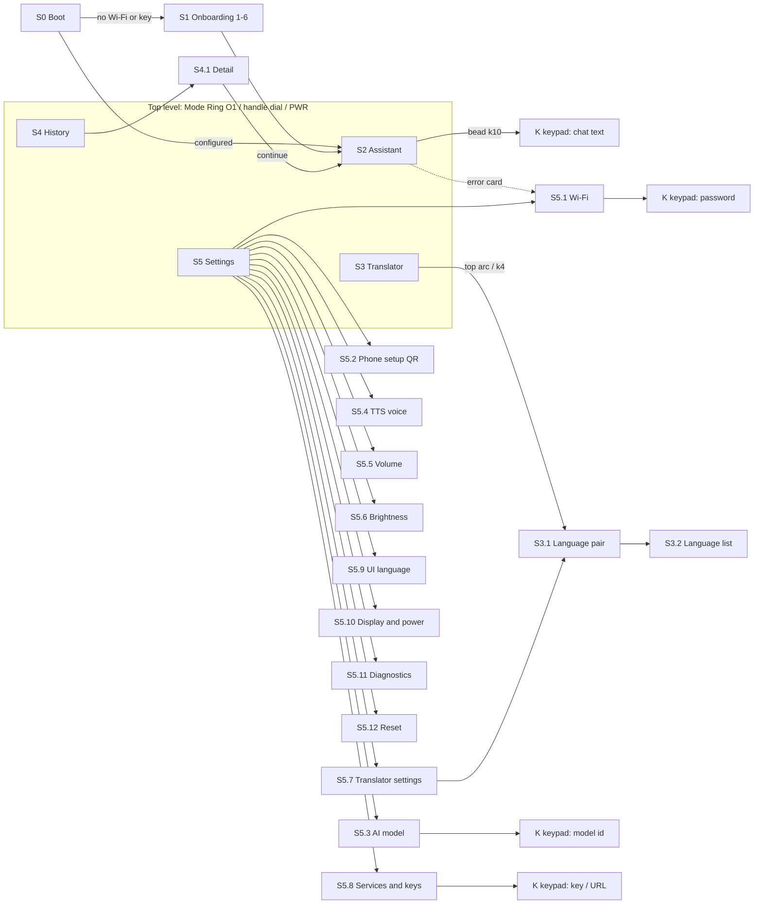

# Round AI Assistant: UI/UX Specification, concept "RIM" (rim-centric)

*Version 1.0, 2026-10-17. Target: Waveshare ESP32-S3-Touch-LCD-1.85 rev 2.1 (360×360 ST77916 over QSPI, CST816T single touch). Software: ESP-IDF 6.1, esp_lvgl_port 2.9, LVGL 9.5.x. Rendering: PARTIAL mode with two 360×40 RGB565 draw buffers in internal DMA RAM; everything else in the 8 MB PSRAM.*

> This is a design spec; none of it has been checked on hardware yet. Values marked *est.* are planning estimates. Replace them with measurements before tuning (see §9). Corrections from `docs/research/stack_2026-10-17.json` (the `verify:*` entries) have been applied throughout: no `clip_corner` on the root, no full-screen FADE/MOVE, no TE/FULL mode, popovers clip at the rim, `lv_roller` INFINITE does not suit long lists, and subjects are wrapped for 9.6.

---

## 0. Concept

The screen works like a watch with a **virtual touch bezel**. The outer ring (radius ≥ 130 px) is one persistent **rim layer**. It owns navigation, status, controls and the animated voice "halo". The inner disc is a quiet **content window** for chat, lists, the keypad and the QR code. Every screen uses the same **rim grammar**:

- **top arc**: context (status, title, typed text);
- **bottom arc**: the screen's main action (switch mode, cancel, space);
- **left**: back;
- **four diagonal beads**: secondary actions;
- **sliding a finger along the edge**: scroll or adjust a value.

The content disc never uses horizontal swipes. Chat scrolling and hold-to-talk therefore cannot clash with navigation.

### 0.1 Decisions at a glance

| # | Topic | Decision | Reason |
|---|---|---|---|
| D1 | Navigation | Rim grammar plus a radial **Mode Ring**. No tileview, no swipes on content. | Content gestures (scroll, hold-to-talk) never compete with navigation. |
| D2 | Who owns a touch | One custom `rim` object on `lv_layer_top()` with `LV_OBJ_FLAG_ADV_HITTEST`. It claims presses at r ≥ 130 px; everything else goes to content. | The split is by place, so one gesture recogniser handles the whole rim. |
| D3 | Circular mask | On voice screens the rim paints an opaque ring from r 134 to 180. `clip_corner` is never used. | Verified: `clip_corner` with radius 180 renders the whole screen through ARGB8888 layers. |
| D4 | Voice state | A "Halo" on the rim (18 radial bars, a ping-pong comet, a progress arc) plus a small puck in the disc. | Each frame invalidates ≤ 25k px. |
| D5 | Push-to-talk | The on-screen puck and BOOT work the same way: tap = toggle, hold ≥ 300 ms = hold-to-talk. Recording starts on press. | One mental model; the first syllable is never lost. |
| D6 | Translator | Split disc: the owner's half at the bottom, the partner's half at the top (rotated 180°), one puck each. The model's language detection wins over the half that was pressed. BOOT = fully automatic. | Reliable direction, and each person reads face to face. |
| D7 | Keyboard | **Halo Keypad**: a 3×3 phone-style grid of letter groups in the disc, a choice bar for picking the letter, 7 control keys on the rim, and the typed text along the top arc. | All targets ≥ 50 px; all 33 Russian letters visible; fits the circle's capacity (§5.1). |
| D8 | Long secrets | A phone portal (SoftAP + two QR codes) is the main way to enter the Wi-Fi password and API key. | A 73-character key at 2 taps per character is about 150 taps. |
| D9 | Transitions | Instant `lv_screen_load()`, motion only on small elements, plus a "rim sweep". | Verified: FADE and MOVE push a full frame on every step. |
| D10 | Fonts | Inter (OFL 1.1) at 14/18/20/28 px plus 40 px digits, 4 bpp. FontAwesome 5 Free icons merged into the 14/18/20 px fonts, plus a 32 px icon font. | Covers Cyrillic, Latin-1 and Latin Ext-A in about 150 KB of flash. |

---

## 1. Geometry system

### 1.1 Coordinates and radii

- Origin is top-left. Centre **C = (180, 180)**.
- Polar coordinates (r, θ): x = 180 + r·cos θ, y = 180 + r·sin θ.
- **θ = 0° at 3 o'clock and increases clockwise.** This matches lv_arc and lv_arclabel. So 12 o'clock = 270°, 6 o'clock = 90°, 9 o'clock = 180°.

| Name | r (px) | Meaning |
|---|---|---|
| R_EDGE | 180 | physical edge of the glass |
| R_SAFE | 168 | nothing important lies beyond this (12 px rim margin) |
| RIM_OUT | 166 | outer edge of rim visuals |
| RIM_MID | 151 | centre line for rim text, beads and the comet |
| RIM_IN | 136 | inner edge of rim visuals |
| R_WINDOW | 134 | radius of the content window on FULL-profile screens (the band is painted from 134 to 180) |
| R_TOUCH | 130 | a press at r ≥ 130 goes to the rim recogniser; r < 130 goes to content |

### 1.2 Chord widths

- Full circle: **w(d) = 2·√(168² − d²)**.
- Content window: w_W(d) = 2·√(134² − d²).
- Inner touch disc: w_T(d) = 2·√(130² − d²).
- For a rectangle spanning y1..y2, take d = max(|y1−180|, |y2−180|). That is the limiting chord at the rectangle's outer corner.

| d | 0 | 20 | 30 | 40 | 50 | 60 | 70 | 80 | 90 | 100 | 110 | 120 | 130 | 140 | 150 | 160 |
|---|---|---|---|---|---|---|---|---|---|---|---|---|---|---|---|---|
| w(d) | 336.0 | 333.6 | 330.6 | 326.3 | 320.8 | 313.8 | 305.4 | 295.5 | 283.7 | 270.0 | 254.0 | 235.2 | 212.8 | 185.7 | 151.3 | 102.4 |
| w_W(d) | 268.0 | 265.0 | 261.2 | 255.8 | 248.6 | 239.6 | 228.5 | 215.0 | 198.6 | 178.4 | 153.0 | 119.3 | – | – | – | – |
| w_T(d) | 260.0 | 256.9 | 253.0 | 247.4 | 240.0 | 230.7 | 219.1 | 204.9 | 187.6 | 166.1 | 138.6 | 100.0 | – | – | – | – |

### 1.3 Rim slots

The rim has 12 slots of 30°. Slot k (k = clock hour, k0 = 12 o'clock) is centred at θk = (270 + 30·k) mod 360. Bead centres sit at r = 150.

| k | θ | bead centre | k | θ | bead centre |
|---|---|---|---|---|---|
| 0 | 270° | (180, 30) | 6 | 90° | (180, 330) |
| 1 | 300° | (255, 50) | 7 | 120° | (105, 310) |
| 2 | 330° | (310, 105) | 8 | 150° | (50, 255) |
| 3 | 0° | (330, 180) | 9 | 180° | (30, 180) |
| 4 | 30° | (310, 255) | 10 | 210° | (50, 105) |
| 5 | 60° | (255, 310) | 11 | 240° | (105, 50) |

- **Bead visual:** a circle Ø36 spanning r 132–168, filled `bg.raised`, with a 20 px icon.
- **Bead touch area:** the whole sector θk ± 15° at r ≥ 130. That is 50 px deep (out to the glass edge, which acts as a Fitts edge) by 68 px (inner) to 94 px (outer) wide.
- The visible bead may be smaller than its touch area; Wear OS guidance allows this.

### 1.4 Rim grammar (applies to every screen)

| Region | Angles | Role |
|---|---|---|
| Top arc | k11–k1 (225°–315°) | **Context**: status, title, voice state or typed text. Tap = context action (Quick panel on top-level screens). |
| Bottom arc | 60°–120° (up to 45°–135°) | **Main action**: mode handle (top level), Cancel (voice active), Space (keypad), primary action (sub-screens). |
| Left (k9) | 165°–195° | **Back** on sub-screens. Swiping inward from here also means back. |
| Diagonals k2, k10, k4, k8 | ±15° each | Secondary actions, at most 4 per screen. |
| Right (k3) | 330°–30° | Scroll-position indicator: a 3 px arc at r = 172. |
| Anywhere else | – | **Turning the bezel** (sliding along the edge) scrolls or adjusts. |

A "left-handed" setting mirrors k2↔k10, k4↔k8 and k3↔k9.

### 1.5 Constants (`ui_geom.h`)

```c
#define UI_CX 180
#define UI_CY 180
#define UI_R_SAFE 168
#define UI_R_WINDOW 134
#define UI_R_TOUCH 130
#define UI_RIM_IN 136
#define UI_RIM_MID 151
#define UI_RIM_OUT 166
#define UI_BEAD_R 150
#define UI_BEAD_D 36
#define UI_SLOT_DEG(k) ((270 + 30 * (k)) % 360)
#define UI_HALO_R_IN 140
#define UI_HALO_LEN_MIN 4
#define UI_HALO_LEN_MAX 26
#define UI_HALO_W 6
#define UI_PUCK_X 180
#define UI_PUCK_Y 278
#define UI_PUCK_D 64
#define UI_ORB_Y 160
#define UI_ORB_D 112
#define UI_LIST_W 264
#define UI_ITEM_H 56
#define UI_ITEM_PITCH 60
#define UI_HOLD_MS 300
#define UI_LONG_MS 500
#define UI_TAP_SLOP_PX 10
#define UI_BEZEL_START_DEG 10
```

---

## 2. Visual language

### 2.1 Palette (dark; RGB565-checked)

The "RGB565 shows as" column is the colour after 5-6-5 quantisation. The two backgrounds stay distinct after quantisation. Large surfaces use solid tints, never runtime opacity.

| Token | Hex | RGB565 shows as | Use |
|---|---|---|---|
| `bg.rim` | #05070A | #000408 | rim band (bezel), overlay backgrounds |
| `bg.core` | #0B0F14 | #080C10 | screen/content background |
| `bg.raised` | #141B24 | #101821 | beads, keys, cards, user pill |
| `bg.raised2` | #1E2936 | #182831 | pressed keys, focused list pill |
| `line` | #223042 | #213042 | hairline at r = 134, arc tracks, dividers |
| `text.primary` | #E9EEF5 | #EFEFF7 | main text |
| `text.secondary` | #9AA7B8 | #9CA6BD | user transcript, captions |
| `text.tertiary` | #5D6B7E | #5A697B | disabled text, hints |
| `acc.assistant` | #38BDF8 | #39BEFF | Assistant mode accent |
| `acc.translator` | #C6F432 | #C6F731 | Translator mode accent |
| `acc.history` | #E3A3FF | #E7A2FF | History mode accent |
| `acc.settings` | #A7B4C6 | #A5B6C6 | Settings mode accent |
| `st.listen` | #FF4F6D | #FF4D6B | recording |
| `st.think` | #8B7CFF | #8C7DFF | uploading / thinking |
| `st.speak` | #22D3B6 | #21D3B5 | speaking |
| `st.warn` | #FFB547 | #FFB642 | recoverable errors, low battery |
| `st.error` | #FF5C5C | #FF5D5A | fatal errors, destructive confirm |
| `st.ok` | #4ADE80 | #4ADF84 | success |
| `tint.assistant` | #10242F | – | 12 % accent on `bg.core`, e.g. focused chips |
| `tint.translator` | #212A18 | – | same, for Translator |
| `tint.warn` | #28231A | – | warning card background |
| `tint.error` | #28181D | – | error card background |
| `tint.listen` | #28171F | – | cancel bead when armed |
| `qr.light` / `qr.dark` | #F2F5F8 / #000000 | – | QR plate and modules |

Each mode accent colours: the mode-handle text, the idle puck ring, the focus pill outline, and the rim sweep when switching modes. State colours override the mode accent while a voice state is active.

### 2.2 Typography

**Font:** Inter 4.x static TTFs (Inter-Regular, Inter-SemiBold), SIL OFL 1.1. lv_font_conv needs static TTFs, not the variable font. All fonts are 4 bpp with `--no-compress` (faster rendering; flash is plentiful).

| Style | Font object | Face / size | Line height | Used for |
|---|---|---|---|---|
| `T_RIM` | `font_ui_14` | SemiBold 14, letter_space 1, CAPS strings | 18 | rim arclabels, captions, timers, chips |
| `T_BODY` | `font_ui_18` | Regular 18 | 24 | chat text, descriptions, keypad group labels, translator text |
| `T_TITLE` | `font_ui_20` | SemiBold 20 | 26 | list titles, buttons/pills, bead and rim-key icons |
| `T_HEAD` | `font_ui_28` | SemiBold 28 | 34 | headings, choice-bar letters, digit keys, Mode Ring centre |
| `T_NUM` | `font_num_40` | SemiBold 40, tabular digits | 44 | volume/brightness %, big timers |
| `T_ICON32` | `font_icon_32` | FontAwesome 5 Solid 32 | – | puck/orb icon, Mode Ring sectors |

**Glyph ranges**

```
R_TEXT  = 0x20-0x7E,0xA0-0xFF,0x100-0x17F,0x400-0x45F,0x490-0x491,
          0x2010-0x2027,0x2030,0x2039-0x203A,0x2116,0x20AC,0x20BD,0x2190-0x2193,0x2212
          # ASCII, Latin-1, Latin Ext-A (pl/cs/ro/hu/tr/de/fr/es…),
          # Cyrillic incl. Ёё, Ґґ, Єє, Іі, Її, Ўў; dashes, quotes „“”«»,
          # ellipsis, bullet, ‰, ‹›, №, €, ₽, arrows, minus
R_HEAD  = 0x20-0x7E,0xC0-0xFF,0x401,0x410-0x44F,0x451,0x2014,0x2026
R_NUM   = 0x20,0x25,0x2B-0x2E,0x30-0x3A,0xB0,0x2212
FA_SET  = 0xF00C,0xF00D,0xF011,0xF013,0xF021,0xF023,0xF026-0xF029,0xF04B,0xF04D,0xF053,0xF054,
          0xF05A,0xF062,0xF067,0xF06E,0xF070,0xF071,0xF075,0xF077,0xF078,0xF084,0xF093,0xF0AC,
          0xF0C0,0xF0E7,0xF11C,0xF130,0xF131,0xF185,0xF1AB,0xF1DA,0xF1DE,0xF1EB,0xF240-0xF244,
          0xF2ED,0xF35B,0xF362,0xF3CD,0xF544,0xF55A,0xF6A9            # 48 icons
FA_BIG  = 0xF130,0xF131,0xF04D,0xF093,0xF00C,0xF071,0xF544,0xF1AB,0xF1DA,0xF013,0xF028,0xF185,0xF029,0xF0C0
```

**Generation** (run later on the dev PC). `FontAwesome5-Solid+Brands+Regular.woff` is the file LVGL uses in `scripts/built_in_font/`.

```
lv_font_conv --bpp 4 --size 14 --no-compress --no-kerning --format lvgl --lv-font-name font_ui_14 \
  --font Inter-SemiBold.ttf -r <R_TEXT> --font FontAwesome5-Solid+Brands+Regular.woff -r <FA_SET> -o font_ui_14.c
lv_font_conv --bpp 4 --size 18 --no-compress --format lvgl --lv-font-name font_ui_18 \
  --font Inter-Regular.ttf  -r <R_TEXT> --font FontAwesome5-Solid+Brands+Regular.woff -r <FA_SET> -o font_ui_18.c
lv_font_conv --bpp 4 --size 20 --no-compress --format lvgl --lv-font-name font_ui_20 \
  --font Inter-SemiBold.ttf -r <R_TEXT> --font FontAwesome5-Solid+Brands+Regular.woff -r <FA_SET> -o font_ui_20.c
lv_font_conv --bpp 4 --size 28 --no-compress --format lvgl --lv-font-name font_ui_28 \
  --font Inter-SemiBold.ttf -r <R_HEAD> -o font_ui_28.c
lv_font_conv --bpp 4 --size 40 --no-compress --format lvgl --lv-font-name font_num_40 \
  --font Inter-SemiBold.ttf -r <R_NUM> -o font_num_40.c
lv_font_conv --bpp 4 --size 32 --no-compress --format lvgl --lv-font-name font_icon_32 \
  --font FontAwesome5-Solid+Brands+Regular.woff -r <FA_BIG> -o font_icon_32.c
```

**Flash budget (est.)**, scaled from the measured 4 bpp Montserrat sizes in the research:

| Font | Glyphs | Size |
|---|---|---|
| font_ui_14 | ~500 | ~27 KB |
| font_ui_18 | ~500 | ~38 KB |
| font_ui_20 | ~500 | ~45 KB |
| font_ui_28 | ~225 | ~35 KB |
| font_num_40 | ~20 | ~6 KB |
| font_icon_32 | ~14 | ~3 KB |
| **Total** | | **≈ 155 KB** |

**Text sanitiser.** All model output passes through `ui_text_sanitize()` before any label sees it:

- Markdown: strip `**`, `__`, `#`, backticks. Turn list markers `- ` / `* ` into `• `.
- Emoji: drop.
- Unknown code points: replace with nothing, and log them in dev builds.
- Set `LV_USE_FONT_PLACEHOLDER 0` so no boxes appear.
- Optional script packs for translator targets outside Latin/Cyrillic (CJK, Arabic, Devanagari, Thai) are `lv_binfont` files on the storage partition, loaded with `lv_binfont_create("S:/fonts/<pack>_18.bin")` and set as `font_ui_18.fallback`. Without a pack, the partner half shows "🔊 + language code" and the device only speaks the text.

### 2.3 Icons

- Icons are FontAwesome 5 Free Solid glyphs merged into the text fonts, so a label can mix icon and text (`UI_ICON_MIC "  Микрофон"`).
- Use LVGL's own macros where they exist: `LV_SYMBOL_OK` F00C, `CLOSE` F00D, `POWER` F011, `SETTINGS` F013, `REFRESH` F021, `MUTE` F026, `VOLUME_MID` F027, `VOLUME_MAX` F028, `PLAY` F04B, `STOP` F04D, `LEFT` F053, `RIGHT` F054, `PLUS` F067, `EYE_OPEN` F06E, `EYE_CLOSE` F070, `WARNING` F071, `UP` F077, `DOWN` F078, `UPLOAD` F093, `CHARGE` F0E7, `KEYBOARD` F11C, `WIFI` F1EB, `BATTERY_*` F240–F244, `TRASH` F2ED, `BACKSPACE` F55A.
- Define the rest yourself:

```c
#define UI_ICON_MIC        "\xEF\x84\xB0"  /* F130 */
#define UI_ICON_MIC_OFF    "\xEF\x84\xB1"  /* F131 */
#define UI_ICON_SHIFT      "\xEF\x81\xA2"  /* F062 arrow-up */
#define UI_ICON_CAPS       "\xEF\x8D\x9B"  /* F35B */
#define UI_ICON_KEY        "\xEF\x82\x84"  /* F084 */
#define UI_ICON_GLOBE      "\xEF\x82\xAC"  /* F0AC */
#define UI_ICON_SWAP       "\xEF\x8D\xA2"  /* F362 */
#define UI_ICON_FACE2FACE  "\xEF\x83\x80"  /* F0C0 users */
#define UI_ICON_TEXTONLY   "\xEF\x81\xB5"  /* F075 comment */
#define UI_ICON_ROBOT      "\xEF\x95\x84"  /* F544 */
#define UI_ICON_LANG       "\xEF\x86\xAB"  /* F1AB */
#define UI_ICON_HISTORY    "\xEF\x87\x9A"  /* F1DA */
#define UI_ICON_QR         "\xEF\x80\xA9"  /* F029 */
#define UI_ICON_PHONE      "\xEF\x8F\x8D"  /* F3CD */
#define UI_ICON_SUN        "\xEF\x86\x85"  /* F185 */
#define UI_ICON_INFO       "\xEF\x81\x9A"  /* F05A */
#define UI_ICON_SLIDERS    "\xEF\x87\x9E"  /* F1DE */
#define UI_ICON_VOL_MUTE   "\xEF\x9A\xA9"  /* F6A9; fall back to F026 if missing from the woff */
```

No images and no Lottie are used. Every graphic is a glyph or a primitive (arc, line, circle).

### 2.4 Shapes, spacing, elevation

- Spacing is on a 4 px grid: 4, 6, 8, 12, 16.
- Corner radii: pills radius = height/2; cards 16; keys 12; beads and puck LV_RADIUS_CIRCLE.
- Elevation comes only from colour steps (`bg.core` → `bg.raised` → `bg.raised2`) and 1–2 px outlines in the accent colour. **No shadows, no gradients** (RGB565 bands dark gradients, and gradients need COMPLEX_GRADIENTS).
- Minimum touch target in the disc is **50 × 50 px**. Rim sectors are ≥ 50 px deep and ≥ 68 px wide.

### 2.5 Motion principles

| Kind | Duration |
|---|---|
| micro (press feedback) | 90–160 ms |
| state change | 150–260 ms |
| spatial (orb dock, rim sweep) | 300–400 ms |
| loops | 900–2400 ms |

- Easing: `lv_anim_path_ease_out` for entrances, `ease_in` for exits, `ease_in_out` for loops and ping-pong, `overshoot` for confirmations, `linear` for progress.
- Continuous loops stop after 30 s without interaction, to save power on battery.
- Motion always stays inside small bounding boxes (§7).

---

## 3. The rim system

### 3.1 Rim profiles

| Profile | Screens | Band painted | Top arc | Bottom arc | Beads | Bezel turn |
|---|---|---|---|---|---|---|
| **FULL** | Assistant, Translator | yes: annulus r 134–180 in `bg.rim`, plus a 1 px `line` hairline at r = 134 | status, or voice state in words | mode handle, or ✕ while voice is active | k2 k4 k8 k10 | chat scroll; starting on the handle = mode dial |
| **LIST** | History, Settings, all pickers, Wi-Fi, diagnostics, onboarding | no (lists fade toward the edge) | screen title | mode handle (top level) or primary action (sub-screens) | k9 back + up to 3 | moves list focus 1 item per 15° |
| **KB** | keypad | no | typed text | Space (Digits: 0 + Space) | 7 rim keys (§5.4) | moves the cursor when started on the text arc |
| **MIN** | QR, volume, brightness, dialogs | no | title | caption or primary action | k9 back, optionally k3 | adjusts the value |

### 3.2 Architecture

- **`rim`** is one `lv_obj` of 360×360 at (0,0) on `lv_layer_top()`. It is not scrollable, has `bg_opa = 0`, and has `LV_OBJ_FLAG_ADV_HITTEST` set.
  - In the FULL profile its style is `border_width = 46`, `radius = LV_RADIUS_CIRCLE`, `border_color = bg.rim`. That border is the circular mask, at no extra cost.
  - Its `LV_EVENT_DRAW_MAIN` handler draws, in this order: the hairline, rim-key segments (KB), beads (Ø36 discs + icon via `lv_draw_label`), halo bars (`lv_draw_line`, round caps), comet and progress (`lv_draw_arc`), the bezel finger trail, and the scroll indicator.
  - It invalidates only computed boxes, via `lv_obj_invalidate_area(rim, &box)`.
- **Children of `rim`** (all `lv_arclabel`, `LV_USE_ARCLABEL 1`; available from LVGL 9.4):
  - `rim_top`: object 300×70 at (30, 6). Centre offset y = +139 puts the arc centre on C. Direction CLOCKWISE, radius 151, vertical align CENTER, `font_ui_14`.
  - `rim_bottom`: direction COUNTER_CLOCKWISE, so text reads upright at the bottom (the source rotates glyphs by angle − 90°).
  - `kb_text` and `kb_field_label`: keypad only.
  - The arclabel centre is the object centre plus `center_offset`, so band-shaped objects keep text redraws small.
  - The 9.5 setter takes `uint32_t`. A negative offset (bottom band) relies on the value being stored as int32 (§9). Fallback: a 360×360 object with offset 0; bottom text changes only ≤ 2×/s.
- **Overlays** are children of `lv_layer_top()` created *after* `rim`, so they sit above it and get hit-tested first: Mode Ring, Quick panel, keypad choice bar, full-text preview, dialogs, power ring.
- **Screens** are plain `lv_obj` screens with `bg.core`, `LV_OBJ_FLAG_SCROLLABLE` removed. The rim persists across `lv_screen_load()`; each screen calls `rim_apply(&cfg)` on `LV_EVENT_SCREEN_LOADED`.

```c
typedef struct {
  rim_profile_t profile;
  const char *top_text;
  const char *bottom_text;
  void (*bottom_cb)(void);
  rim_bead_t beads[12];        /* icon, tap_cb, long_cb, tooltip_str; NULL icon = empty */
  lv_obj_t *bezel_scroller;    /* chat or list container, or NULL */
  void (*bezel_value_cb)(int steps);
  uint16_t bezel_step_deg;     /* 15 lists, 10 sliders, 8 cursor, 0 = continuous */
} rim_cfg_t;

static void rim_hit_cb(lv_event_t *e) {
  lv_hit_test_info_t *hi = lv_event_get_hit_test_info(e);
  int32_t dx = hi->point->x - UI_CX, dy = hi->point->y - UI_CY;
  hi->res = (dx * dx + dy * dy >= UI_R_TOUCH * UI_R_TOUCH) && rim_profile_accepts(dx, dy);
}
lv_obj_add_flag(rim, LV_OBJ_FLAG_ADV_HITTEST);
lv_obj_add_event_cb(rim, rim_hit_cb, LV_EVENT_HIT_TEST, NULL);
lv_obj_add_event_cb(rim, rim_draw_cb, LV_EVENT_DRAW_MAIN, NULL);
lv_obj_add_event_cb(rim, rim_input_cb, LV_EVENT_ALL, NULL);   /* PRESSED / PRESSING / RELEASED / PRESS_LOST */
```

Beads and rim keys are *not* LVGL objects. The rim maps a touch angle to a sector and owns the press state of each sector. Angles come from `lv_atan2()`, called exactly as `lv_arc.c` calls it (0–359°, clockwise from 3 o'clock).

### 3.3 Rim gesture recogniser

One state machine, inside `rim_input_cb`.

| Press starts at | Movement before release | Result |
|---|---|---|
| a bead or rim-key sector | < 10 px and < 500 ms | **tap**: the sector's action (bead flashes `bg.raised2` + accent ring, 90 ms) |
| a bead | ≥ 500 ms, < 10 px | **long-press**: tooltip as a rim toast (e.g. "НОВЫЙ ЧАТ"), or the secondary action |
| anywhere except the mode handle | cumulative \|Δθ\| ≥ 10° before radial movement reaches 24 px | **bezel turn**: cancels any bead press, then scrolls or adjusts (below) |
| mode handle (60°–120°, top-level screens) | \|Δθ\| ≥ 10° | **mode dial**: opens the Mode Ring with the highlight following the finger angle; release selects |
| k9 sector (sub-screens) | moves inward ≥ 40 px with \|Δθ\| < 10° | **back swipe** |
| top arc (top-level) | tap | Quick panel (O2) |

What one bezel step does:

| Target | Step | Effect |
|---|---|---|
| list | 15° | `lv_obj_scroll_by_bounded(list, 0, ∓60, LV_ANIM_ON)`; snap keeps the focus centred; faster than 180°/s gives 2 items per step |
| chat | continuous | scroll distance = arc length (Δθ_rad × 150 px), `LV_ANIM_OFF` |
| slider | 10° | ±5 % |
| cursor | 8° | ±1 character |

Turning clockwise = next / down / increase, as on Galaxy Watch.

**Feedback:** a 20° trail arc (accent colour, 4 px wide, opa 160) follows the finger at r = 174 (decorative, outside R_SAFE). Each step flashes a 6×12 tick for 120 ms. When sounds are on and a speaker is present, a 10 ms click plays.

**Touch rate:** `lv_timer_set_period(lv_indev_get_read_timer(indev), 16)`. Long-press time: `lv_indev_set_long_press_time(indev, 500)`.

### 3.4 Halo geometry

The halo is a **horseshoe open at the bottom**, where Cancel lives, and centred over the top.

| Element | Geometry | Drawing |
|---|---|---|
| Bars (listening, speaking) | 18 bars at θ = 135°, 150°, …, 255°, 285°, …, 45° (15° steps, skipping 270°, which holds the timer). Each runs from r = 140 to 140 + L, L ∈ [4, 26] px, 6 px wide, round caps. | `lv_draw_line`, one invalidated box per bar (≤ 32×32 px) |
| Comet (thinking) | radius 151 (`dsc.radius = 154`, width 6). Head 36° at opa 255, tail 3 × 12° at opa 160 / 90 / 40. Ping-pongs along 135° → (top) → 45°. | `lv_draw_arc`; invalidate 3–4 boxes covering old ∪ new |
| Progress (upload, hold-to-confirm) | radius 151, width 4, from 135° clockwise, sweep = 270° × pct | `lv_draw_arc`; invalidate only the newly added segment |
| Cancel bead | k6 (180, 330), Ø36, `st.listen` icon ✕; Ø44 and `tint.listen` fill when armed by a slide | rim bead |
| State text | top arc: timer "0:07", "ОТПРАВКА 64%", "ДУМАЮ", "ОТВЕЧАЮ", "ГОВОРЮ", or error text | `rim_top` arclabel |

**Bar level pipeline:**

1. The audio task writes `_Atomic uint16_t g_level` (RMS mapped to dBFS → 0..1000) every 20 ms.
2. An `lv_timer` at 33 ms reads it and smooths it (attack 0.5, release 0.12).
3. Per-bar length: L_i = 4 + 22 · level · (0.65 + 0.35·sin(φ_i + t·2π/1.6 s)).
4. A box is invalidated only if its L changed by ≥ 1 px.

### 3.5 Overlays

| ID | Overlay | Geometry | Open / close |
|---|---|---|---|
| **O1 Mode Ring** | Opaque full-circle `bg.rim`. Four sectors (band r 106–166): Assistant 228°–312°, Translator 318°–42°, History 48°–132°, Settings 138°–222°. Each sector has `bg.raised` fill and a 32 px icon at r = 136. The current mode gets a `tint.*` fill and a 2 px accent outline. Centre: the highlighted mode name (T_HEAD, y 150–184) and a one-line description (T_RIM, y 190–206). | Opens on a tap of the mode handle, PWR short press on a top-level screen, or a handle dial gesture. Touch at r ≥ 70 = sector by angle; r < 70 = close. PWR = close. BOOT = close and start PTT. |
| **O2 Quick panel** | Opaque circle. **Volume** arc on the right: `lv_arc` 320×320 at (20, 20), `bg_angles(300, 60)`, `LV_ARC_MODE_REVERSE`, so it fills upward from 5 o'clock. **Brightness** arc on the left: `bg_angles(120, 240)`, NORMAL, fills upward from 7 o'clock. Both: arc width 14, knob Ø26, track `line`. Centre pills 200×52: "Только текст" at y 128–180, "Экран выкл." at y 188–240. Info line (T_RIM) at y 250–266: "HomeNet · 87%". While dragging, the centre shows T_NUM "70%". | Opens on a tap of the top arc. Bezel turn on the right half = volume, left half = brightness. A knob drag sets the absolute value. PWR, or a tap at r < 60 outside the pills, closes it. |
| **O3 Rim toast** | Replaces the `rim_top` text for 2.5 s in st.ok / st.warn / st.error / text.secondary, over a 90° tint segment (225°–315°, r 136–166). | auto |
| **O4 Dialog** | Centre card: title T_TITLE at y 120–146, body T_BODY at y 150–200 (max 2 lines, width 236). Confirm pill 160×52 at y 212–264. Cancel = k9 bead / PWR. Destructive actions are **hold-to-confirm**: hold the pill 1.5 s while a progress ring fills on the rim. | – |
| **O5 Power ring** | Opens on PWR held ≥ 600 ms. Centre "Выключение" (T_TITLE). A ring fills 0→360° over 1500 ms (`st.error`, width 8, r 151). Releasing early cancels; completion drives GPIO7 low. | – |
| **O6 Full-text preview** | Keypad: the whole text in a 236 px wide T_BODY label (≤ 6 lines) in the centre. A k6 eye bead toggles masking. | Tap anywhere or PWR closes it. |

---

## 4. Screens and navigation

### 4.1 Inventory

| ID | Screen | Profile | Lifetime |
|---|---|---|---|
| S0 | Boot splash | MIN (no touch) | deleted |
| S1.1–S1.6 | Onboarding: language, how to talk, network, API key, audio check, done | LIST | deleted |
| S2 | Assistant (empty orb, or chat) | FULL | cached |
| S3 | Translator | FULL | cached |
| S3.1 / S3.2 | Language pair / language list | LIST | deleted |
| S4 / S4.1 | History list / conversation detail | LIST | deleted |
| S5 | Settings list | LIST | deleted |
| S5.1 | Wi-Fi scan list (+ network details) | LIST | deleted |
| S5.2 | Phone setup (SoftAP + QR) | MIN | deleted |
| S5.3 | AI model picker | LIST | deleted |
| S5.4 | TTS model and voice picker | LIST | deleted |
| S5.5 / S5.6 | Volume / Brightness | MIN | deleted |
| S5.7 | Translator settings (pair, voices per language) | LIST | deleted |
| S5.8 | Services and keys (chat / STT / TTS endpoint, key) | LIST | deleted |
| S5.9 | UI language | LIST | deleted |
| S5.10 | Display and power (timeout, handedness, UI sounds) | LIST | deleted |
| S5.11 | Diagnostics / About (incl. firmware slot and rollback) | LIST | deleted |
| S5.12 | Factory reset (O4, hold-to-confirm) | – | – |
| K | Halo Keypad (text, password, key, URL, model id, SSID) | KB | deleted |
| O1–O6 | Overlays (§3.5) | – | on demand |
| E | Error cards and states (§4.17) | in context | – |

### 4.2 Navigation map



Navigation is a stack (max depth 4). Selecting a top-level mode clears the stack.

### 4.3 Moving between modes, and why nothing conflicts

**Ways to switch:**

1. Tap the mode handle, then tap a sector of the Mode Ring (2 taps).
2. Mode dial: press the handle and slide along the rim to the target sector, then release (1 stroke).
3. PWR short press on a top-level screen opens the Mode Ring.
4. **BOOT from any screen** jumps to the Assistant and starts listening ("voice anywhere"). In the Translator, BOOT is the automatic PTT.
5. Back: PWR short press, the k9 bead, or an inward swipe from k9.

**Physical buttons**

| Button | Short press (< 600 ms) | Hold | Notes |
|---|---|---|---|
| BOOT (GPIO0, active low, internal pull-up, 30 ms debounce) | PTT tap (toggle) | ≥ 300 ms = hold-to-talk | In the keypad: hold = dictate into the field (online only; not for password/key/URL). It is a strapping pin, so the onboarding warns: "Не удерживайте BOOT при включении". |
| PWR (GPIO6, active low) | Back / open or close the Mode Ring / cancel recording | ≥ 600 ms = O5 power ring | Double press = screen off. Ignore PWR until it has been released once after boot, because the power-on press is still held. |

**Why there is no conflict:**

- **Touches are split by place.** `rim` claims r ≥ 130 through its hit test; the disc gets r < 130.
- **The pressed object keeps the gesture.** LVGL leaves an ongoing press on the object that received it (default `LV_OBJ_FLAG_PRESS_LOCK`). A chat scroll that drifts into the rim stays a scroll, and a bezel turn that drifts inward stays a bezel turn.
- **No horizontal gestures in content.** There is no tileview and no `LV_EVENT_GESTURE` handling. Content only scrolls vertically, taps, and long-presses on the puck.
- **The puck is outside the chat.** It is a sibling of the chat container on a non-scrollable screen, so holding it can never scroll the chat.
- **Mode changes are hard to trigger by accident.** They need a press that starts on the bottom handle, or a hardware button.

### 4.4 S0 Boot splash (≤ 1.2 s)

- An accent arc sweeps 0→360° at r 151 (600 ms, ease_out, drawn incrementally).
- Centre: device name, T_HEAD at y 163–197 (placeholder "Orb"; configurable).
- `rim_bottom` shows "v0.3.1 · OTA_0".
- If the image is in PENDING_VERIFY: "ПРОВЕРКА ОБНОВЛЕНИЯ…". After a bootloader rollback, toast "ВОЗВРАТ К v0.3.0".

### 4.5 S1 Onboarding (6 steps)

Shared layout:

| Element | Geometry | Fit check |
|---|---|---|
| Title (T_HEAD) | y 76–110, centred, ≤ 240 px | w(104) = 264 ✓ |
| Body (T_BODY, ≤ 3 lines) | y 118–190, width 260, centred | w(62) = 312 ✓ |
| Primary pill | 240×56 at (60, 204) | corner (60, 260) → r 144 ✓ |
| Secondary pill | 160×52 at (100, 268) | corner (100, 320) → r 161 ✓ |
| Progress dots | 6 × Ø8 at r 151, θ = 75°, 81°, …, 105° (current dot accent, done dots `text.secondary`) | – |
| Rim top | "ШАГ n ИЗ 6" | – |
| Back | k9 bead from step 2 | – |

| Step | Title | Body | Primary | Secondary |
|---|---|---|---|---|
| 1 | "Язык · Language" | – | "Русский" | "English" (pill style is the same; layout pills at y 150–206 and 214–270) |
| 2 | "Как говорить" | "Удерживайте круг или кнопку BOOT и говорите. Отпустите — я отвечу." A live mini puck demo plays (tap it to try the mic). | "Далее" | – |
| 3 | "Wi-Fi" | "Удобнее с телефона: там же вводится ключ API." | "С телефона" → S5.2 | "Здесь" → S5.1 |
| 4 | "Ключ OpenRouter" (skipped if received from the phone) | – | "С телефона" | "Ввести здесь" → K (API_KEY) |
| 5 | "Проверка звука" | Mic: "Скажите что-нибудь", live halo bars, then "Микрофон ✓". Speaker: a chime plays, then "Слышно?" | "Да" | "Нет динамика" → `S_SPEAKER_PRESENT = 0`, text-only default; tip about the hardware volume button |
| 6 | "Готово!" | "Удерживайте круг, чтобы говорить." | "Начать" → S2 | – |

Step 4 validates the key with `GET /api/v1/key`: success → toast "КЛЮЧ ПРИНЯТ" (plus "лимит $X" if the key has one); HTTP 401 → st.error "КЛЮЧ НЕ ПОДХОДИТ".

### 4.6 S2 Assistant (FULL)

**Rim layout (idle)**

```
                    k0  status: 14:05 · wifi · 87%  (tap = Quick panel)
          k11 ──────────────────────────────── k1
   k10 [keyboard]                               [voice/text]  k2
 k9 (none)                                          (scroll rail) k3
   k8 [new chat]                                [↓ newest]    k4   (only when scrolled up)
          k7 ────────  ‹ АССИСТЕНТ ›  ──────── k5      bottom arc = mode handle
                    k6
```

**Disc, empty state** (new session):

| Element | Geometry |
|---|---|
| Orb core | Ø112 at (124, 104), centre (180, 160), `bg.raised`, `font_icon_32` mic icon in `text.primary` |
| ring1 | Ø128, 2 px border, accent at opa 120 |
| ring2 | Ø148, 1 px border, accent at opa 60 |
| Touch | Ø128 (ext click 8 px) |
| Hint line 1 (T_BODY, `text.secondary`) | "Удерживайте круг" at y 240–264 (w_W(84) = 209 ✓) |
| Hint line 2 | "или кнопку BOOT" at y 264–288 (w_W(108) = 159 ✓) |

**Disc, conversation state**

| Element | Geometry / style |
|---|---|
| Chat viewport | x 46–314, y 46–242 (268×196). Flex column, `scroll_dir VER`, scrollbar off, `SCROLL_ELASTIC` off, pad_left/right 16, pad_top 60, pad_bottom 8, pad_row 12 |
| Assistant message | `lv_label`, width 236 (x 62–298), T_BODY, `text.primary`, left aligned, no background |
| User message | pill: `bg.raised`, radius 14, pad 8/12, max width 200, right edge x = 298, T_BODY, `text.secondary` |
| System / error card | 236 wide, `tint.warn` or `tint.error`, 1 px border in st.warn / st.error, radius 16. Contents: icon + title (T_BODY) + action pill 180×52 |
| Puck | Ø64 at (148, 246), centre (180, 278); ext click 4 → Ø72 touch. Lowest point at r = 130, so it does not overlap rim touch. |
| Puck ring | Ø76, 2 px border, accent (idle breathing) |
| Pulse ring | Ø64→88 outline (listening) |

- **Fit:** 236 px lines fit the window for y ≥ 118 (w_W(62) = 237.6). The band masks anything above that.
- **Fade rule** (`LV_EVENT_SCROLL`): child opa = 255 if its centre y ≥ 130; linear down to 0 at y = 70.
- **Message limit:** keep **20** messages on screen (xiaozhi uses the same limit on S3). Older ones stay only in the History store.

**Beads:**

| Bead | Icon | Action |
|---|---|---|
| k2 | volume-up ↔ comment | text-only toggle (§6.4) |
| k10 | keyboard | type a message → K (CHAT_TEXT) |
| k8 | sync | new chat (orb undocks, chat clears to History) |
| k4 | chevron-down | shown when not at the bottom; jumps to newest (`LV_ANIM_ON`) |

While a voice state is active, the chrome (status, beads, handle) fades out, the halo appears, and the ✕ bead shows at k6 (§6).

### 4.7 S3 Translator (FULL)

| Element | Geometry |
|---|---|
| Top puck (language B, partner) | Ø60, centre (180, 80) (y 50–110); label "EN" (T_TITLE) rotated 180° in face-to-face mode |
| Partner panel | 220×66 at (70, 112): 3 lines of T_BODY, centred, long mode dots. `transform_rotation 1800` in face-to-face mode. Corner (70, 112) → r 129.3 ✓, so it never overlaps the halo boxes (§7). |
| Divider | 1 px `line`, x 64–296 at y 180; a 2 s "авто: EN" chip (T_RIM) can appear centred on it |
| Owner panel | 220×66 at (70, 182) |
| Bottom puck (language A, owner) | Ø60, centre (180, 280) (y 250–310) |
| Rim top | language B name, **COUNTER_CLOCKWISE**, so it is upright for the partner across the table (glyph rotation = angle − 90° = 180° at the top). Accent colour. Tap → S3.1. |
| Rim bottom | mode handle "‹ ПЕРЕВОДЧИК ›" |

**Beads:**

| Bead | Icon | Action |
|---|---|---|
| k10 | exchange | swap A and B |
| k2 | users | face-to-face on/off (rotates the partner half) |
| k8 | comment | text-only |
| k4 | globe | S3.1 |
| k3 | – | amber Wi-Fi or key warning, only when relevant |

**Content rule:** each half always shows text in *its own* language.

- After the owner speaks: owner panel = owner transcript (`text.secondary`); partner panel = translation (`text.primary`). The B voice speaks it.
- After the partner speaks: the reverse.
- The full text goes to History.

Empty placeholders: partner panel "🎤 EN" (icon + code, no UI strings in third languages); owner panel "🎤 Русский — удерживайте".

### 4.8 S3.1 Language pair and S3.2 Language list

**S3.1**

| Element | Geometry |
|---|---|
| Caption "СОБЕСЕДНИК" (T_RIM) | y 80–96 |
| Pill B | 240×52 at (60, 100), T_TITLE |
| Swap button | Ø52 centred at (180, 180) |
| Pill A | 240×52 at (60, 208) |
| Caption "Я ГОВОРЮ" | y 264–280 |

- Pill corners (60, 100) and (60, 260) → r 144 ✓.
- Rim: top "ЯЗЫКИ", k9 back.

**S3.2** is a standard list (§4.9) of 24 curated languages: ru, en, de, fr, es, it, pt, pl, uk, tr, nl, sv, fi, cs, ro, hu, zh, ja, ko, ar, hi, vi, th, id. Names are shown in the UI language.

- The focus caption names the voice that will speak: "голос: ru-RU-Masha (MAI)", or "нет голоса — только текст".
- Languages without a glyph pack carry a "🔊" marker (spoken only).

### 4.9 Generic list (used by every LIST screen)

| Element | Geometry / style |
|---|---|
| Container | x 48–312, y 24–336 (264×312). Flex column, `scroll_snap_y CENTER`, scrollbar off, elastic off, pad_top = pad_bottom = 128, pad_row 4. **No `clip_corner`.** |
| Item | 264×56, pitch 60. Unfocused: title only, T_TITLE centred, max text width 216 (dots), opa by distance d of its centre: 0 → 255, 60 → 170, 120 → 60, ≥ 150 → 0 |
| Focused item (nearest y = 180, `LV_STATE_CHECKED`) | pill `bg.raised2`, radius 28, 1 px outline in the mode accent. Title at y + 8; caption (T_RIM sentence case, `text.secondary`, ≤ 216 px) at y + 32 |
| Leading icon | merged glyph inside the title string: `UI_ICON_* "  " title` |

- **Visible items:** focus (y 152–208), ±1 (92–148 / 212–268), ±2 (32–88 / 272–328).
- **Fit:** text of the ±1 items fits w(88) = 286. The ±2 items are at opa 60, and their ends may fall outside w(148) = 159.
- **Taps:** an item with |d| ≤ 90 activates on tap. Tapping ±2 scrolls it to the focus position instead.
- **Rim:** top = title. Bottom = mode handle on S4/S5, otherwise the screen's primary action. k9 = back on sub-screens. Bezel = 1 item per 15°.
- **Entry animation:** "list cascade" (§7, A17).

### 4.10 S4 History and S4.1 Detail

- **S4 items:** first user transcript, ≤ 24 characters ("Какая погода завтра…"). Caption: "сегодня 14:05 · 3 реплики", with a ⇄ glyph for translator sessions.
- **S4 beads:** k2 trash = delete all (O4 hold-to-confirm).
- **Storage:** the last 50 sessions in PSRAM, persisted as JSON lines on the storage partition (or SD).
- **S4.1:** a read-only chat column, styled like S2 but using the LIST layout (container x 52–308, y 24–336).
  - Beads: k9 back, k2 play (repeat the last reply with TTS), k10 comment ("Продолжить": loads the session as context into S2), k4 trash (hold-to-confirm).

### 4.11 S5 Settings list

| # | Title (icon) | Focus caption example |
|---|---|---|
| 1 | Wi-Fi (wifi) | "HomeNet · −58 dBm" / "не подключено" |
| 2 | Настройка с телефона (mobile) | "QR: Wi-Fi, ключ, модели" |
| 3 | Модель ИИ (robot) | "Gemini 3.1 Flash-Lite" |
| 4 | Голос (volume-up) | "ru-RU-Masha · MAI-Voice" / "только текст" |
| 5 | Громкость (volume-mid) | "70 %" |
| 6 | Яркость (sun) | "60 %" |
| 7 | Переводчик (language) | "Русский ⇄ English" |
| 8 | Сервисы и ключи (key) | "OpenRouter · ключ ••••a3f9" |
| 9 | Язык интерфейса (globe) | "Русский" |
| 10 | Экран и питание (sliders) | "гаснет через 2 мин · правша" |
| 11 | Диагностика (info) | "v0.3.1 · OTA_0 · подтверждена" |
| 12 | Сброс настроек (trash) | "удерживайте для сброса" |

### 4.12 S5.1 Wi-Fi list

- **Scanning:** title "WI-FI · ПОИСК…" with 5 skeleton items (`bg.raised` pills at opa 60). Then the 20 strongest networks.
- **Items:** a lock glyph for secured networks; the connected network gets a check glyph and accent colour.
- **Caption:** "−58 dBm · WPA2 · канал 6", or "подключено · 192.168.1.42".
- **Rim:** bottom primary = "ОБНОВИТЬ" (rescan); k10 plus = hidden network → K (SSID) → K (password); k4 qrcode = S5.2; k9 back.

**Tapping a network:**

| Network | Result |
|---|---|
| secured, not saved | K (WIFI_PASS), title "ПАРОЛЬ · <ssid>" |
| saved | connect |
| connected | details list ("Забыть сеть" with O4 hold-to-confirm) |

**Connecting:**

- The caption reads "подключение…" and a comet runs on the rim (k2–k4 arc).
- Success → toast "ПОДКЛЮЧЕНО" (st.ok), then return to the caller.
- 15 s timeout or auth failure → caption in st.warn ("неверный пароль"), and K reopens with the text kept.

### 4.13 S5.2 Phone setup (SoftAP portal + QR)

**Network:** SoftAP "Orb-7568" (last two MAC bytes) with WPA2 and a random 8-character password per session (e.g. `k7m2q9xa`), so the key is never sent over an open AP. 10-minute timeout. Raise brightness to ≥ 80 % while this screen is open.

| Element | Geometry |
|---|---|
| QR plate | `qr.light` 196×196, radius 20, at (82, 70); corner → r 147 ✓ |
| QR | `lv_qrcode_create()`, `lv_qrcode_set_size(qr, 172)`, `set_dark_color(#000000)`, `set_light_color(#F2F5F8)`, `set_quiet_zone(qr, true)`, centred on the plate |
| Hint (T_RIM, sentence case) | "Наведите камеру телефона", y 274–292 (w(112) = 250 ✓) |
| Rim top | "ШАГ 1 ИЗ 2 · WI-FI" |
| Rim bottom (CCW) | "СЕТЬ Orb-7568 · ПАРОЛЬ k7m2q9xa" (~103° at r 151) |
| Beads | k9 back (stops the AP); k3 chevron-right = switch the QR step manually |

| Step | QR payload | Advances when |
|---|---|---|
| 1 | `WIFI:T:WPA;S:Orb-7568;P:k7m2q9xa;H:false;;` | `WIFI_EVENT_AP_STACONNECTED` → toast "ТЕЛЕФОН ПОДКЛЮЧЁН" |
| 2 | `http://192.168.4.1/` (the captive portal usually opens by itself; the QR is the backup) | form POST received |
| 3 | no QR: checklist (T_BODY): "Wi-Fi HomeNet ✓ · Ключ ••••a3f9 ✓ · Модель ✓", each line turning ✓ as it is verified (join STA → `GET /api/v1/key`) | "Готово" pill → previous flow |

The portal page collects: Wi-Fi SSID and password, OpenRouter key, chat/STT/TTS base URL + key + model, TTS voice, UI language. This needs our own `esp_http_server` page; `esp-wifi-connect` has no generic fields.

### 4.14 S5.3 AI model picker and S5.4 TTS voice picker

**S5.3 AI model**

- **Items:**
  - "Gemini 3.1 Flash-Lite" (default, marked "рекомендуется"; caption "$0.25 / $1.50 · аудио $0.50 за 1M");
  - "Gemini 3.5 Flash-Lite";
  - models fetched over the network;
  - "Другая модель…" → K (MODEL_ID).
- **Fetching:** the bottom primary "ИЗ СЕТИ" calls `GET /api/v1/models?input_modalities=audio&output_modalities=text&sort=pricing-low-to-high`. Keep only models that support `response_format` and `structured_outputs`. Drop `:batch` ids, negative prices, `-preview` duplicates, `~` aliases and any non-null `expiration_date`. Keep at most 30 (a flex list, not lv_roller).
- **Selection:** the selected item shows a check glyph. Toast "МОДЕЛЬ: …".

**S5.4 TTS voice**

- **Level 1, model:** MAI-Voice-2.1-Flash (default), Gemini 3.8 Flash-Lite TTS, Grok Voice TTS.
- **Level 2, voices:** from `supported_voices`, filtered by the locale of the UI language (`ru-RU-Masha:MAI-Voice-2.1-Flash`, Lev, Grant, Harper).
- **Selecting:** a tap selects and, when a speaker is present, plays "Привет! Так звучит мой голос." The bottom primary "ПРОСЛУШАТЬ" replays it.
- **Caption:** price per 1M characters.

### 4.15 S5.5 Volume and S5.6 Brightness (MIN)

| Element | Geometry |
|---|---|
| Arc | `lv_arc` 320×320 at (20, 20), `bg_angles(135, 45)` (270° range, gap at the bottom), width 16, knob Ø30, track `line`, indicator accent |
| Icon | `font_icon_32`, y 104–136 |
| Value | T_NUM "70%", y 150–194 |
| Hint (T_RIM) | "ПОВЕРНИТЕ ПО КРАЮ", y 214–230 |

- **Input:** bezel = ±5 % per 10°; a knob drag sets the absolute value. Tapping the centre toggles mute (volume) or 30 % ↔ 100 % (brightness).
- **Volume** is a software gain with a log curve; on release a 200 ms test chime plays at the new level (if a speaker is present).
- **Brightness** sets LEDC duty with gamma 2.2, range 5–100 %, and applies live.
- **NVS writes** happen 1 s after release (debounced, §8.6).

### 4.16 S5.8 Services/keys and S5.11 Diagnostics/About

**S5.8**

- **Items:**
  - "Чат: OpenRouter · gemini-3.1-flash-lite";
  - "Распознавание: в чат-модели" (alternative: `/audio/transcriptions`);
  - "Озвучка: OpenRouter · MAI-Voice";
  - "Ключ API: ••••a3f9" (never shown in full; the last 4 characters only);
  - "Проверить подключение".
- **Editing an endpoint:** opens a sub-list (Base URL / Ключ / Модель) → K (URL, API_KEY or MODEL_ID). The k4 phone bead opens S5.2.
- **Test results** appear in the caption: "✓ 200 · 420 мс", or the error code.

**S5.11** read-only items, with their captions:

| Item | Caption |
|---|---|
| Прошивка | "v0.3.1 · OTA_0 · подтверждена" or "ожидает проверки" |
| Сеть | SSID / RSSI / IP |
| Ключ | "осталось $4.20" or "без лимита" (from `GET /api/v1/key` `limit_remaining`; this is the per-key limit, not the account balance) |
| Задержка | "2.8 с: загрузка 0.6 · ответ 1.4 · голос 0.8" |
| Память | internal free / PSRAM free |
| Экран | "панель 00 7F 7F 7F · 38 fps" (sysmon) |
| Микрофон | live level test |
| Динамик | test tone |
| Перезагрузка | – |
| Откат прошивки | only if the other OTA slot holds a valid image; O4 hold-to-confirm |
| Лицензии | xiaozhi-esp32 MIT notice, Inter OFL, FontAwesome Free (OFL / CC BY 4.0) |

### 4.17 Error states

One pattern everywhere:

1. The puck shakes (A21).
2. A rim toast in the error colour.
3. A system card in the chat or panel with exactly one action pill.
4. The last recording stays in PSRAM so "Повторить" re-sends the same audio.

| Code | Trigger | Card title (RU / EN) | Action | Persistent rim sign |
|---|---|---|---|---|
| NO_WIFI | no IP when PTT is pressed (recording is blocked) | "Нет подключения к Wi-Fi" / "No Wi-Fi connection" | "Настроить Wi-Fi" → S5.1 | amber wifi glyph in status |
| NO_KEY | key empty | "Нужен ключ API" / "API key required" | "С телефона" → S5.2 | amber key glyph |
| BAD_KEY | HTTP 401 | "Ключ API не принят" / "API key rejected" | "Изменить ключ" → S5.8 | amber key glyph |
| NO_CREDIT | HTTP 402 | "Недостаточно кредитов OpenRouter" / "Out of OpenRouter credits" | "Подробнее" → S5.11 | – |
| RATE_LIMIT | HTTP 429 | "Слишком много запросов" / "Too many requests" | automatic retry with a countdown ring on the rim (progress arc), "Отмена" | – |
| REGION | HTTP 403 | "Сервис недоступен в регионе" / "Service unavailable in your region" | "Сменить сервис" → S5.8 | – |
| SERVER | 5xx, 524, 529, or `finish_reason:"error"` in the stream | "Сервер перегружен" / "Server busy" | "Повторить" (one automatic retry first) | – |
| TIMEOUT | > 30 s without the first token | "Нет ответа" / "No response" | "Повторить" | – |
| MODEL_GONE | HTTP 404 model | "Модель недоступна" / "Model unavailable" | "Выбрать модель" → S5.3 | – |
| MIC_SILENT | RMS below the floor for the whole clip | "Не слышу вас" / "I can't hear you" | "Проверить микрофон" → S5.11 | – |
| TOO_SHORT | clip < 400 ms | toast only: "СЛИШКОМ КОРОТКО" | – | – |
| NO_SPEAKER | `S_SPEAKER_PRESENT = 0` (user-declared; a line-out amplifier cannot be detected) | one-time info card: "Динамик не подключён — отвечаю текстом" | "Включить звук" → S5.4 | mute glyph in status |
| TTS_FAIL | TTS error after the chat reply succeeded | chip under the reply: "Озвучка не удалась ↻" | tap the chip = retry TTS | – |
| LOW_BAT | ≤ 15 % / ≤ 5 % | toast "ПОДКЛЮЧИТЕ ЗАРЯДКУ" at 5 % | – | amber / red battery glyph |

---

## 5. Halo Keypad (on-screen keyboard)

### 5.1 Decision and justification

**How many 50 px keys fit?** On a grid with 50 px pitch inside R = 168, 50 px rows hold 5 + 6 + 6 + 5 + 1 = 23 keys once a text field sits at the top (rows at y 92–342: w = 286 / 327 / 312 / 250 / 89). Without a text field, a centred grid holds at most 26–28 keys. Russian needs 33 letters plus about 6 controls = 39 keys.

| Option | Verdict |
|---|---|
| ЙЦУКЕН split over 2 pages | 50 px keys and familiar positions, but about one page flip per two letters (~1.5 taps per letter), and controls still compete for space. Rejected. |
| Rare letters behind long-press | Still about 32 visible keys, which does not fit; hidden letters (Ё, Ъ, Щ…) are hard to discover. Rejected. |
| Ring of 33 letters on the rim | 360/33 ≈ 10.9° ≈ 29 px at r 150, below the target size. The COMPASS evidence comes from physical-bezel watches. Rejected. |
| **3×3 phone-keypad groups + choice step (chosen)** | Uses the Russian phone-keypad grouping people know (2 АБВГ … 9 ЬЭЮЯ), with Ё added to group 3. Every letter is visible; 9 large keys (64×46 visual, ≥ 68×51 touch) fit inside the inner disc (r < 130), so all controls go on the rim, where edge targets are easy to hit. RU, EN, digits and symbols all use one mechanism. |

**Expected speed (est.):** about 2 taps per letter, ≈ 7 WPM; with press-slide-release, ≈ 10–12 WPM. That is acceptable, because voice dictation and the phone portal are the main input paths.

### 5.2 Layout

```
                 text arc 224°–316°:  "parol‸123"        (field label "ПАРОЛЬ · HomeNet" at r 124)
        ✕ 190–224 ┐                                      ┌ ⌫ 316–350
     РУ/EN 156–190 │   [ .,?! ] [ абвг ] [ деёжз ]       │ ✓ 350–24
     123 122–156   │   [ ийкл ] [ мноп ] [ рсту  ]       │ ⇧ 24–58
                   │   [ фхцч ] [ шщъы ] [ ьэюя  ]       │
                    └──────── пробел 58–122 ─────────────┘
```

**Keypad: one `lv_keyboard`**

- Placement: `lv_obj_set_size(kb, 208, 154)`, `lv_obj_align(kb, LV_ALIGN_TOP_LEFT, 76, 103)`.
- Style: pad_all 2, pad_row 6, pad_column 6, background transparent. Keys: `bg.raised`, radius 12, T_BODY labels; pressed state `bg.raised2` with accent text.

| Row | Visual y | Touch y | Keys and widths (visual / touch) | Row width | Fit check |
|---|---|---|---|---|---|
| 1 | 105–151 | 103–154 | 3 × 64 px (x 78–142, 148–212, 218–282) / 69–70 px | 204 (+2 pad) = 208 | limiting d = 77: w_T(77) = 209.5 ≥ 208 ✓; corner (76, 103) → r 129.4 < 130 ✓; w(77) = 298.6 ✓ |
| 2 | 157–203 | 154–206 | 3 × 64 / 70 | 208 | d = 26: w_T = 254.7 ✓ |
| 3 | 209–255 | 206–257 | 3 × 64 / 70 | 208 | d = 77: 209.5 ✓; corner (284, 257) → r 129.4 ✓ |

Touch heights come from the edge padding plus half-gaps, which `get_button_from_point` adds: 51 / 52 / 51 px ✓.

**Choice bar:** an `lv_buttonmatrix` on `lv_layer_top()`, above the rim. One row, `pad_column 4`, keys `bg.raised2` with a 1 px accent outline and T_HEAD letters. It appears next to the pressed row, never under the finger.

| Variant | Used for | y | n = 4 | n = 5 | Fit check |
|---|---|---|---|---|---|
| A | groups in rows 1 and 3 | 150–210 (h 60) | 304×60 at x 28: keys 73 visual / 76 pitch | 320×60 at x 20: keys 60–61 / 64 pitch | d = 30: w(30) = 330.6 ≥ 320 ✓; corner (20, 150) → r 162.8 ✓ |
| B | groups in row 2 | 94–150 (h 56) | 272×56 at x 44: 65 / 68 | 280×56 at x 40: 52–53 / 56 | d = 86: w(86) = 288.6 ≥ 280 ✓; corner (40, 94) → r 164.3 ✓ |

The bar covers the outer ends of the lang/⇧/✓ rim keys. That is intended: while it is open it is modal, and a tap outside it closes it.

### 5.3 Maps (all modes)

The keypad is always 3×3. Control flags: `G = LV_BUTTONMATRIX_CTRL_CLICK_TRIG | LV_BUTTONMATRIX_CTRL_NO_REPEAT | 1` for every key (width 1). Group 1 depends on the field type (§5.6); the default is shown.

```
EN lower  (LV_KEYBOARD_MODE_TEXT_LOWER):   ".,?!"  "abc"   "def"   \n  "ghi"   "jkl"   "mno"   \n  "pqrs"  "tuv"   "wxyz"
EN upper  (LV_KEYBOARD_MODE_TEXT_UPPER):   ".,?!"  "ABC"   "DEF"   \n  "GHI"   "JKL"   "MNO"   \n  "PQRS"  "TUV"   "WXYZ"
RU lower  (LV_KEYBOARD_MODE_USER_1):       ".,?!"  "абвг"  "деёжз" \n  "ийкл"  "мноп"  "рсту"  \n  "фхцч"  "шщъы"  "ьэюя"
RU upper  (LV_KEYBOARD_MODE_USER_2):       ".,?!"  "АБВГ"  "ДЕЁЖЗ" \n  "ИЙКЛ"  "МНОП"  "РСТУ"  \n  "ФХЦЧ"  "ШЩЪЫ"  "ЬЭЮЯ"
Digits    (LV_KEYBOARD_MODE_NUMBER):       "1" "2" "3" \n "4" "5" "6" \n "7" "8" "9"     (direct insert; 0 is on the rim)
Symbols   (LV_KEYBOARD_MODE_SPECIAL):      "-_@#"  ":;'\""  "()[]"  \n  "{}<>"  "+=*/"  "$%&^"  \n  "\\|~`"  "«»—№"  ".,?!"
```

- **Coverage:** all 33 Russian letters (Ё in group 3, Ъ in group 8), all 26 Latin letters, and all 32 printable ASCII symbols. Symbols are only reachable in symbol mode: `-_@#`, `:;'"`, `()[]`, `{}<>`, `+=*/`, `$%&^`, `\|~` plus backtick, `.,?!` = 32, plus `«»—№`.
- **Label widths** (T_BODY, `font_ui_18`): "ДЕЁЖЗ" ≈ 58 px and "деёжз" ≈ 50 px, inside the 64 px key ✓. "WXYZ" ≈ 48 px ✓.

### 5.4 Rim keys (KB profile)

Each key is a segment drawn by `rim`: radius 151, width 30 (r 136–166), 2° gaps, `bg.raised`; pressed `bg.raised2`. The label is a T_TITLE icon or T_RIM text at r 151 on the segment's centre angle. Touch is r ≥ 130 over the segment's angles.

| Key | Angles | Arc at r 130 / 155 | Label | Action |
|---|---|---|---|---|
| Text arc | 224°–316° | 209 / 249 px | typed text | bezel = cursor ±1 per 8°; tap = O6 full-text preview; long-press = reveal/mask |
| ⌫ | 316°–350° | 77 / 92 px | backspace | `lv_textarea_delete_char`; repeats every 80 ms after 400 ms, by word after 2 s |
| ✓ | 350°–24° | 77 / 92 | check | submit (single-line fields) / send (chat) |
| ⇧ | 24°–58° | 77 / 92 | arrow-up / caps | one-shot upper case; double tap (≤ 400 ms) or long-press = caps lock (segment filled with the accent) |
| Space | 58°–122° | 145 / 173 | "ПРОБЕЛ" / "SPACE" (CCW) | `lv_textarea_add_char(ta, ' ')`. In Digits mode the arc splits: **"0" 58°–100°** (95 px at r 130) and **space 100°–122°** (50 px at r 130 ✓) |
| Mode | 122°–156° | 77 / 92 | "123" → "#+=" → "АБВ"/"ABC" (shows the *next* mode) | cycles letters → digits → symbols |
| Lang | 156°–190° | 77 / 92 | "РУ" / "EN" | toggles RU/EN and returns to letters; disabled for ASCII-only fields |
| ✕ | 190°–224° | 77 / 92 | close | leave without saving. If the text changed, the first tap turns the segment amber and the text arc shows "ЕЩЁ РАЗ — ВЫЙТИ"; a second tap within 2 s exits |

The layout is symmetric: ⌫ ↔ ✕, ✓ ↔ Lang, ⇧ ↔ Mode, with Space at the bottom and text at the top.

**Text display**

- **Model:** a hidden `lv_textarea` (`LV_OBJ_FLAG_HIDDEN`, `one_line`, `max_length` per field type, `password_mode` for masked fields). Linked with `lv_keyboard_set_textarea(kb, ta)`.
- **View:** `kb_text`, an `lv_arclabel` along the top: radius 151, span 226°–314° (232 px, ≈ 24 characters), T_BODY, recolor on.
  - It shows a window of the text around the cursor, with a caret `#38BDF8 |#` (recolor syntax) and a leading "…" when the text is clipped.
  - Masked fields show "•" for each character; the last typed character stays visible for 1.5 s.
  - It is rebuilt after every edit (the redraw box is about 300×60).
- **Field label:** `kb_field_label`, an arclabel at r 124, span 236°–304°, T_RIM, `text.secondary` (e.g. "ПАРОЛЬ · HomeNet"). It sits above the keypad: at θ 236° the glyph band ends at y 83 < 103 ✓.

### 5.5 Interaction and event handling

**Tap-tap:** tap a group key → the choice bar shows its letters (in the current case) → tap a letter → it is inserted and the bar closes. Tapping outside the bar, or PWR, closes it without inserting.

**Press-slide-release (fast path):** press a group key; the bar appears on press; slide onto a letter (it highlights with `lv_buttonmatrix_set_selected_button`); release to commit. Releasing on the group key itself keeps the bar open (the tap-tap path). Releasing anywhere else cancels.

**Letter-key repeats and auto-capitalisation:** shift resets after one letter unless caps lock is on. Chat fields auto-arm shift at the start and after ". ? !".

**Mapping to `lv_keyboard`:**

```c
lv_obj_t *kb = lv_keyboard_create(scr);
lv_obj_set_size(kb, 208, 154);
lv_obj_align(kb, LV_ALIGN_TOP_LEFT, 76, 103);
lv_keyboard_set_popovers(kb, false);                  /* popovers would clip at the rim */
lv_obj_remove_event_cb(kb, lv_keyboard_def_event_cb); /* no stock control keys in our maps */
lv_keyboard_set_map(kb, LV_KEYBOARD_MODE_TEXT_LOWER, map_en_lc, ctrl_g9);
lv_keyboard_set_map(kb, LV_KEYBOARD_MODE_TEXT_UPPER, map_en_uc, ctrl_g9);
lv_keyboard_set_map(kb, LV_KEYBOARD_MODE_USER_1,     map_ru_lc, ctrl_g9);
lv_keyboard_set_map(kb, LV_KEYBOARD_MODE_USER_2,     map_ru_uc, ctrl_g9);
lv_keyboard_set_map(kb, LV_KEYBOARD_MODE_NUMBER,     map_digits, ctrl_g9);
lv_keyboard_set_map(kb, LV_KEYBOARD_MODE_SPECIAL,    map_sym,    ctrl_g9);
lv_keyboard_set_textarea(kb, ta_hidden);
lv_obj_add_event_cb(kb, kp_event_cb, LV_EVENT_ALL, NULL);
```

What `kp_event_cb` does for each event. The class handler runs first, so `lv_buttonmatrix_get_selected_button()` is already valid.

| Event | Handling |
|---|---|
| `PRESSED` | If the key is a group: record `origin_id`, `p0`, `t0`; open the choice bar in variant A or B by row (opa 0→255 and translate_y 6→0 over 120 ms). |
| `PRESSING` | If the point is inside the bar: highlight the letter under it. |
| `VALUE_CHANGED` | Fires on release because of CLICK_TRIG. Group keys: ignored here. Digits mode: `lv_textarea_add_text(ta, digit)`. |
| `RELEASED` | If the bar is open and the finger moved ≥ 10 px and is inside the bar: commit the letter under it. Else, if it was a tap on `origin_id`: keep the bar open. Else: close the bar. |

The choice bar's own `VALUE_CHANGED` commits and closes. Commit = apply case → `lv_textarea_add_text()` → refresh `kb_text`.

The maps are static (they must stay valid while in use). The group-1 string for each field type is copied into a static map before `lv_keyboard_set_map()`.

### 5.6 Field types

| Type | Starts in | Group 1 | Auto-cap | Mask | RU allowed | BOOT dictation | Max length |
|---|---|---|---|---|---|---|---|
| CHAT_TEXT | UI language letters | `.,?!` | sentence | no | yes | yes (STT, inserted at the cursor) | 500 |
| WIFI_SSID | EN lower | `-_.@` | no | no | yes (UTF-8 ≤ 32 bytes) | no | 32 B |
| WIFI_PASS | EN lower | `.,?!` | no | yes | **no** (WPA needs 8–63 printable ASCII) | no | 63 |
| API_KEY | EN lower | `-_.:` | no | yes; shows prefix `sk-or-` and the last 4 characters | no | no | 200 |
| URL | EN lower | `./:-` | no | no | no | no | 128 |
| MODEL_ID | EN lower | `/-.:` | no | no | no | no | 96 |

✓ is disabled while the input is invalid, for example a Wi-Fi password shorter than 8 characters. The text arc then shows a red hint "МИНИМУМ 8 СИМВОЛОВ".

---

## 6. Interaction design

### 6.1 Push-to-talk: puck and BOOT behave identically

| Phase | Rule |
|---|---|
| Press | **Recording starts immediately** at `PRESSED` (16 kHz mono into PSRAM). State → LISTEN. The halo grows. Top arc shows "0:00". |
| Release < 300 ms | **Tap → toggle mode.** Keep listening. Top hint: "НАЖМИТЕ — ОТПРАВИТЬ". Ends with a puck tap, BOOT, or auto-stop. |
| Still held at 300 ms | **Hold mode.** Top hint "ОТПУСТИТЕ — ОТПРАВИТЬ". Release = send. |
| Auto-stop (toggle mode, setting on by default) | Energy VAD: after ≥ 600 ms of speech, 1500 ms below the noise floor + 10 dB → send. |
| Limits | Minimum 400 ms (shorter → TOO_SHORT toast). Maximum 30 s (setting 10–60 s). In the last 5 s the horseshoe ends turn st.warn and close inward; the clip is sent at the limit. |
| Cancel | Hold mode: slide from the puck onto the bottom rim (r ≥ 130, 45°–135°); the ✕ bead grows to Ø44 and turns `tint.listen`; releasing there cancels. PWR also cancels. Toggle mode: the ✕ bead at k6, or PWR. Cancelling clears the halo bars and shows toast "ОТМЕНЕНО". |
| No network | The press is refused: no recording, puck shake, NO_WIFI card. |

**During other states**

| Current state | Tap (puck / BOOT) | Hold ≥ 300 ms |
|---|---|---|
| UPLOADING / THINKING / STREAMING | nothing; hint "ЖДУ ОТВЕТ · ✕ — ОТМЕНА" | cancel the request and start a new recording ("rephrase"; recording starts at 300 ms) |
| SPEAKING | **stop speech** (I2S flush, TTS request aborted); the text stays | stop speech, then barge-in recording. To avoid recording its own voice, the device first flushes I2S (~30 ms) and only then starts the mic. A recording shorter than 300 ms is discarded. |
| ERROR | new recording | new recording |

### 6.2 Voice state machine (`S_VOICE`)

`IDLE → LISTEN(hold|toggle) → UPLOADING → THINKING → STREAMING → SPEAKING → IDLE`. Any state can go to `ERROR`, which returns to IDLE after 4 s; the error card stays. Text-only mode skips SPEAKING (STREAMING → IDLE, with a success tick).

| State | Puck | Halo (rim) | Top arc | Bottom arc |
|---|---|---|---|---|
| IDLE | `bg.raised`, mic icon, mode-accent ring breathing | hidden; chrome visible | status | mode handle |
| LISTEN | `st.listen` fill, white mic, pulse ring | 18 bars, `st.listen`, driven by mic RMS | timer "0:07" + hint | ✕ bead |
| UPLOADING | `st.think` fill, upload icon | progress arc (`st.think`) by bytes sent | "ОТПРАВКА 64%" | ✕ |
| THINKING | `st.think`, "•••" dots, gentle breathing | comet ping-pong (`st.think`) | "ДУМАЮ" | ✕ |
| STREAMING | `st.think` → `st.speak` when the first audio arrives | comet fades toward `st.speak` | "ОТВЕЧАЮ" | ✕ |
| SPEAKING | `st.speak` fill, stop icon (tap = stop) | 18 bars, `st.speak`, driven by TTS output RMS | "ГОВОРЮ" | ✕ (= stop) |
| ERROR | `st.warn` or `st.error` fill, "!" icon, shake | 90° tint segment at the top | error text, 4 s | mode handle |

### 6.3 Chat bubbles

1. At UPLOADING a **placeholder user pill** "…" appears, so the turn is visibly registered.
2. When the `transcript` field finishes (it comes first in the JSON schema, so it can be streamed) or the full JSON arrives, the pill's text is replaced by the transcript. Entry animation A12.
3. **Assistant reply:** a new label. Text is appended from a PSRAM buffer by an `lv_timer` every 66 ms, only when changed (≈ 15 Hz rewrap). Each update passes through the sanitiser.
4. **Auto-scroll:** the newest line is kept visible with `lv_obj_scroll_to_y(..., LV_ANIM_OFF)` while text streams. This is skipped if the user scrolled within the last 5 s; the k4 "↓" bead then appears instead.
5. **Errors** become a system card in the thread (§4.17).

### 6.4 Text-only toggle and no speaker

- **k2 bead** in S2 and **k8** in S3: icon volume-up (voice on) ↔ comment (text only). Toast "ТОЛЬКО ТЕКСТ" / "ГОЛОС ВКЛЮЧЁН". A comment glyph shows in the status while text-only is on.
- The toggle is bound to `S_TEXT_ONLY` and saved to NVS (debounced).
- When text-only is on, no TTS request is sent at all.
- `S_SPEAKER_PRESENT = 0` forces text-only and draws the bead with a slash. That value comes from onboarding step 5 or S5.4.

### 6.5 Translator turn-taking (decision)

**Choice: two pucks, plus automatic language detection as a safety net, plus BOOT for fully automatic use.**

1. **Pressing a half's puck** (bottom = me/A, top = partner/B) sets the expected source language. The request carries both languages and the hint. The schema returns `{src_lang, transcript, translation}`.
2. **When `src_lang` differs from the hint**, the model wins: the text goes to the correct halves and a chip "авто: EN" shows for 2 s. A mispress therefore never produces a wrong-direction translation.
3. **BOOT (or the owner holding the device and pointing it at whoever speaks)** sends no hint. Detection alone picks the direction. This is the one-button flow for handheld use.
4. **Output:** the translation is spoken with the voice mapped to the target language (S5.7) and shown on the listener's half. In face-to-face mode the partner half is rotated 180°, and the top rim label is upside-down for the owner but upright for the partner.

**Why not one button only:** short utterances and names are detected unreliably, and the UI also needs to know who is talking to decide orientation. **Why not two buttons without detection:** a mispress would translate in the wrong direction. The hybrid keeps both benefits at the cost of one extra puck. There is enough room for it: Ø60 pucks at y 50–110 and 250–310.

---

## 7. Animations and performance

### 7.1 Performance model (est.; replace after running `lv_demo_benchmark` and SYSMON)

- **Flush cost:** 2 B/px at ~40 MB/s = **50 ns/px**. It overlaps with rendering the next band, thanks to double buffering.
- **Render cost:** LVGL 9.5 SW renderer on the S3 at 240 MHz, with no SIMD (esp_lvgl_port's SIMD blends only cover 9.1). Planning figure: **≈ 250 ns per invalidated pixel** for typical 2–3 overlapping anti-aliased layers. A full screen (129.6k px) ≈ 32 ms.

| Animation class | Budget per frame | Est. time |
|---|---|---|
| Continuous loops | **≤ 25k px** | ≈ 6 ms, so 30 fps holds even with 2 loops running |
| Short transitions (≤ 400 ms) | **≤ 60k px** | ≤ 15 ms |
| Full-screen redraw | single frames only (screen load, overlay open) | – |

- **Invalid-area count:** never more than **28 per frame**. `LV_INV_BUF_SIZE` is 32, and overflowing it invalidates the whole screen.
- **Refresh period:** `LV_DEF_REFR_PERIOD = 20 ms` (50 Hz cap). The LVGL task sleeps when nothing is invalid.

### 7.2 Animation catalogue

| ID | State / transition | Mechanism | Animated properties | Duration / easing | Invalidated area per frame (est.) |
|---|---|---|---|---|---|
| A1 | Empty-state orb breathing | 2 × `lv_anim` (ring1, ring2) | width/height ±4 px (centre-aligned) | 2400 ms ease_in_out, reverse 2400, infinite; ring2 phase +600 ms; stops after 30 s idle | old ∪ new box ≈ 156² = 24.3k |
| A2 | Docked puck breathing (idle) | `lv_anim` on the puck ring | border_opa 90↔200 | 2400 ms ease_in_out, reverse, infinite; stops after 30 s | 76² = 5.8k |
| A3 | Puck press / release | `lv_anim` | width/height 64→58, then 58→64 | 90 ms ease_out / 160 ms overshoot | 4.1k |
| A4 | IDLE → LISTEN | `lv_anim_timeline` | puck bg colour mix (0–150 ms, ease_out); rim chrome_opa 255→0 (0–150 ms, ease_in; status, beads, handle); bars L 0→level, staggered 6 ms per bar (60–260 ms, ease_out) | 260 ms | ≈ 4k + 25k + 14k = 43k for ≤ 13 frames |
| A5 | LISTEN loop | `lv_timer` 33 ms (bars from atomic level) + `lv_anim` pulse ring | bar lengths; ring width/height 64→88 with border_opa 180→0 | ring 900 ms ease_out, repeat | 18 bars × ≤ 800 = 14.4k + 8.1k = 22.5k |
| A6 | Recording timer | `lv_arclabel_set_text`, 1 Hz | text | – | ≈ 1.5k |
| A7 | LISTEN → UPLOADING | `lv_anim` per bar + colour anim | L → 0 (stagger 4 ms); puck colour → `st.think` | 140 ms ease_in / 150 ms | ≤ 18k |
| A8 | Upload progress | custom draw | arc sweep = 270° × pct | per network callback (≤ 15 Hz) | ≤ 1.5k (new segment only) |
| A9 | THINKING loop | `lv_anim` 0..1000 driving the comet position; puck breathing; dots | comet head angle; puck width/height 64↔70; 3 dots' opa, staggered | comet 1100 ms ease_in_out, reverse, infinite; puck 1600 ms; dots 600 ms | comet ≤ 9k + puck 5.5k + dots 0.5k = 15k |
| A10 | Streaming text | `lv_timer` 66 ms, only when dirty | label text | – | bubble ≤ 236×144 = 34k on update frames |
| A11 | SPEAKING loop | `lv_timer` 33 ms | bar lengths from TTS RMS | – | 14.4k |
| A12 | Bubble entry | `lv_anim` × 2 | translate_y 12→0, opa 0→255 (plain `opa`, not `opa_layered`) | 180 ms ease_out | ≤ 236×108 = 25k |
| A13 | Orb dock / undock | `lv_anim_timeline` | orb x/y and width/height from (180,160) Ø112 to (180,278) Ø64; ring border_opa → 0; hint opa → 0. **No `transform_scale`.** | 380 ms ease_in_out | union ≈ 156×200 = 31k + hint 7.7k |
| A14 | Chat appears after docking | `lv_anim` on the chat container | opa 0→255 (inherited, no layer) | 200 ms ease_out, 200 ms delay | 52.5k (≤ 10 frames) |
| A15 | Mode Ring open | 1 opaque frame, then custom-drawn sector angles | sector span 0→84° each, staggered 30 ms | 200 ms ease_out each | first frame 129.6k (once), then ≤ 12k |
| A16 | Mode switch | `lv_screen_load()` (instant), then rim sweep (custom draw) | accent arc end 0→360°, then tail catch-up; mode label text swap | sweep 300 ms ease_out + retract 200 ms ease_in | 1 full frame, then ≤ 3k |
| A17 | Sub-screen entry (list cascade) | `lv_anim` per item | translate_y 10→0, opa 0→255 | 160 ms ease_out, 30 ms stagger over 5 items | ≤ 3 × 15k = 45k |
| A18 | Bezel feedback | custom draw | 20° trail arc; detent tick | per touch event; tick 120 ms | ≤ 3k |
| A19 | Key press | buttonmatrix internal | pressed style | instant | 3k |
| A20 | Choice bar open | `lv_anim` × 2 | opa 0→255, translate_y 6→0 | 120 ms ease_out | 320×66 = 21k |
| A21 | Error | `lv_anim` with a custom path; rim tint segment | puck translate_x 0, 6, −5, 3, −1, 0; tint segment opa 0→255, hold 4 s, →0 | 360 ms; 160 ms in / 200 ms out | 5k + 14k |
| A22 | Success tick | `lv_anim` | badge width/height 0→56 | 260 ms overshoot | 3.1k |
| A23 | Hold-to-confirm / countdowns | custom draw | progress arc | 1500 ms linear | ≤ 2k |
| A24 | Volume / brightness drag | `lv_arc_set_value` + label | arc indicator (only the changed span is invalidated) + number | per touch | ≤ 10k |
| A25 | Translator turn | label set_text on the rotated partner panel (layer of ≈ 58 KB ARGB8888 in PSRAM) + owner panel | text | ≤ 10 Hz while streaming | 14.5k each + transform cost (est. 6–10 ms per update) |

### 7.3 Patterns that are not allowed

1. `clip_corner` on a screen or any container larger than about 100 px. The FULL band, or opacity fades, do the masking instead.
2. `transform_scale` / `transform_rotation` on animated objects larger than 100×100. The static 180° partner panel is the only exception, redrawn ≤ 10 Hz. Its corners stay at r ≤ 129.3, so no halo box ever overlaps it.
3. `lv_arc_set_rotation()` in animations: it invalidates the whole arc object. Animate angles, or draw the arc yourself.
4. Box shadows, gradients, `opa_layered` or blend modes on large objects. Lottie / ThorVG is disabled entirely.
5. `lv_screen_load_anim` with FADE / MOVE / OVER, and any full-screen opacity fade.
6. Label long modes SCROLL / SCROLL_CIRCULAR (they animate forever); `lv_roller` INFINITE.
7. More than 28 invalid areas per frame.
8. NVS / flash writes during animation. PSRAM and flash cache stall the LVGL task. Debounce writes ≥ 1 s and run them when the voice state is IDLE.

### 7.4 Performance acceptance tests (SYSMON, dev console)

| Scenario | Target |
|---|---|
| LISTEN with 10 chat messages on screen | ≥ 30 fps |
| THINKING | ≥ 30 fps |
| SPEAKING while text streams | ≥ 25 fps |
| Chat drag-scroll | ≥ 25 fps |
| Settings list fling | ≥ 25 fps |
| Mode Ring open, after its first frame | ≥ 30 fps |
| Touch → first visual feedback | ≤ 50 ms |

---

## 8. LVGL 9.5 implementation notes

### 8.1 Configuration (Kconfig `CONFIG_LV_*` or lv_conf.h)

```
LV_COLOR_DEPTH 16                LV_USE_OS LV_OS_FREERTOS         LV_DEF_REFR_PERIOD 20
LV_DPI_DEF 195 (360 px / 1.85 in) LV_INV_BUF_SIZE 32               LV_DRAW_SW_COMPLEX 1
LV_USE_DRAW_SW_COMPLEX_GRADIENTS 0  LV_DRAW_LAYER_SIMPLE_BUF_SIZE (24*1024)  LV_DRAW_LAYER_MAX_MEMORY (128*1024)
LV_USE_STDLIB_MALLOC LV_STDLIB_CLIB (with CONFIG_SPIRAM_USE_MALLOC: big objects/text go to PSRAM)
LV_USE_OBSERVER 1  LV_USE_ARCLABEL 1  LV_USE_QRCODE 1  LV_USE_KEYBOARD 1 (xiaozhi sets it to n: re-enable)
LV_USE_TEXTAREA 1  LV_USE_BUTTONMATRIX 1  LV_USE_ARC 1  LV_USE_LABEL 1
LV_USE_LIST 0  LV_USE_MENU 0  LV_USE_WIN 0  LV_USE_TILEVIEW 0  LV_USE_ROLLER 0     (deprecated in 9.6 / not needed)
LV_USE_LOTTIE 0  LV_USE_THORVG_INTERNAL 0  LV_USE_VECTOR_GRAPHIC 0  LV_USE_FONT_PLACEHOLDER 0
LV_FONT_MONTSERRAT_* 0; LV_FONT_CUSTOM_DECLARE + LV_FONT_DEFAULT &font_ui_18
LV_USE_THEME_DEFAULT 0 (custom theme, §8.3)   LV_ATTRIBUTE_FAST_MEM in IRAM   COMPILER_OPTIMIZATION_PERF
Dev only: LV_USE_SYSMON 1, LV_USE_PERF_MONITOR 1, LV_USE_SNAPSHOT 1
```

**esp_lvgl_port**

- Display: `buffer_size = 360*40`, `double_buffer = true`, `flags.buff_dma = 1`, `flags.buff_spiram = 0`, `flags.swap_bytes = 1`, `hres = vres = 360`, `color_format = LV_COLOR_FORMAT_RGB565`, no rotation, no `full_refresh` or `direct_mode` (TE is not usable on QSPI).
- Port: `task_affinity = 1`, `task_priority = 4`, `task_stack = 8192` (internal), `timer_period_ms = 5`, `task_max_sleep_ms = 500`.
- Touch: `lvgl_port_add_touch()` with the CST816 handle, interrupt on GPIO4; read period 16 ms; long-press 500 ms.
- If the panel shows artefacts at odd coordinates, add a rounder (x1 &= ~1, x2 |= 1). This changes the area estimates by less than 1 %.

**Task layout**

| Task | Core | Priority |
|---|---|---|
| LVGL | 1 | 4 |
| Mic capture | 0 | 10 |
| I2S out | 0 | 9 |
| Network / HTTP | 0 | 5 |

### 8.2 Widgets per screen

| Part | Widgets |
|---|---|
| Rim | 1 custom `lv_obj` (draw + hit test) + 2–4 `lv_arclabel` |
| Assistant | screen `lv_obj`; chat = `lv_obj` flex column (not `lv_list`); messages = `lv_label`, or `lv_obj` pill + `lv_label`; card = `lv_obj` + 2 `lv_label` + pill `lv_obj`; puck = `lv_obj` (circle) + `lv_label` icon; 2–3 ring `lv_obj` (border only) |
| Translator | 2 pucks, 2 panel `lv_obj` + `lv_label`, divider `lv_obj` (1 px) |
| Lists | container `lv_obj` + items (`lv_obj` + title `lv_label` + caption `lv_label`) |
| Keypad | `lv_keyboard`, hidden `lv_textarea`, choice-bar `lv_buttonmatrix` (layer_top), 2 rim arclabels |
| QR | `lv_obj` plate + `lv_qrcode` |
| Sliders | `lv_arc` |
| Dialogs, toasts | `lv_obj` + `lv_label`; toasts reuse `rim_top` |

### 8.3 Styles and theme

- One custom theme: `lv_theme_create()` + `lv_theme_set_apply_cb()` + `lv_display_set_theme()`. It applies only the base screen style. Everything else uses **static shared `lv_style_t`** objects initialised once at boot:
  - `st_screen`, `st_text_body`, `st_text_title`, `st_text_rim`, `st_text_head`;
  - `st_pill`, `st_pill_pressed`, `st_pill_focus`, `st_card_warn`, `st_card_err`;
  - `st_bubble_user`, `st_key`, `st_key_pressed`, `st_choice_key`;
  - `st_puck` (+ one per-state colour style swapped via observer), `st_ring`.
- Apply them with `lv_obj_add_style(obj, &st, LV_PART_MAIN | LV_STATE_*)`.
- **Local styles** only for per-frame values: opa / translate / width during animations, list fade opa.
- No style transitions (`lv_style_transition_dsc`): every motion is an explicit `lv_anim`, so it can be budgeted.

### 8.4 Subjects (observer) behind a 9.6-proof wrapper

```c
/* ui_subject.h — the only file to touch when moving to LVGL 9.6 */
static inline lv_subject_t *ui_subject_int(int32_t v) {
#if LVGL_VERSION_MAJOR == 9 && LVGL_VERSION_MINOR >= 6
    lv_subject_t *s = lv_subject_create(LV_SUBJECT_TYPE_INT);
    lv_subject_set_int(s, v);
#else
    lv_subject_t *s = lv_malloc_zeroed(sizeof(lv_subject_t));
    lv_subject_init_int(s, v);
#endif
    return s;   /* subjects live for the whole app; never deinit */
}
```

All code uses `lv_subject_t *` handles; no `lv_subject_init_*` appears anywhere else. 9.6 also moves the public headers to `include/lvgl`; include via one `ui_lvgl.h` shim.

| Subject (int) | Values | Bound to |
|---|---|---|
| `S_MODE` | 0 Assistant, 1 Translator, 2 History, 3 Settings | rim handle text, Mode Ring highlight, sweep colour |
| `S_VOICE` | IDLE, LISTEN_HOLD, LISTEN_TOGGLE, UPLOADING, THINKING, STREAMING, SPEAKING, ERROR | puck observer (`lv_subject_add_observer_obj`, starts A4/A7…), rim halo mode, ✕ bead |
| `S_ERR` | NONE … LOW_BAT (§4.17) | card builder, top toast, status glyphs |
| `S_NET` | OFF, CONNECTING, ONLINE, AP | status glyph, PTT gating |
| `S_BATT` / `S_CHG` | 0–100 / 0–1 | status glyph |
| `S_VOLUME` / `S_BRIGHT` | 0–100 / 5–100 | `lv_arc` value (observer, or `lv_arc_bind_value` if present in 9.5), LEDC, gain |
| `S_TEXT_ONLY` / `S_SPK` | 0–1 | `lv_obj_bind_checked(quick_pill, S_TEXT_ONLY)`, bead icon |
| `S_UI_LANG` | RU, EN | string table reload, then a rebuild of the visible screen |
| `S_TR_A` / `S_TR_B` | language index | translator labels, voices |
| `S_UPLOAD_PCT` | 0–100 | halo progress |

Mic and TTS levels are **not** subjects (50 Hz is too frequent). They are atomics read by the halo timer.

### 8.5 Thread-safety rule

- **Only the LVGL task touches LVGL objects or subjects.** Other tasks (audio, Wi-Fi, HTTP, buttons) never call `lv_*`. They post to a FreeRTOS queue, which an `lv_timer` drains in LVGL context:

```c
typedef struct { uint8_t kind, id; int32_t v; void *p; } ui_msg_t;   /* e.g. SET_SUBJECT, APPEND_TEXT, SHOW_ERROR */
void ui_post(uint8_t kind, uint8_t id, int32_t v, void *p);          /* any task: xQueueSend(q, &m, 0) */
static void ui_pump_cb(lv_timer_t *t) {                              /* lv_timer_create(ui_pump_cb, 20, NULL) */
    ui_msg_t m; while (xQueueReceive(s_ui_q, &m, 0) == pdTRUE) ui_apply(&m);
}
```

- **Streaming text:** the network task appends to a PSRAM ring guarded by a mutex and sets `dirty`. The 66 ms UI timer copies the text out and calls `lv_label_set_text`.
- **`lvgl_port_lock(100)` / `lvgl_port_unlock()`** is allowed only for: building the UI before the first `lv_timer` runs, dev-console snapshot/touch commands, and emergency error screens from a crash handler. Never call it from inside an LVGL callback. Never hold another mutex while waiting for it.
- **Buttons** (BOOT and PWR, GPIO ISR → queue) go through the same `ui_post`.

### 8.6 Memory per screen (est.)

| Item | Where | Size |
|---|---|---|
| Draw buffers 2 × 360×40×2 | internal DMA | 57.6 KB |
| Fonts | flash | ≈ 155 KB |
| Rim + arclabels + styles + subjects | heap (PSRAM-capable) | ≈ 8 KB |
| S2 Assistant (20 messages incl. text) | heap | ≈ 20 KB |
| S3 Translator | heap; layer allocated during redraw | ≈ 4 KB + transient 58 KB |
| List screen (13–30 items × 3 objects) | heap | 6–12 KB |
| Model list JSON (parse, then free) | PSRAM (`heap_caps_malloc SPIRAM`) | ≤ 100 KB transient |
| Keypad (kb, ta, choice bar, arclabels) | heap | ≈ 3 KB + text |
| QR (`lv_qrcode`, I1 canvas 172²/8) | heap | ≈ 3.7 KB |
| Overlay (Mode Ring / Quick panel) | heap | 2–4 KB |
| History store (50 sessions) | PSRAM + flash | ≤ 100 KB |
| **Peak LVGL heap** | PSRAM | **< 250 KB** |

- Only S2 and S3 are cached; their data lives in models (`chat_model_t`, `tr_model_t`), so widgets can be rebuilt.
- Every other screen is created on push and deleted on pop (`lv_obj_delete_async`).
- Keep `SPIRAM_MALLOC_RESERVE_INTERNAL` (xiaozhi uses 100 KB) and `MBEDTLS_DYNAMIC_BUFFER`, so TLS does not take the internal RAM the DMA buffers need.

### 8.7 Strings (i18n)

`ui_tr(STR_*)` with RU (default) and EN tables. Strings are never concatenated into sentences.

- Rim CAPS strings ≤ 14 characters (they fit a 60° span at 14 px).
- List titles ≤ 20 characters.
- Captions ≤ 28 characters.

| ID | RU | EN |
|---|---|---|
| MODE_* | АССИСТЕНТ / ПЕРЕВОДЧИК / ИСТОРИЯ / НАСТРОЙКИ | ASSISTANT / TRANSLATOR / HISTORY / SETTINGS |
| HINT_HOLD | Удерживайте круг · или кнопку BOOT | Hold the circle · or the BOOT key |
| ST_* | ДУМАЮ / ОТВЕЧАЮ / ГОВОРЮ / ОТПРАВКА | THINKING / ANSWERING / SPEAKING / SENDING |
| HINT_SEND_HOLD / HINT_SEND_TAP | ОТПУСТИТЕ — ОТПРАВИТЬ / НАЖМИТЕ — ОТПРАВИТЬ | RELEASE TO SEND / TAP TO SEND |
| TOAST_TEXT_ONLY / TOAST_VOICE_ON | ТОЛЬКО ТЕКСТ / ГОЛОС ВКЛЮЧЁН | TEXT ONLY / VOICE ON |
| KB_SPACE / KB_EXIT_CONFIRM | ПРОБЕЛ / ЕЩЁ РАЗ — ВЫЙТИ | SPACE / TAP AGAIN TO EXIT |
| NEW_CHAT / CANCELLED / TOO_SHORT | НОВЫЙ ЧАТ / ОТМЕНЕНО / СЛИШКОМ КОРОТКО | NEW CHAT / CANCELLED / TOO SHORT |

### 8.8 Development hooks

- **Exact screenshots via a "flush tap".** When a dev-console flag is armed, `flush_cb` also copies each band into a 259.2 KB PSRAM frame. Then `lv_obj_invalidate(lv_screen_active())` + `lv_refr_now(NULL)`. The frame now holds exactly what the panel shows, including `layer_top` (rim and overlays). `lv_snapshot_take()` on a single screen would miss the rim. The frame is sent to the PC as PNG.
- **Touch injection:** a second `lv_indev` (POINTER) whose read_cb pops `x, y, pressed, ms` from a console queue. Bezel turns are scripted as arcs of points.
- **Forced states:** `ui state THINKING`, `ui err BAD_KEY`, `ui goto S5.1`, for screenshot regression tests of every state in §6.2 and §4.17.
- **PC simulator** (`lv_port_pc_visual_studio`, 360×360): the same UI code, with a simulator-only black mask outside r 180 to preview the bezel.

---

## 9. Hardware checks before freezing the numbers

1. **CST816T edge accuracy.** Log the maximum reported radius when tapping along the rim. If it is below 172 px, or edge jitter exceeds 6 px, lower `UI_R_TOUCH` to 126 and shrink the keypad by 4 px. (The keypad corners are at r 129.4.)
2. **Render cost.** Measure ns per pixel with `lv_demo_benchmark` and the A5/A9 scenes under SYSMON, then rescale every budget in §7.
3. **`lv_arclabel` in 9.5.** Check that a negative `center_offset` (stored as int32) works for bottom-band objects, and that vertical align CENTER puts the glyph centre on the radius. Otherwise use a 360×360 arclabel object.
4. **Press-slide on `lv_keyboard`.** Confirm that `PRESS_LOCK` keeps the press on the keypad while the finger crosses into the choice bar on `layer_top`, and that the selected-button highlight moving under the finger is not distracting. Fallback: tap-tap only.
5. **Partner panel.** Measure the cost of the 180° `transform_rotation`. Fallback: two concentric COUNTER_CLOCKWISE arclabels (r 118 and 96) holding a word-wrapped translation.
6. **Fonts.** Inter at 14 px with 4 bpp: check Cyrillic legibility on the panel against Montserrat 14 (both OFL). Check that FontAwesome F6A9 exists in LVGL's woff.
7. **Even-coordinate rounder** need on the ST77916 (watch for 1 px artefacts on bezel-feedback boxes).
8. **Speaker presence** cannot be detected (line-out PCM5101 plus an amplifier with no feedback). Keep it user-declared.
